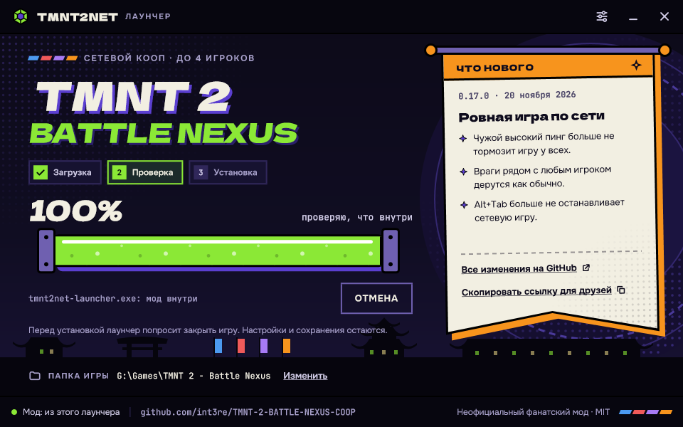
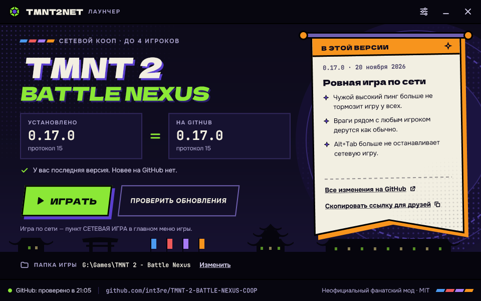
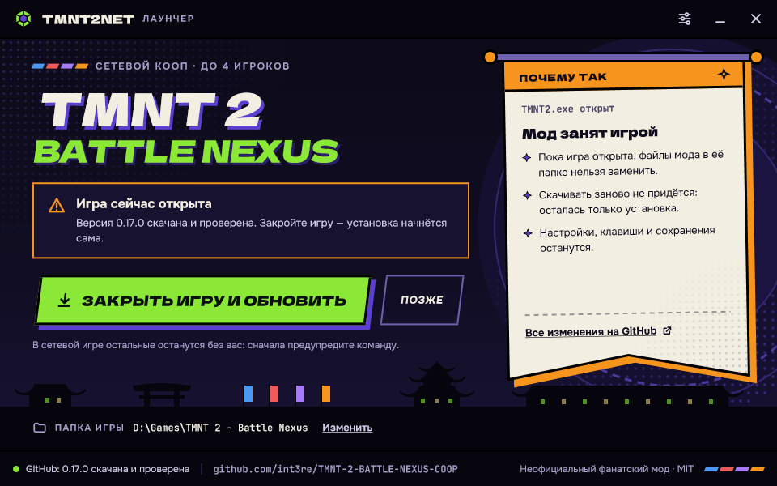
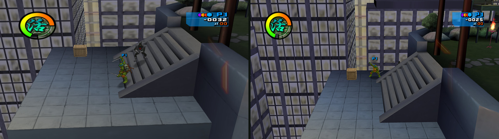
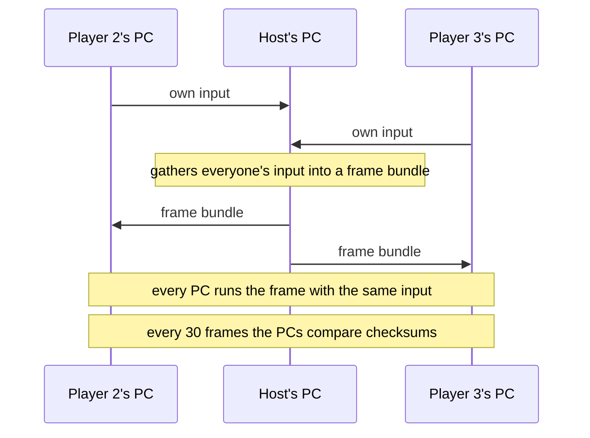

<h1 align="center">TMNT 2 Online Co-op</h1>

<p align="center">
  <b>tmnt2net — online co-op for up to four players in TMNT 2: Battle Nexus (PC, 2004)</b><br>
  One file · runs on Windows 10/11 · widescreen · modern gamepads · play over Steam or by code
</p>

<p align="center">
  
  
  
  
  
  
  
</p>

<p align="center">
  <a href="https://github.com/int3re/TMNT-2-BATTLE-NEXUS-COOP/releases/latest/download/tmnt2net-launcher.exe"></a><br>
  <sub>One file, 5.9 MB: the mod is inside the launcher. It installs the mod, updates it and starts the game.</sub>
</p>

<p align="center">
  <a href="README.md">Русский</a> · <b>English</b>
</p>

<p align="center">
  
</p>

**tmnt2net** is a mod for the original PC release of *Teenage Mutant Ninja Turtles 2: Battle Nexus*. The game
shipped with four-player co-op, but only on one computer. The mod gives you the same thing over the network:
every player runs their own copy of the game, with their own screen and their own camera, and everything is
set up from the game's own menus, in the game's own font and style.

Along the way it fixes what stops this 2004 game from starting on modern Windows at all, and brings its
picture and controls up to date.

> The mod contains no game files and never changes `TMNT2.exe` on disk: every change is made in memory when the
> game starts. You need your own copy of the game.

The same kind of mod for other games: [TMNT (2003)](https://github.com/int3re/TMNT-2003-COOP) ·
[The Incredibles: Rise of the Underminer](https://github.com/int3re/INCREDIBLES-RISE-OF-THE-UNDERMINER-COOP) — see [Other mods](#other-mods).

> **Language.** The mod was developed and tested with a Russian release of the game, so the screenshots are
> in Russian, and so is the launcher. The full documentation is in English in [`docs/en/`](docs/en/README.md)
> and in Russian in [`docs/`](docs/README.md). The mod's own menu texts have English counterparts for copies of
> the game whose font has no Russian letters; that path is far less tested.

## Contents

- [The launcher: one file](#the-launcher-one-file)
- [What the mod adds and changes](#what-the-mod-adds-and-changes)
- [The mod's menus](#the-mods-menus)
- [Features](#features)
- [Quick start](#quick-start)
- [Controls](#controls)
- [Requirements](#requirements)
- [Documentation](#documentation)
- [Versions and compatibility](#versions-and-compatibility)
- [Project status](#project-status)
- [Building from source](#building-from-source)
- [How it works](#how-it-works)
- [Contributing](#contributing)
- [Credits](#credits)
- [Thank the author](#thank-the-author)
- [License](#license)
- [Legal](#legal)
- [Other mods](#other-mods)

## The launcher: one file

<p align="center">
  
</p>

**[`tmnt2net-launcher.exe`](https://github.com/int3re/TMNT-2-BATTLE-NEXUS-COOP/releases/latest/download/tmnt2net-launcher.exe)** is the only thing to download: the mod is inside it and there is no separate
installer. The launcher finds the game, installs the mod, watches for updates and starts the game. Its
interface is in Russian.

<table>
  <tr>
    <td align="center" width="33%"><br><b>1. Install</b><br><sub>The mod is already inside: one button, nothing to download</sub></td>
    <td align="center" width="33%"><br><b>2. A couple of seconds</b><br><sub>The files go next to the game; the game itself is not changed</sub></td>
    <td align="center" width="33%"><br><b>3. Play</b><br><sub>The launcher tells you when a new version is out</sub></td>
  </tr>
</table>

| What it does | How |
|---|---|
| **Finds the game** | in its own folder, by the game installer's entry in Windows, or in the folders next to it; otherwise it asks where `TMNT2.exe` is |
| **Installs the mod offline** | the mod is inside the launcher; the game's files are not changed |
| **Updates with one button** | the new version is downloaded from GitHub, checked against its SHA-256 and installed; settings and saves stay |
| **Tells you whether you can still play with friends** | it shows the network protocol of both versions: "does not join 0.16.7 — update the whole team" |
| **Updates itself** | at its start it downloads a newer launcher, checks its SHA-256, puts it in its own place and restarts; the new version of the mod is already inside |
| **Sets the game up** | the Graphics, Sound and Controls tabs: the picture, the volume and the keys, before the game starts |
| **Waits while the game is open** | or asks it to close, the way its window's close button does |
| **Works where GitHub is hard to reach** | it tries the Windows settings, a VPN client on the same PC, or your proxy |
| **Removes the mod** | one button in its settings: exactly what was installed is removed |

<table>
  <tr>
    <td align="center" width="33%"><br><sub>An update: download, SHA-256 check, install</sub></td>
    <td align="center" width="33%"><br><sub>The game is open — the launcher waits</sub></td>
    <td align="center" width="33%"><br><sub>Settings: proxy, logs, removing the mod, accent colour</sub></td>
  </tr>
  <tr>
    <td align="center" width="33%"><br><sub>Graphics: the same rows as the game's OPTIONS → SCREEN page</sub></td>
    <td align="center" width="33%"><br><sub>Sound: volume, intro movies, running in the background</sub></td>
    <td align="center" width="33%"><br><sub>Controls: keys and mouse buttons, layouts</sub></td>
  </tr>
</table>

Details: **[the launcher page](docs/en/LAUNCHER.md)**. Without a window, from a command line:
`tmnt2net-launcher.exe /install "game folder" /quiet`.

## What the mod adds and changes

<p align="center">
  <br>
  <sub>The same area on a 16:9 monitor. Left: the original, a 4:3 frame stretched sideways. Right: with the mod.</sub>
</p>

| | Original | With the mod |
|---|---|---|
| **Starting on Windows 10/11** | "Unkown Error", the game does not start | starts |
| **Co-op** | up to 4 players on one PC | the same over the network: Steam, LAN, IP |
| **Camera** | one for everybody | one of your own in a network game |
| **Distance between players** | nobody leaves the shared screen | go as far apart as you like in a network game |
| **Health** | one bar for the team | one for each player; teammates can be woken |
| **Costumes and heroes** | unlocked as you play | all unlocked, picked with the arrows |
| **Widescreen** | a stretched 4:3 frame | a wider view in the right proportions |
| **Resolution and window** | three resolutions, fullscreen only | any monitor mode, window, borderless window |
| **Picture quality** | no antialiasing or filtering | antialiasing up to 8x, 16x filtering, sharpening, colour |
| **Game speed** | 53–57 frames per second | exactly 60 |
| **Gamepads** | Xbox pads have their buttons mixed up | Xbox, PlayStation, Switch Pro |
| **Mouse** | not used | attacks on the mouse buttons, the wheel zooms the camera |
| **Title menu** | new game, continue, options, quit | plus NETWORK GAME and MOD SETTINGS |
| **Installing and updating** | — | one file: [the launcher](#the-launcher-one-file) installs the mod, updates it and starts the game |

A page with a screenshot for every menu and every change:
**[docs/en/TOUR.md](docs/en/TOUR.md)**.

## The mod's menus

Everything is set up inside the game, in its own font and style.

<table>
  <tr>
    <td align="center"><br><sub>Title menu: two new items and the mod's version</sub></td>
    <td align="center"><br><sub>NETWORK GAME: host a game or join a friend</sub></td>
    <td align="center"><br><sub>Host page: places, readiness, ping, code</sub></td>
  </tr>
  <tr>
    <td align="center"><br><sub>Options → Screen: window, resolution, picture</sub></td>
    <td align="center"><br><sub>MOD SETTINGS: keys, gamepads, intro movies</sub></td>
    <td align="center"><br><sub>Character select: costumes and player names</sub></td>
  </tr>
  <tr>
    <td align="center"><br><sub>Joining by code or IP</sub></td>
    <td align="center"><br><sub>Shared pause in a network game</sub></td>
    <td align="center"><br><sub>Joining a game in progress</sub></td>
  </tr>
</table>

## Features

### Network play


- **Up to 4 players on different PCs.** Only button presses travel over the network, never the picture: there
  is no video latency, and the game runs frame for frame on every PC.
- **Steam or a code.** Steam friends see an open game and join it, and invitations are sent from inside the
  game. Without Steam, join by a `TMNT-XXXX-XXX` code or an IP address, on a LAN or over the internet.
- **No restart.** The host presses START and the shared game begins for everyone right in the title menu.
- **Join a game in progress.** A latecomer connects in the middle of a stage and takes one of the team's
  turtles. While their game catches up they see a plain loading screen with a percentage; nobody else is
  interrupted.
- **A dropped link is not the end.** The player comes back to their place on their own; if their game was
  closed, they join again and control their hero as before.
- **Shared progress.** Everyone plays with the host's progress. It is kept apart from single-player saves,
  which the mod never touches.
- **Smooth play on uneven links.** Every player's input delay follows their own link, so one player with a
  high ping does not slow the game down for everybody.
- **Shared pause**, leaving the session from the game's menu, a link indicator for every player, and a notice
  telling you whom the game is waiting for.

<br clear="right">

### Co-op


- **A camera of your own.** It follows your hero and the screen is never split. Teammates beyond the edge of
  the screen are shown by their name and an arrow.
- **Go your own way.** The original never lets players further apart than the shared screen; in a network
  game there is no such limit.
- **Player names** over the heroes, at character select and in the results.
- **Health of your own.** In the original the whole team shares one health bar. A player who goes down falls
  asleep and gets up after 10 seconds; a teammate can wake them sooner.
- **Every costume and hero unlocked** and picked at character select with the up and down arrows: ordinary,
  samurai, nexus, and also Casey, Splinter, Karai and Slashuur.
- **Area results** per player: hits dealt, blows blocked, hits taken, times down, teammates woken.
- On one PC: up to 4 players on gamepads, and two players on one keyboard.

<br clear="right">

### Screen and picture


- **The game starts on Windows 10/11.** The "Unkown Error" at start-up and the crash on Alt+Tab during
  loading are fixed.
- **Widescreen without stretching** (16:9, 16:10, 21:9, 32:9): a wider view, menus and text in the right
  proportions, gauges in the corners of the frame, the world map out to the edges of the screen.
- Borderless window over the whole monitor or an ordinary window; **any resolution of your monitor**,
  applied at once.
- A steady **60 frames per second**, the game's native speed.
- Antialiasing up to 8x, 16x texture filtering, sharpening and colour, field of view, camera zoom with the
  mouse wheel.
- **Every setting is in the game's own OPTIONS**, with a hint for each row.

<br clear="right">

### Controls

- **Xbox, PlayStation (DualShock 4, DualSense), Switch Pro** and other gamepads, with the buttons where you
  expect them and hot-plugging.
- **Mouse.** Attack on the left and right buttons, a ready WASD + mouse layout, any keys of your own.
- Pause from the keyboard and from a gamepad; Esc goes back in every menu.

<p align="center">
  <br>
  <sub>The same moment on two PCs. Left: the shared camera of the original. Right: a player's own camera.</sub>
</p>

## Quick start

1. Download **[`tmnt2net-launcher.exe`](https://github.com/int3re/TMNT-2-BATTLE-NEXUS-COOP/releases/latest/download/tmnt2net-launcher.exe)** and run it. It is the only file: the mod is inside it. Every
   version is on the [Releases](https://github.com/int3re/TMNT-2-BATTLE-NEXUS-COOP/releases/latest) page.
2. The launcher finds the game. Press the green button: first **УСТАНОВИТЬ МОД** (install the mod), then
   **ИГРАТЬ** (play).
3. The mod's version appears under the game's title menu, along with two new items: **NETWORK GAME**
   (СЕТЕВАЯ ИГРА) and **MOD SETTINGS** (НАСТРОЙКИ МОДА).

> The launcher is not signed with a certificate, so Windows may show "Windows protected your PC". Click
> "More info" → "Run anyway".

Playing together:

| | Host | Everyone else |
|---|---|---|
| 1 | NETWORK GAME → **HOST A GAME** | NETWORK GAME → **JOIN A FRIEND** → the host's game |
| 2 | waits until everyone is in the list | wait in the title menu |
| 3 | **START THE GAME** | the game begins by itself |
| 4 | New game or Continue | everyone presses Start at character select |

Steam must be running and the players must be Steam friends. Without Steam, the host copies a code from the
host page and the others enter it under **JOIN BY CODE**.

## Controls

The default keys are the game's own. The second column is the "WASD + mouse" layout from MOD SETTINGS.

| Action | Game default | WASD + mouse | Gamepad (Xbox / PlayStation) |
|---|---|---|---|
| Move | arrows | W A S D | left stick, d-pad |
| Attack, "select" in menus | F | left mouse button | A / ✕ |
| Strong attack | D | right mouse button | X / □ |
| Jump, "cancel" in menus | Space | Space | B / ○ |
| Shuriken | R | E | Y / △ |
| Dash | E | Shift | LB / L1 |
| Guard, wake a teammate | S | Q | RB / R1 |
| Change hero | Shift | F | LT / L2 |
| Pause | Esc, Enter | Esc, Enter | START, BACK |
| Camera zoom | mouse wheel | mouse wheel | — |

Keys and gamepad buttons can be reassigned in the game's options.

## Requirements

- **Windows 10 or 11.**
- **The original game** with the `TMNT2.exe` of the North American 2004 release (the same file is used by
  Russian releases). SHA-256:
  `22f49908bcd3b84278bea888b7285e1e0ba73a72a89764f495aceb76a42d8b6a`. With any other exe the mod changes
  nothing, and the installer warns you beforehand.
- For Steam play: a running Steam client and any account. Nothing has to be bought.
- For play by IP over the internet: UDP port `7790` open on the host's side.

## Documentation

Every page exists in two languages: English in [`docs/en/`](docs/en/README.md), Russian in
[`docs/`](docs/README.md).

| Page | What it covers |
|---|---|
| [What is added and changed](docs/en/TOUR.md) | a tour in pictures: every menu and every change |
| [Launcher](docs/en/LAUNCHER.md) | one-button install and updates, its settings, a proxy for GitHub |
| [Installation](docs/en/INSTALL.md) | installing, updating, removing, what goes where |
| [Network play](docs/en/NETPLAY.md) | getting together, joining a running game, dropped links, saves |
| [Controls](docs/en/CONTROLS.md) | keyboard, mouse, gamepads, two players on one keyboard |
| [Settings](docs/en/SETTINGS.md) | the in-game settings pages and the `tmnt2net.ini` reference |
| [Troubleshooting](docs/en/TROUBLESHOOTING.md) | common questions and what to attach to a bug report |
| [Changelog](docs/en/CHANGELOG.md) | what changed from version to version, network compatibility |
| [Building](docs/en/BUILDING.md) | building the mod and the launcher from source |
| [Architecture](docs/en/ARCHITECTURE.md) | how network play works, modules, protocol |
| [Reverse-engineering notes](re/notes.md) | addresses, structures and evidence for `TMNT2.exe` |
| [Contributing](CONTRIBUTING.en.md) | how to report a bug, the rules of working with the code |

## Versions and compatibility

The current version is **0.17.3**; it is shown under the game's title menu.

In a network game everyone needs a compatible version of the mod: the game must run identically on every PC,
so any change to how it plays also changes the protocol version. The host refuses a player with an
incompatible version and says why.

| Mod versions | Play together |
|---|---|
| 0.17.1 – 0.17.3 | yes |
| 0.17.0 | with 0.17.0 only |
| 0.16.6 – 0.16.7 | yes |
| 0.16.4 – 0.16.5 | yes |
| 0.16.3 | with 0.16.3 only |
| 0.16.0 – 0.16.2 | yes |
| 0.15.0 and older | see the [changelog](docs/en/CHANGELOG.md) |

## Project status

The mod is in active development: version **0.17.3**, launcher **1.3.1**. What changed in every version, and
why, is in the [changelog](docs/en/CHANGELOG.md).

- **Network play** has been played in real games over Steam; the desyncs found in them from the players' logs
  were fixed in the 0.16.x versions. The 0.17.x versions were checked on two to four copies of the game on one
  PC: the copies' frame logs match. There are no reports from real games on 0.17.x yet.
- **The launcher** is checked by scripts without showing its window; its self-update was verified against the
  real GitHub.

Known limits:

- The mod works with one `TMNT2.exe`: the North American 2004 release (Russian releases use the same file). With
  any other file the mod changes nothing in the game, and the launcher warns you beforehand.
- There is no exclusive full screen "as in the original": a borderless window over the whole monitor takes its
  place. In real full screen the game froze on Alt+Tab, and a network game waited on every PC.
- In a network game one person plays on one PC: that PC's keyboard and gamepad are one player of the session.
- The launcher is in Russian. The mod's texts inside the game exist in Russian and in English; the English ones
  are far less tested.
- Anything that depends on the active window — taking the keyboard, the real mouse — is not covered by the test
  bench: it is known from ordinary play only.

## Building from source

You need Windows, Visual Studio with the C++ tools, and CMake. The build is 32-bit only, because `TMNT2.exe`
is a 32-bit process.

```bash
cmake -B build -A Win32
```

```bash
cmake --build build --config Release
```

The files and the launcher end up in `build/dist/Release`. SDL2, ENet and Ultimate ASI Loader are not part
of the repository; where CMake expects them, and how to build with or without Steam, is described in
[docs/en/BUILDING.md](docs/en/BUILDING.md).

## How it works



The mod is `tmnt2net.asi`, loaded into the game's process by
[Ultimate ASI Loader](https://github.com/ThirteenAG/Ultimate-ASI-Loader). At start-up it checks the SHA-256
of `TMNT2.exe` and only then installs its hooks; every hook also verifies the bytes at its address first.

Network play is deterministic lockstep. Every PC runs the whole game and only input travels: the host gathers
all players' input into a frame bundle, and no PC runs a frame before it has that frame's bundle. The same
input gives the same game, so enemies, physics and items never need to be sent. Every 30 frames the PCs
compare checksums; a game that has gone its own way rejoins the session by itself.

A player who joins a running game receives every frame bundle since the first frame and replays the session
locally, with drawing and sound switched off, at roughly 37 times the game's speed.

The launcher is a separate program with no dependencies: Direct2D and DirectWrite for the picture, WinHTTP
for the network. The mod's files are in its resources. A new version arrives as a new launcher, which is
downloaded, checked against the SHA-256 of the release and opened as data, never run.

More in [docs/en/ARCHITECTURE.md](docs/en/ARCHITECTURE.md).

## Contributing

Bug reports and suggestions go to [Issues](https://github.com/int3re/TMNT-2-BATTLE-NEXUS-COOP/issues). Attach
`tmnt2net.log`, and for a network problem `tmnt2net.log` and `tmnt2net-sim.log` **from every PC** that took
part, plus the `tmnt2net-desync-*.log` files if the games went apart: without the other side's logs a network
bug usually cannot be found. The launcher opens them from its settings: «Открыть журнал» (Open the log) and
«Журналы рассинхрона» (Desync logs). What else to say is in
[How to report a bug](docs/en/TROUBLESHOOTING.md#how-to-report-a-bug).

How the code is laid out, which rules in it are not up for discussion and how to check a change:
[CONTRIBUTING.en.md](CONTRIBUTING.en.md).

## Credits

| Who and what | What for | License |
|---|---|---|
| [xntrz/tmnt2](https://github.com/xntrz/tmnt2) | an open reimplementation of the game's code: class and function names were matched against it. No code of it is in the mod | — |
| [Ultimate ASI Loader](https://github.com/ThirteenAG/Ultimate-ASI-Loader) (ThirteenAG) | loads the mod into the game | MIT |
| [MinHook](https://github.com/TsudaKageyu/minhook) (Tsuda Kageyu) | hooks on the game's functions | BSD 2-Clause |
| [SDL2](https://www.libsdl.org/) | Xbox, PlayStation and Switch Pro gamepads | zlib |
| [ENet](http://enet.bespin.org/) (Lee Salzman) | networking over UDP: LAN, IP, code | MIT |
| [Steamworks SDK](https://partner.steamgames.com/) (Valve) | networking over Steam, lobbies and invites. The SDK is not part of this repository | Valve's license |
| [Dela Gothic One](https://github.com/syakuzen/DelaGothic), [Onest](https://github.com/googlefonts/onest), [JetBrains Mono](https://github.com/JetBrains/JetBrainsMono) | the launcher's fonts | SIL OFL 1.1 |

And special thanks to:

- everyone who played the early versions and sent their logs: the desyncs were found and fixed from them;
- the makers of the game: Konami made *TMNT 2: Battle Nexus* in 2004, and the mod exists only because people
  still want to play it together.

## Thank the author

The mod is free. If it was of use to you and you would like to say thanks, you can send USDT to any of these
addresses:

| Network | Address |
|---|---|
| TRON (TRC20) | `TVdy7i7qoF1ZdrnNSZaC5Mgz1ZddaMhw4y` |
| The Open Network (TON) | `UQB-oxQVLLN3hm-YRGfr5-XJ95P0zIAeLFstgG40HiaR8oMz` |
| BNB Smart Chain (BEP20) | `0xA11f8221952FA5f540bC528072213b14F124379B` |

USDT only, and only on the network named next to the address; the smallest amount is 0.1 USDT. On BNB Smart
Chain USDT is the token with the contract
[`0x55d398326f99059fF775485246999027B3197955`](https://bscscan.com/token/0x55d398326f99059fF775485246999027B3197955).

## License

The mod's code is released under the [MIT license](LICENSE). Third-party libraries keep their own licenses (see
the table above); the launcher's fonts are in [`src/launcher/assets/fonts`](src/launcher/assets/fonts) together
with the texts of their licenses. The game, its files and its artwork are not covered by the mod's license.

## Legal

This is an unofficial fan project. It is not affiliated with or endorsed by Konami, Mirage Studios, Viacom or
any other rights holder. *Teenage Mutant Ninja Turtles* and related names and characters are trademarks of
their owners. The repository and the releases contain no files of the game: the mod needs your own copy. The
screenshots show the mod at work and are included for illustration; the player names in them are made up. The
launcher's look is its own: it uses neither the game's logo nor its characters.

For Steam networking the mod uses the AppID of Valve's test application Spacewar (480), so Steam shows the
status "Spacewar" during a network game.

## Other mods

The same network co-op — a copy of the game and a screen of their own for every player, a one-file launcher —
exists for two more games:

| Game | Mod | Players |
|---|---|---|
| *Teenage Mutant Ninja Turtles* (2003) | [TMNT-2003-COOP](https://github.com/int3re/TMNT-2003-COOP) · tmntnet | up to 4 |
| *TMNT 2: Battle Nexus* (2004) | this repository · tmnt2net | up to 4 |
| *The Incredibles: Rise of the Underminer* (2005) | [INCREDIBLES-RISE-OF-THE-UNDERMINER-COOP](https://github.com/int3re/INCREDIBLES-RISE-OF-THE-UNDERMINER-COOP) · in2net | 2 |
