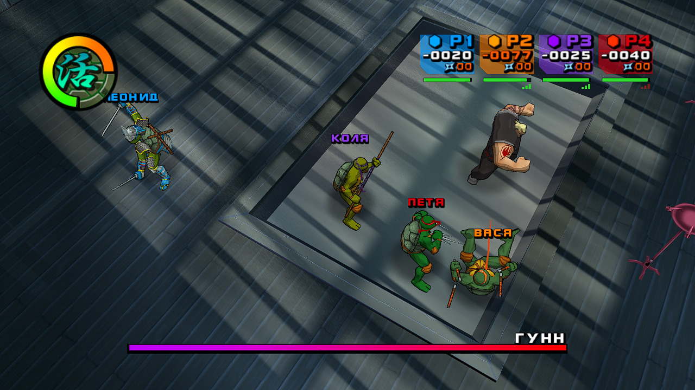
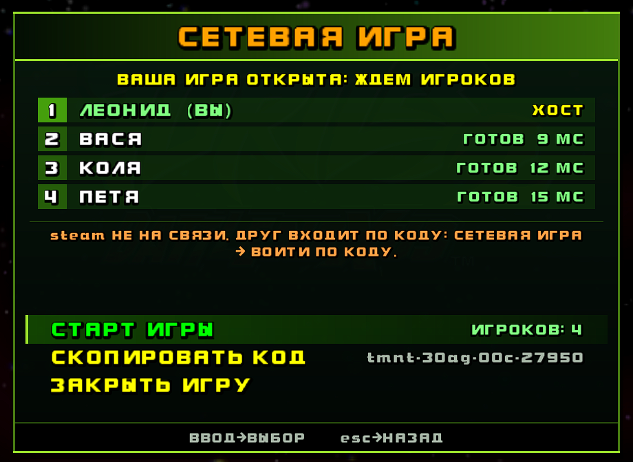
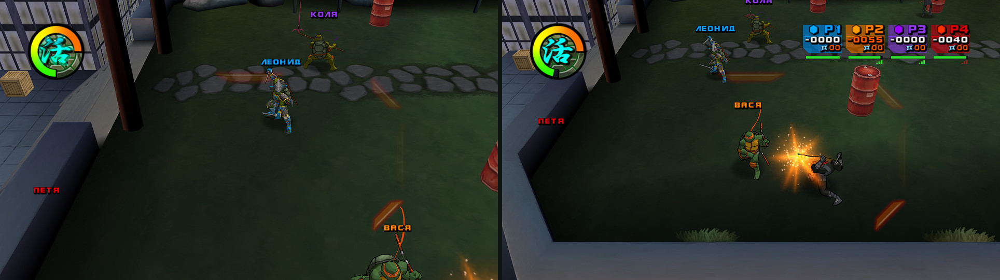

<h1 align="center">TMNT 2 Online Co-op</h1>

<p align="center">
  <b>tmnt2net — online co-op for up to four players in TMNT 2: Battle Nexus (PC, 2004)</b><br>
  Runs on Windows 10/11 · widescreen · modern gamepads · play over Steam or by code
</p>

<p align="center">
  
  
  
  
  
</p>

<p align="center">
  <a href="README.md">Русский</a> · <b>English</b>
</p>

<p align="center">
  
</p>

**tmnt2net** is a mod for the original PC release of *Teenage Mutant Ninja Turtles 2: Battle Nexus*. The game
shipped with four-player co-op, but only on one computer. The mod gives you the same thing over the network:
every player runs their own copy of the game, with their own screen and their own camera, and everything is
set up from the game's own menus, in the game's own font and style.

Along the way it fixes what stops this 2004 game from starting on modern Windows at all, and brings its
picture and controls up to date.

> The mod contains no game files and never changes `TMNT2.exe` on disk: every change is made in memory when the
> game starts. You need your own copy of the game.

The same kind of mod for the first game of the series, *TMNT* (2003):
[int3re/TMNT-2003-COOP](https://github.com/int3re/TMNT-2003-COOP).

> **Language.** The mod was developed and tested with a Russian release of the game, so the screenshots and
> the detailed documentation in [`docs/`](docs/) are in Russian. The mod's own menu texts have English
> counterparts for copies of the game whose font has no Russian letters; that path is far less tested.

## What the mod adds and changes

<p align="center">
  <br>
  <sub>The same area on a 16:9 monitor. Left: the original, a 4:3 frame stretched sideways. Right: with the mod.</sub>
</p>

| | Original | With the mod |
|---|---|---|
| **Starting on Windows 10/11** | "Unkown Error", the game does not start | starts |
| **Co-op** | up to 4 players on one PC | the same over the network: Steam, LAN, IP |
| **Camera** | one for everybody | one of your own in a network game |
| **Health** | one bar for the team | one for each player; teammates can be woken |
| **Costumes and heroes** | unlocked as you play | all unlocked, picked with the arrows |
| **Widescreen** | a stretched 4:3 frame | a wider view in the right proportions |
| **Resolution and window** | three resolutions, fullscreen only | any monitor mode, window, borderless window |
| **Picture quality** | no antialiasing or filtering | antialiasing up to 8x, 16x filtering, sharpening, colour |
| **Game speed** | 53–57 frames per second | exactly 60 |
| **Gamepads** | Xbox pads have their buttons mixed up | Xbox, PlayStation, Switch Pro |
| **Mouse** | not used | attacks on the mouse buttons, the wheel zooms the camera |
| **Title menu** | new game, continue, options, quit | plus network play and mod settings |

A page with a screenshot for every menu and every change (in Russian):
**[docs/TOUR.md](docs/TOUR.md)**.

## The mod's menus

Everything is set up inside the game, in its own font and style.

<table>
  <tr>
    <td align="center"><br><sub>Title menu: two new items and the mod's version</sub></td>
    <td align="center"><br><sub>Network play: open your game or join a friend</sub></td>
    <td align="center"><br><sub>Host page: places, readiness, ping, code</sub></td>
  </tr>
  <tr>
    <td align="center"><br><sub>Options → Screen: window, resolution, picture</sub></td>
    <td align="center"><br><sub>Mod settings: keys, gamepads, intro movies</sub></td>
    <td align="center"><br><sub>Character select: costumes and player names</sub></td>
  </tr>
  <tr>
    <td align="center"><br><sub>Joining by code or IP</sub></td>
    <td align="center"><br><sub>Shared pause in a network game</sub></td>
    <td align="center"><br><sub>Joining a game in progress</sub></td>
  </tr>
</table>

## Features

### Network play


- **Up to 4 players on different PCs.** Only button presses travel over the network, never the picture: there
  is no video latency, and the game runs frame for frame on every PC.
- **Steam or a code.** Steam friends see an open game and join it, and invitations are sent from inside the
  game. Without Steam, join by a `TMNT-XXXX-XXX` code or an IP address, on a LAN or over the internet.
- **No restart.** The host presses START and the shared game begins for everyone right in the title menu.
- **Join a game in progress.** A latecomer connects in the middle of a stage and takes one of the team's
  turtles. While their game catches up they see a plain loading screen with a percentage; nobody else is
  interrupted.
- **A dropped link is not the end.** The player comes back to their place on their own; if their game was
  closed, they join again and control their hero as before.
- **Shared progress.** Everyone plays with the host's progress. It is kept apart from single-player saves,
  which the mod never touches.
- **Shared pause**, leaving the session from the game's menu, a link indicator for every player, and a notice
  telling you whom the game is waiting for.

<br clear="right">

### Co-op


- **A camera of your own.** It follows your hero and the screen is never split. Teammates beyond the edge of
  the screen are shown by their name and an arrow.
- **Player names** over the heroes, at character select and in the results.
- **Health of your own.** In the original the whole team shares one health bar. A player who goes down falls
  asleep and gets up after 10 seconds; a teammate can wake them sooner.
- **Every costume and hero unlocked** and picked at character select with the up and down arrows: ordinary,
  samurai, nexus, and also Casey, Splinter, Karai and Slashuur.
- **Area results** per player: hits dealt, blows blocked, hits taken, times down, teammates woken.
- On one PC: up to 4 players on gamepads, and two players on one keyboard.

<br clear="right">

### Screen and picture


- **The game starts on Windows 10/11.** The "Unkown Error" at start-up and the crash on Alt+Tab during
  loading are fixed.
- **Widescreen without stretching** (16:9, 16:10, 21:9, 32:9): a wider view, menus and text in the right
  proportions, gauges in the corners of the frame.
- Borderless window, ordinary window or fullscreen; **any resolution of your monitor**, applied at once.
- A steady **60 frames per second**, the game's native speed.
- Antialiasing up to 8x, 16x texture filtering, sharpening and colour, field of view, camera zoom with the
  mouse wheel.
- **Every setting is in the game's own OPTIONS**, with a hint for each row.

<br clear="right">

### Controls

- **Xbox, PlayStation (DualShock 4, DualSense), Switch Pro** and other gamepads, with the buttons where you
  expect them and hot-plugging.
- **Mouse.** Attack on the left and right buttons, a ready WASD + mouse layout, any keys of your own.
- Pause from the keyboard and from a gamepad; Esc goes back in every menu.

<p align="center">
  <br>
  <sub>The same moment on two PCs. Left: the shared camera of the original. Right: a player's own camera.</sub>
</p>

## Quick start

1. Download `tmnt2net-setup.exe` from [Releases](../../releases/latest).
2. Run it and choose to install or update the mod. The installer finds the game and checks it.
3. Start the game. The mod's version appears under the title menu, along with two new items: network play
   (**СЕТЕВАЯ ИГРА**) and mod settings (**НАСТРОЙКИ МОДА**).

> The installer is not signed with a certificate, so Windows may show "Windows protected your PC". Click
> "More info" → "Run anyway".

Playing together:

| | Host | Everyone else |
|---|---|---|
| 1 | Network play → **open your game** | Network play → **join a friend** → the host's game |
| 2 | waits until everyone is in the list | wait in the title menu |
| 3 | **START** | the game begins by itself |
| 4 | New game or Continue | everyone presses Start at character select |

Steam must be running and the players must be Steam friends. Without Steam, the host copies a code from the
host page and the others enter it under "join by code".

## Controls

The default keys are the game's own. The second column is the "WASD + mouse" layout from the mod settings.

| Action | Game default | WASD + mouse | Gamepad (Xbox / PlayStation) |
|---|---|---|---|
| Move | arrows | W A S D | left stick, d-pad |
| Attack, "select" in menus | F | left mouse button | A / ✕ |
| Strong attack | D | right mouse button | X / □ |
| Jump, "cancel" in menus | Space | Space | B / ○ |
| Shuriken | R | E | Y / △ |
| Dash | E | Shift | LB / L1 |
| Guard, wake a teammate | S | Q | RB / R1 |
| Change hero | Shift | F | LT / L2 |
| Pause | Esc, Enter | Esc, Enter | START, BACK |
| Camera zoom | mouse wheel | mouse wheel | — |

Keys and gamepad buttons can be reassigned in the game's options.

## Requirements

- **Windows 10 or 11.**
- **The original game** with the `TMNT2.exe` of the North American 2004 release (the same file is used by
  Russian releases). SHA-256:
  `22f49908bcd3b84278bea888b7285e1e0ba73a72a89764f495aceb76a42d8b6a`. With any other exe the mod changes
  nothing, and the installer warns you beforehand.
- For Steam play: a running Steam client and any account. Nothing has to be bought.
- For play by IP over the internet: UDP port `7790` open on the host's side.

## Documentation

The detailed pages are in Russian.

| Page | What it covers |
|---|---|
| [What is added and changed](docs/TOUR.md) | a tour in pictures: every menu and every change |
| [Installation](docs/INSTALL.md) | installing, updating, removing, what goes where |
| [Network play](docs/NETPLAY.md) | getting together, joining a running game, dropped links, saves |
| [Controls](docs/CONTROLS.md) | keyboard, mouse, gamepads, two players on one keyboard |
| [Settings](docs/SETTINGS.md) | the in-game settings pages and the `tmnt2net.ini` reference |
| [Troubleshooting](docs/TROUBLESHOOTING.md) | common questions and what to attach to a bug report |
| [Changelog](docs/CHANGELOG.md) | what changed from version to version, network compatibility |
| [Building](docs/BUILDING.md) | building the mod and the installer from source |
| [Architecture](docs/ARCHITECTURE.md) | how network play works, modules, protocol |
| [Reverse-engineering notes](re/notes.md) | addresses, structures and evidence for `TMNT2.exe` (in English) |

## Versions and compatibility

The current version is **0.16.5**; it is shown under the game's title menu.

In a network game everyone needs a compatible version of the mod: the game must run identically on every PC,
so any change to how it plays also changes the protocol version. The host refuses a player with an
incompatible version and says why.

| Mod versions | Play together |
|---|---|
| 0.16.4 – 0.16.5 | yes |
| 0.16.3 | with 0.16.3 only |
| 0.16.0 – 0.16.2 | yes |
| 0.15.0 and older | see the [changelog](docs/CHANGELOG.md) |

## Building from source

You need Windows, Visual Studio with the C++ tools, and CMake. The build is 32-bit only, because `TMNT2.exe`
is a 32-bit process.

```bash
cmake -B build -A Win32
```

```bash
cmake --build build --config Release
```

The files and the installer end up in `build/dist/Release`. SDL2, ENet and Ultimate ASI Loader are not part
of the repository; where CMake expects them, and how to build with or without Steam, is described in
[docs/BUILDING.md](docs/BUILDING.md).

## How it works

The mod is `tmnt2net.asi`, loaded into the game's process by
[Ultimate ASI Loader](https://github.com/ThirteenAG/Ultimate-ASI-Loader). At start-up it checks the SHA-256
of `TMNT2.exe` and only then installs its hooks; every hook also verifies the bytes at its address first.

Network play is deterministic lockstep. Every PC runs the whole game and only input travels: the host gathers
all players' input into a frame bundle, and no PC runs a frame before it has that frame's bundle. The same
input gives the same game, so enemies, physics and items never need to be sent. Every 30 frames the PCs
compare checksums; a game that has gone its own way rejoins the session by itself.

A player who joins a running game receives every frame bundle since the first frame and replays the session
locally, with drawing and sound switched off, at roughly 37 times the game's speed.

More in [docs/ARCHITECTURE.md](docs/ARCHITECTURE.md).

## Credits and legal

- [xntrz/tmnt2](https://github.com/xntrz/tmnt2) — an open reimplementation of the game's code; class and
  function names were matched against it.
- [Ultimate ASI Loader](https://github.com/ThirteenAG/Ultimate-ASI-Loader) by ThirteenAG — the mod loader.
- [MinHook](https://github.com/TsudaKageyu/minhook) — function hooks.
- [SDL2](https://www.libsdl.org/) — gamepads.
- [ENet](http://enet.bespin.org/) — networking over UDP.
- Steamworks SDK — networking over Steam. The SDK is not part of this repository.

### License

The mod's code is released under the [MIT license](LICENSE). Third-party libraries keep their own licenses:
MinHook — BSD 2-Clause, SDL2 — zlib, ENet — MIT, Ultimate ASI Loader — MIT. The game, its files and its
artwork are not covered by the mod's license.

This is an unofficial fan project. It is not affiliated with or endorsed by Konami, Mirage Studios, Viacom or
any other rights holder. *Teenage Mutant Ninja Turtles* and related names and characters are trademarks of
their owners. The screenshots show the mod at work and are included for illustration; the player names in
them are made up.

For Steam networking the mod uses the AppID of Valve's test application Spacewar (480), so Steam shows the
status "Spacewar" during a network game.
