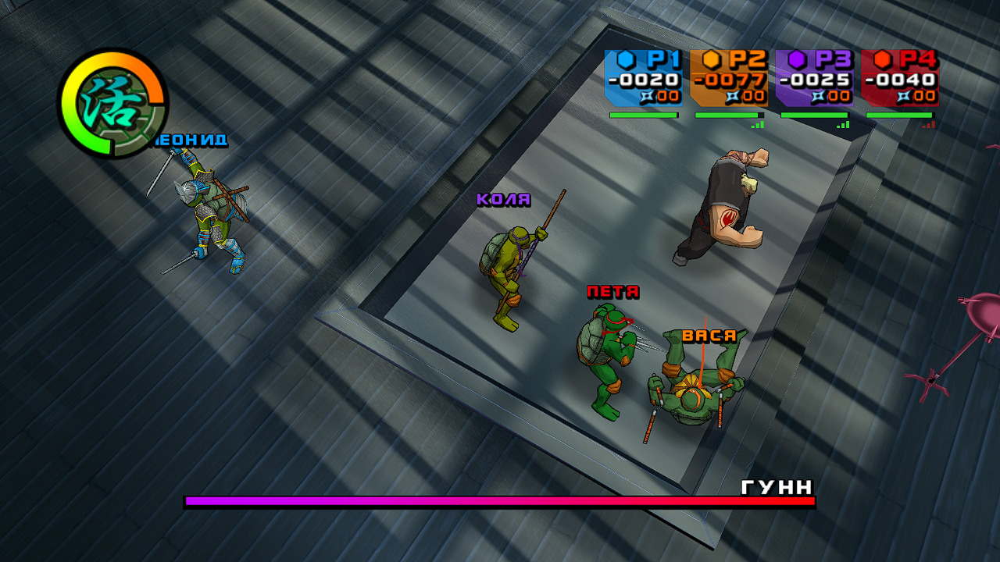
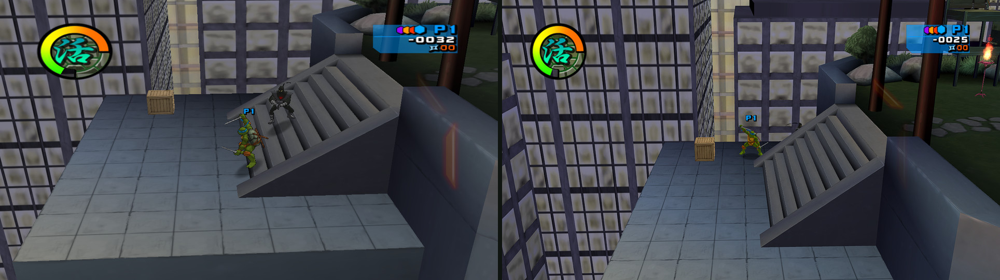
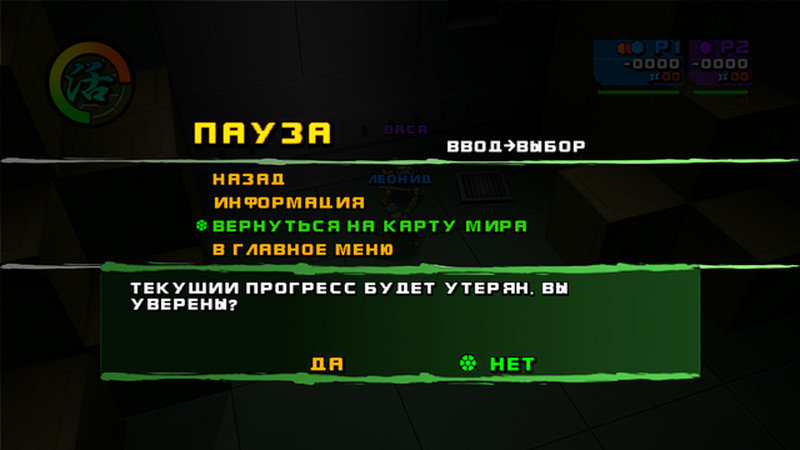
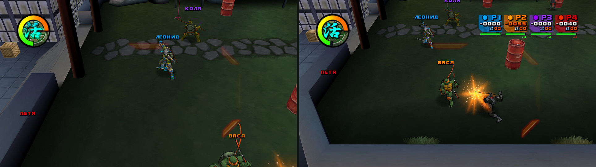

<h1 align="center">TMNT 2 Online Co-op</h1>

<p align="center">
  <b>tmnt2net — сетевой кооператив до четырёх игроков для TMNT 2: Battle Nexus (PC, 2004)</b><br>
  Запуск на Windows 10/11 · широкий экран · современные геймпады · игра по Steam или по коду
</p>

<p align="center">
  
  
  
  
  
</p>

<p align="center">
  <b>Русский</b> · <a href="README.en.md">English</a>
</p>

<p align="center">
  
</p>

**tmnt2net** — мод для оригинальной ПК-версии *Teenage Mutant Ninja Turtles 2: Battle Nexus*. В игре был
кооператив на четверых, но только за одним компьютером. Мод даёт то же самое по сети: у каждого своя копия
игры, свой экран и своя камера, а всё управление — в меню самой игры, её шрифтом и в её оформлении.

Заодно мод чинит то, из-за чего игра 2004 года на современной Windows не запускается вовсе, и приводит картинку
и управление к сегодняшним меркам.

> Мод не содержит файлов игры и не меняет `TMNT2.exe` на диске: все изменения делаются в памяти при запуске.
> Нужна своя копия игры.

Такой же мод для первой игры серии, *TMNT* (2003): [int3re/TMNT-2003-COOP](https://github.com/int3re/TMNT-2003-COOP).

## Содержание

- [Что добавлено и что изменено](#что-добавлено-и-что-изменено)
- [Меню мода](#меню-мода)
- [Возможности](#возможности)
- [Быстрый старт](#быстрый-старт)
- [Управление](#управление)
- [Что нужно для игры](#что-нужно-для-игры)
- [Документация](#документация)
- [Версии и совместимость](#версии-и-совместимость)
- [Сборка из исходников](#сборка-из-исходников)
- [Как это работает](#как-это-работает)
- [Благодарности и права](#благодарности-и-права)

## Что добавлено и что изменено

<p align="center">
  <br>
  <sub>Один и тот же район на мониторе 16:9. Слева — оригинал: кадр 4:3 растянут вширь. Справа — с модом.</sub>
</p>

| | В оригинале | С модом |
|---|---|---|
| **Запуск на Windows 10/11** | «Unkown Error», игра не стартует | запускается |
| **Кооператив** | до 4 игроков за одним ПК | то же по сети: Steam, локальная сеть, IP |
| **Камера** | одна на всех | в сети у каждого своя |
| **Расстояние между игроками** | никто не отойдёт дальше общего экрана | в сети можно расходиться как угодно |
| **Здоровье** | одно на команду | у каждого своё; напарника можно поднять |
| **Костюмы и герои** | открываются по ходу игры | открыты сразу, выбираются стрелками |
| **Широкий экран** | кадр 4:3 растянут | обзор шире, пропорции верные |
| **Разрешение и окно** | три разрешения, только полный экран | любой режим монитора, окно, окно без рамки |
| **Качество картинки** | без сглаживания и фильтрации | сглаживание до 8x, фильтр 16x, резкость, цвета |
| **Скорость игры** | 53–57 кадров в секунду | ровно 60 |
| **Геймпады** | у геймпадов Xbox кнопки перепутаны | Xbox, PlayStation, Switch Pro |
| **Мышь** | не используется | атака на кнопках мыши, колесо — камера |
| **Главное меню** | НОВАЯ ИГРА, ПРОДОЛЖИТЬ, ОПЦИИ, ВЫХОД | добавлены СЕТЕВАЯ ИГРА и НАСТРОЙКИ МОДА |

Полный список с картинками по каждому пункту — на странице
**[«Что мод добавляет и что меняет»](docs/TOUR.md)**.

## Меню мода

Всё управление модом — внутри игры, её шрифтом и в её оформлении.

<table>
  <tr>
    <td align="center"><br><sub>Главное меню: два новых пункта и версия мода</sub></td>
    <td align="center"><br><sub>СЕТЕВАЯ ИГРА: открыть свою игру или войти к другу</sub></td>
    <td align="center"><br><sub>Страница хоста: места, готовность, пинг, код</sub></td>
  </tr>
  <tr>
    <td align="center"><br><sub>ОПЦИИ → ЭКРАН: окно, разрешение, картинка</sub></td>
    <td align="center"><br><sub>НАСТРОЙКИ МОДА: клавиши, геймпады, заставки</sub></td>
    <td align="center"><br><sub>Выбор героя: костюмы и ники игроков</sub></td>
  </tr>
  <tr>
    <td align="center"><br><sub>Вход по коду или IP</sub></td>
    <td align="center"><br><sub>Общая пауза в сетевой игре</sub></td>
    <td align="center"><br><sub>Подключение к идущей игре</sub></td>
  </tr>
</table>

## Возможности

### Сетевая игра


- **до 4 игроков с разных ПК**. По сети идут только нажатия кнопок, картинка не передаётся: задержки видео
  нет, игра на всех ПК идёт кадр в кадр;
- **Steam или код**: друзья в Steam видят открытую игру и входят в неё, приглашение отправляется прямо из
  игры; без Steam — по коду `TMNT-XXXX-XXX` или IP (локальная сеть и интернет);
- **без перезапуска**: хост жмёт СТАРТ ИГРЫ, и общая игра начинается у всех в главном меню;
- **вход в идущую игру**: опоздавший подключается посреди уровня и получает одну из черепах команды. Пока его
  игра догоняет остальных, на экране обычная загрузка с процентами; у остальных игра не останавливается;
- **обрыв связи — не конец игры**: игрок возвращается на своё место сам, а если его игра закрылась — входит
  заново и снова управляет своим героем;
- **общий прогресс**: все играют с прогрессом хоста, он хранится отдельно, собственные сохранения игроков
  мод не трогает;
- **общая пауза** и выход из сессии из меню игры, значок связи у каждого игрока, подсказка, кого ждёт игра.

<br clear="right">

### Кооператив


- **у каждого своя камера**: она следит за его героем, экран не делится. Напарники за краем экрана видны по
  нику со стрелкой;
- **можно расходиться по уровню**: в оригинале игра не отпускает игроков друг от друга дальше общего экрана,
  в сетевой игре этого ограничения нет;
- **ники игроков** над героями, на выборе героя и в итогах;
- **у каждого своё здоровье**: в оригинале оно одно на команду. Упавший засыпает и встаёт сам через 10
  секунд, напарник может поднять его раньше;
- **все костюмы и герои открыты сразу** и выбираются на экране выбора героя стрелками вверх и вниз:
  обычный, самурай, нексус, а также Кейси, Сплинтер, Караи и Слэшур;
- **итоги района** таблицей по игрокам: удары, блоки, сколько раз получил, сколько лежал и скольких поднял;
- на одном ПК — до 4 игроков на геймпадах и двое за одной клавиатурой.

<br clear="right">

### Экран и картинка


- **игра запускается на Windows 10/11**: исправлены «Unkown Error» при старте и вылет при Alt+Tab во время
  загрузки;
- **широкий экран без растяжения** (16:9, 16:10, 21:9, 32:9): обзор шире, меню и надписи в правильных
  пропорциях, шкалы в углах кадра;
- окно без рамки, обычное окно или полный экран; **любое разрешение монитора**, меняется сразу;
- ровно **60 кадров в секунду** — родная скорость игры;
- сглаживание до 8x, фильтр текстур 16x, резкость и цвета, угол обзора, приближение камеры колесом мыши;
- **все настройки — в ОПЦИЯХ самой игры**, с подсказкой к каждой строке.

<br clear="right">

### Управление

- геймпады **Xbox, PlayStation (DualShock 4, DualSense), Switch Pro** и другие — кнопки на своих местах,
  подключать можно на ходу;
- **мышь**: атака на ЛКМ и ПКМ, готовая раскладка WASD + мышь одной строкой, любые свои клавиши;
- пауза с клавиатуры и с геймпада, Esc — назад во всех меню.

<p align="center">
  <br>
  <sub>Один и тот же момент на двух ПК. Слева — общая камера, как в оригинале; справа — своя камера игрока.</sub>
</p>

## Быстрый старт

1. Скачайте `tmnt2net-setup.exe` со страницы [Releases](../../releases/latest).
2. Запустите его и выберите «Установить или обновить мод». Установщик сам найдёт игру и проверит её.
3. Запустите игру. Под главным меню появится версия мода, в меню — пункты **СЕТЕВАЯ ИГРА** и **НАСТРОЙКИ МОДА**.

> Установщик не подписан сертификатом, поэтому Windows может показать «Система Windows защитила ваш
> компьютер». Нажмите «Подробнее» → «Выполнить в любом случае».

Играть вместе:

| | Хост | Остальные |
|---|---|---|
| 1 | СЕТЕВАЯ ИГРА → **ОТКРЫТЬ СВОЮ ИГРУ** | СЕТЕВАЯ ИГРА → **ВОЙТИ К ДРУГУ** → игра хоста |
| 2 | ждёт, пока все появятся в списке | ждут в главном меню |
| 3 | **СТАРТ ИГРЫ** | игра начинается сама |
| 4 | НОВАЯ ИГРА или ПРОДОЛЖИТЬ | на выборе героя каждый жмёт Start |

Steam должен быть запущен, игроки — друзья в Steam. Без Steam: хост даёт код (СКОПИРОВАТЬ КОД), остальные
вводят его в **ВОЙТИ ПО КОДУ**. Подробно — в [руководстве по сетевой игре](docs/NETPLAY.md).

## Управление

Клавиши по умолчанию — как в игре. Вторая колонка — раскладка «WASD + мышь» из НАСТРОЕК МОДА.

| Действие | Как в игре | WASD + мышь | Геймпад (Xbox / PlayStation) |
|---|---|---|---|
| Ходить | стрелки | W A S D | левый стик, крестовина |
| Атака, «выбрать» в меню | F | ЛКМ | A / ✕ |
| Сильная атака | D | ПКМ | X / □ |
| Прыжок, «отмена» в меню | Пробел | Пробел | B / ○ |
| Сюрикен | R | E | Y / △ |
| Подкат | E | Shift | LB / L1 |
| Блок, поднять напарника | S | Q | RB / R1 |
| Сменить героя | Shift | F | LT / L2 |
| Пауза | Esc, Enter | Esc, Enter | START, BACK |
| Приблизить / отдалить камеру | колесо мыши | колесо мыши | — |

Клавиши и кнопки геймпада переназначаются в игре: ОПЦИИ → УПРАВЛЕНИЕ. Полная таблица — в
[описании управления](docs/CONTROLS.md).

## Что нужно для игры

- **Windows 10 или 11**;
- **оригинальная игра** с `TMNT2.exe` американского издания 2004 года (этот же файл стоит в русских
  изданиях). Установщик проверяет файл и предупреждает, если он другой;
- для игры через Steam — запущенный Steam и любая учётная запись; покупать ничего не нужно;
- для игры по IP через интернет — открытый у хоста порт `7790` UDP.

## Документация

| Страница | О чём |
|---|---|
| [Что добавлено и что изменено](docs/TOUR.md) | обзор в картинках: каждое меню и каждое изменение |
| [Установка](docs/INSTALL.md) | установка, обновление, удаление, что и куда ставится |
| [Сетевая игра](docs/NETPLAY.md) | как собраться, вход в идущую игру, обрывы связи, сохранения |
| [Управление](docs/CONTROLS.md) | клавиатура, мышь, геймпады, двое за одной клавиатурой |
| [Настройки](docs/SETTINGS.md) | страницы настроек в игре и справочник по `tmnt2net.ini` |
| [Если что-то не так](docs/TROUBLESHOOTING.md) | частые вопросы и что прислать в отчёте об ошибке |
| [История версий](docs/CHANGELOG.md) | что менялось от версии к версии |
| [Сборка](docs/BUILDING.md) | как собрать мод и установщик из исходников |
| [Устройство мода](docs/ARCHITECTURE.md) | как работает сетевая игра, модули, протокол |

## Версии и совместимость

Текущая версия — **0.16.7**. Версия видна под главным меню игры.

В сетевой игре у всех должна быть совместимая версия мода: игра на всех ПК обязана идти одинаково, поэтому
любое изменение в её ходе меняет и версию протокола. Хост сам откажет игроку с несовместимой версией и
напишет почему.

| Версии мода | Играют вместе |
|---|---|
| 0.16.6 – 0.16.7 | да |
| 0.16.4 – 0.16.5 | да |
| 0.16.3 | только с 0.16.3 |
| 0.16.0 – 0.16.2 | да |
| 0.15.0 и старше | см. [историю версий](docs/CHANGELOG.md) |

## Сборка из исходников

Нужны Windows, Visual Studio с инструментами C++ и CMake. Сборка только 32-битная: `TMNT2.exe` — 32-битный
процесс.

```bash
cmake -B build -A Win32
```

```bash
cmake --build build --config Release
```

Готовые файлы и установщик появятся в `build/dist/Release`. Зависимости, сборка со Steam и без него —
в [docs/BUILDING.md](docs/BUILDING.md).

## Как это работает

Мод — это `tmnt2net.asi`, который [Ultimate ASI Loader](https://github.com/ThirteenAG/Ultimate-ASI-Loader)
загружает в процесс игры. При старте мод сверяет SHA-256 файла `TMNT2.exe` и только потом ставит перехваты;
с любым другим файлом он ничего не трогает.

Сетевая игра — детерминированный lockstep. Каждый ПК выполняет полную игру, а по сети идёт только ввод: хост
собирает нажатия всех игроков в пакет кадра, и ни один ПК не выполняет кадр, пока не получит его пакет.
Одинаковый ввод даёт одинаковую игру, поэтому врагов, физику и предметы передавать не нужно. Раз в 30 кадров
ПК сверяют контрольные суммы; если чья-то игра пошла иначе, она сама входит заново.

Подробности — в [docs/ARCHITECTURE.md](docs/ARCHITECTURE.md), заметки по разбору игры — в
[re/notes.md](re/notes.md).

## Благодарности и права

- [xntrz/tmnt2](https://github.com/xntrz/tmnt2) — открытая реконструкция кода игры; по ней сверены имена
  классов и функций;
- [Ultimate ASI Loader](https://github.com/ThirteenAG/Ultimate-ASI-Loader) (ThirteenAG) — загрузчик модов;
- [MinHook](https://github.com/TsudaKageyu/minhook) — перехваты функций;
- [SDL2](https://www.libsdl.org/) — геймпады;
- [ENet](http://enet.bespin.org/) — сеть по UDP;
- Steamworks SDK — сеть через Steam. В репозиторий SDK не входит.

### Лицензия

Код мода распространяется по лицензии [MIT](LICENSE). Сторонние библиотеки сохраняют свои лицензии:
MinHook — BSD 2-Clause, SDL2 — zlib, ENet — MIT, Ultimate ASI Loader — MIT. Игра, её файлы и её графика
лицензией мода не покрываются.

Это неофициальный фанатский проект. Он не связан с Konami, Mirage Studios, Viacom и другими правообладателями
и ими не одобрен. *Teenage Mutant Ninja Turtles* и связанные названия и персонажи — товарные знаки их
владельцев. Снимки экрана показывают работу мода и приведены для иллюстрации; имена игроков на них вымышлены.

Для работы через Steam мод использует идентификатор тестового приложения Valve Spacewar (AppID 480), поэтому
во время сетевой игры Steam показывает статус «Spacewar».
