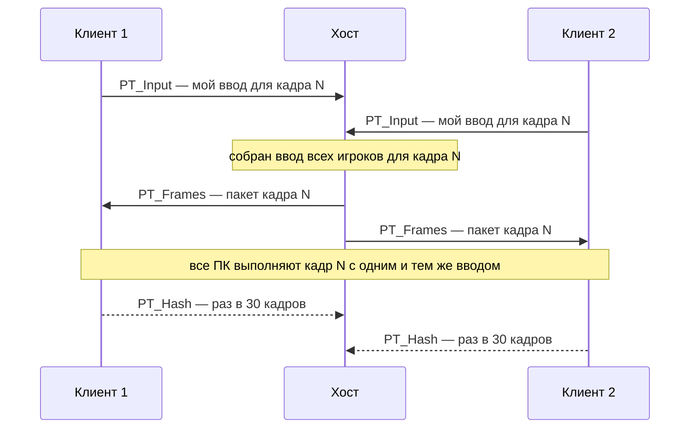

# Устройство мода

[← К описанию мода](../README.md) · [Вся документация](README.md) · [English](en/ARCHITECTURE.md)

Страница для тех, кто хочет разобраться в коде или доработать мод.

- [Как мод попадает в игру](#как-мод-попадает-в-игру)
- [Правила работы с кодом игры](#правила-работы-с-кодом-игры)
- [Карта исходников](#карта-исходников)
- [Детерминированный кадр](#детерминированный-кадр)
- [Сетевая игра: lockstep](#сетевая-игра-lockstep)
- [Начало сессии](#начало-сессии)
- [Вход в идущую игру](#вход-в-идущую-игру)
- [Обрывы и рассинхронизация](#обрывы-и-рассинхронизация)
- [Что у каждого ПК своё](#что-у-каждого-пк-своё)
- [Транспорты](#транспорты)
- [Интерфейс в игре](#интерфейс-в-игре)
- [Версия протокола](#версия-протокола)
- [Проверка и отладка](#проверка-и-отладка)
- [Материалы](#материалы)

## Как мод попадает в игру

```
TMNT2.exe
  └─ импортирует winmm.dll ──► Ultimate ASI Loader (лежит в папке игры под этим именем)
       └─ загружает tmnt2net.asi и вызывает InitializeASI()
            ├─ читает tmnt2net.ini, открывает tmnt2net.log
            ├─ считает SHA-256 файла TMNT2.exe
            │    └─ не тот файл → мод ничего не трогает, игра идёт как без него
            └─ ставит перехваты модуль за модулем
```

`InitializeASI()` вызывается до `WinMain` игры и вне блокировки загрузчика Windows, поэтому все перехваты
стоят раньше, чем игра выполнит первую свою строку. Порядок установки модулей — в `src/mod/dllmain.cpp`.

## Правила работы с кодом игры

- **Файл на диске не меняется.** Все изменения — в памяти процесса.
- **Один поддерживаемый файл.** Адреса в `src/mod/game.h` верны только для `TMNT2.exe` с SHA-256
  `22f49908…42d8b6a`. Мод сверяет хеш при старте.
- **Каждый перехват проверяет байты.** Рядом с адресом в `game.h` записаны первые байты функции. Перед
  установкой перехвата мод сравнивает их с памятью; не совпало — перехват пропускается, в журнал идёт
  предупреждение, остальное работает.
- **Функции самой игры вместо своих.** Где возможно, мод вызывает код игры: её шрифт и звуки меню, её смену
  видеорежима, её загрузку записи прогресса, её установку громкости.

Перехваты ставит [MinHook](https://github.com/TsudaKageyu/minhook); обёртки над ним, запись байтов и замена
записей в таблицах виртуальных функций — в `src/mod/patch.cpp`.

## Карта исходников

```
src/
  common/   общее: журнал, SHA-256, сеть, транспорты, Steam, протокол
  mod/      сам мод: tmnt2net.asi
  launcher/ лаунчер tmnt2net-launcher.exe: мод лежит внутри него
dist/       tmnt2net.ini по умолчанию и описание для игроков
re/         заметки по разбору TMNT2.exe
tools/      шейдер обработки кадра, проверка разрядности сборки, шрифты и значок лаунчера, описание релиза
third_party/minhook
```

### src/mod

| Файл | За что отвечает |
|---|---|
| `dllmain.cpp` | вход, проверка хеша, порядок установки модулей |
| `game.h` | адреса и контрольные байты функций игры |
| `patch.cpp` | перехваты, запись в память, таблицы виртуальных функций |
| `config.cpp` | чтение `tmnt2net.ini` |
| `fixes.cpp` | исправления ошибок игры («Unkown Error» и другие), запись её исключений в журнал |
| `video.cpp` | режимы окна, создание устройства Direct3D, разрешение, сглаживание, ограничение кадров, показ кадра |
| `postfx.cpp` | резкость и цвета готового кадра одним пиксельным шейдером |
| `widescreen.cpp` | широкий экран: обзор камер, раскладка меню и надписей, шкалы в углах |
| `camera.cpp` | своя камера на каждом ПК, приближение колесом, угол обзора |
| `input.cpp` | клавиатура, кнопки мыши как клавиши, раскладки, громкость и клавиши игрока в `tmnt2net.ini`, сценарии для проверок |
| `pads.cpp` | геймпады через SDL2 как виртуальные джойстики игры, клавиатура как геймпад |
| `sim.cpp` | детерминированный кадр: ввод кадра, журнал кадров, загрузки внутри кадра |
| `netplay.cpp` | сессии: лобби, старт, пакеты кадров, контрольные суммы, вход в идущую игру, возврат игрока |
| `midjoin.cpp` | вошедший посреди уровня получает героя команды |
| `netpage.cpp` | страница СЕТЕВАЯ ИГРА |
| `menus.cpp` | пункты главного меню, страницы ЭКРАН и НАСТРОЙКИ МОДА, пауза |
| `pageui.cpp`, `gamefont.cpp` | оформление страниц мода и надписи шрифтом игры |
| `overlay.cpp` | надписи поверх кадра вне сцены игры: загрузка, ожидание игрока |
| `coop.cpp` | ники над героями, выбор героя и костюмов, значки на карте, танец команды |
| `health.cpp` | своё здоровье у каждого игрока, сон и подъём |
| `results.cpp` | таблица итогов района |

### src/common

| Файл | За что отвечает |
|---|---|
| `protocol.h` | формат пакетов и версия протокола |
| `transport.h` | общий интерфейс транспорта |
| `transport_enet.cpp` | ENet: локальная сеть и прямое соединение по IP |
| `transport_steam.cpp` | Steam: `ISteamNetworkingMessages`, обход NAT и ретрансляция средствами Steam |
| `lobby_steam.cpp` | лобби Steam: как игроки находят друг друга |
| `steam_boot.cpp`, `steam_real.cpp`, `steam_stub.cpp` | запуск Steam, настоящие вызовы и заглушка для сборки без SDK |
| `steam_mock.cpp` | стенд: имитация Steam для нескольких копий игры на одном ПК |
| `joincode.cpp` | коды входа: IP-адрес и порт в виде `TMNT-XXXX-XXX` |
| `net.cpp`, `log.cpp`, `sha256.cpp` | сокеты, журнал, хеш |

### src/launcher

[Лаунчер](LAUNCHER.md) в игру не входит. Он несёт файлы мода в своих ресурсах, сам кладёт их в папку игры
и убирает оттуда; новая версия мода приходит как новый лаунчер. Одна программа без зависимостей.

| Файл | За что отвечает |
|---|---|
| `main.cpp` | окно, мышь и клавиатура, что делает каждое нажатие, фоновая работа, режимы проверки без окна |
| `view.cpp` | картинка: каждый экран рисуется по состоянию из `launcher.h`; он же сообщает, где что нажимается |
| `gfx.cpp` | Direct2D и DirectWrite: шрифты из ресурсов exe, контуры из строк SVG, экран в файл PNG |
| `core.cpp` | папка игры и мод в ней, настройки, описание релиза `tmnt2net-latest.json`, загрузка нового лаунчера |
| `gameset.cpp` | настройки игры на вкладках «Графика», «Звук» и «Управление»: строки, их значения, чтение и запись `tmnt2net.ini` |
| `package.cpp` | мод внутри файла лаунчера: чтение его списка и файлов, установка и удаление по `tmnt2net-install.txt` |
| `net.cpp` | HTTP через WinHTTP: напрямую, через прокси Windows или указанный |

## Детерминированный кадр

Lockstep работает, только если игра от одного и того же ввода идёт одинаково на любом ПК. Оригинал так не
умеет: он пропускает кадры, загрузки занимают разное число кадров, логика спрашивает о вещах, зависящих от
реального времени. `sim.cpp` это исправляет.

- **Ввод кадра фиксируется в одной точке** — в `CPCInputsDevice::Sync`. Там собирается структура
  `FrameInput`: клавиатура, четыре геймпада и ответы на вопросы логики к реальному времени — «ролик
  закончился», «голос ещё звучит». В течение кадра игра читает только её.
- **Рисование не пропускается**: нарисованные эффекты берут случайные числа, пропуск кадра изменил бы их
  последовательность.
- **Загрузки заканчиваются внутри кадра**, который их ждёт: число кадров загрузки больше не зависит от диска.
- **Арифметика потока игры одинаковая.** Direct3D оставляет поток игры на одинарной точности x87 с
  округлением к ближайшему, и вся арифметика игры идёт так. Посторонний код в процессе — оверлей, захват
  экрана — может оставить другую точность, и тогда этот ПК считает другие числа: через несколько кадров у
  него другая игра. В начале каждого кадра и перед рисованием мод возвращает управляющее слово x87 и MXCSR к
  значениям самой игры, а изменение пишет в журнал.
- **Журнал кадров** `tmnt2net-sim.log`: номер кадра, эпоха генератора случайных чисел, число его вызовов,
  хеш его состояния и хеш ввода. Две копии игры с одинаковым вводом обязаны писать одинаковые строки.

## Сетевая игра: lockstep

Каждый ПК выполняет полную игру. По сети идёт только ввод.



- **Звезда вокруг хоста.** Клиенты шлют свой ввод хосту, хост рассылает всем готовый пакет кадра. Никто не
  выполняет кадр N, пока не получил его пакет.
- **Задержка ввода.** Каждый ПК снимает ввод на несколько кадров вперёд, чтобы пакет успел дойти. Если ввод
  опаздывает, хост ждёт, и игра стоит у всех: при задержке d кадров и круговом времени R игра делает не больше
  d / R кадров в секунду. Стартовую задержку хост берёт по первым пингам, от 2 до 10 кадров. Дальше каждый
  клиент ведёт свою: хост раз в секунду сообщает в списке игроков, с каким запасом в кадрах приходил ввод
  каждого, и клиент прибавляет или убавляет свою задержку (до 12 кадров). На ход игры это не влияет: хосту
  нужен ровно один ввод каждого игрока на каждый кадр, и клиент при смене задержки не пропускает и не
  повторяет кадры.
- **Два канала.** Управляющие пакеты идут надёжным упорядоченным каналом, ввод и пакеты кадров — ненадёжным.
- **Избыточность вместо повторов.** Каждый пакет ввода и каждый пакет кадров несёт последние 8 кадров, поэтому
  потеря отдельных пакетов игру не задерживает.
- **Скорость.** Игра идёт со скоростью самого медленного участника: кадр ждёт ввода от всех.

### Пакеты

Все структуры — в `src/common/protocol.h`: упакованные, с прямым порядком байтов, без указателей.

| Пакет | Направление | Назначение |
|---|---|---|
| `PT_Hello` | клиент → хост | хеш `TMNT2.exe`, версия мода, ник, номер ПК |
| `PT_Welcome` | хост → клиент | номер игрока; признак, что игра уже идёт |
| `PT_Reject` | хост → клиент | отказ с причиной: версия, нет мест, другой exe |
| `PT_Roster` | хост → всем | кто в игре, готовность, пинги, кого ждут |
| `PT_Record` | хост → игроку | запись прогресса, с которой играют все, и настройки хоста |
| `PT_Start` | хост → всем | старт: задержка ввода, участники |
| `PT_Input` | клиент → хост | свой ввод, последние 8 кадров |
| `PT_Frames` | хост → клиентам | пакеты кадров, последние 8 |
| `PT_Hash` | клиент → хост | контрольная сумма состояния |
| `PT_Desync` | хост → всем | с какого кадра и у кого суммы разошлись |
| `PT_History` | хост → вошедшему | все пакеты кадров с первого, по 18 в пакете |
| `PT_Alive`, `PT_Bye` | клиент → хост | «я здесь» в лобби и выход по своей воле |

## Начало сессии

Сессия начинается в главном меню уже запущенной игры — перезапуск не нужен. Чтобы все ПК стартовали из
одного состояния:

1. хост рассылает **запись прогресса** игры (`CGameData::Record`, 0x968 байт) — у всех она становится
   одинаковой на время сессии;
2. хост рассылает **настройки, влияющие на ход игры**: сложность, автосохранение, эффекты попаданий, окна
   помощи;
3. по `PT_Start` все ПК в одном кадре начинают читать ввод из пакетов кадров.

После сессии каждому возвращаются его запись и его настройки. Общий прогресс сохраняется в
`tmnt2net-coop.rec`.

## Вход в идущую игру

Состояние игры по сети не передаётся — его нечем снять и нечем применить. Вошедший получает **историю**:
все пакеты кадров с первого кадра сессии, и его игра проигрывает их сама.

- История уходит надёжным каналом, частями: за получасовую сессию это мегабайты, и разом их транспорт не
  принимает.
- Код игры выполняется для каждого кадра истории — именно это делает игру одинаковой. Но рисовать эти кадры
  незачем: на время догона вызовы рисования Direct3D пропускаются, звук выключен, на экране кадр загрузки.
  Так догон идёт примерно в 37 раз быстрее игры.
- Когда ввод вошедшего дошёл до текущего кадра, хост включает его в состав участников. `midjoin.cpp` в том же
  кадре на всех ПК отдаёт ему одного из героев команды.

## Обрывы и рассинхронизация

- **Молчание.** Игрок, от которого нет данных дольше `timeout_ms`, исключается из состава: в пакетах кадров
  его бит участника снимается, и на всех ПК это происходит в одном и том же кадре.
- **Возврат на место.** Если игра выбывшего не закрыта и связь вернулась, хост узнаёт его по той же связи,
  досылает пропущенные пакеты кадров, и он снова в составе.
- **Вход заново.** После перезапуска игрок узнаётся по Steam ID или по `player_id` из `tmnt2net.ini` и
  получает своё место.
- **Контрольные суммы.** Раз в 30 кадров клиенты шлют хосту число вызовов генератора случайных чисел и хеш
  его состояния. Если суммы разошлись, хост объявляет `PT_Desync`, и разошедшийся клиент входит в сессию
  заново — до четырёх раз; после двух минут ровной игры счёт начинается сначала. Если не помогло, клиент
  выходит из сессии. Обе стороны при каждом расхождении сохраняют копии своих журналов
  (`tmnt2net-desync-*.log`): сравнение журналов кадров показывает первый кадр расхождения.
- **Каждая сессия с чистого листа.** Игра участвует в сессиях одна за другой без перезапуска, поэтому при
  открытии лобби все буферы прошлой сессии — ввод, пакеты кадров, история, контрольные суммы — очищаются.

## Что у каждого ПК своё

Всё, что влияет на логику, обязано совпадать. Всё остальное мод делает только при рисовании, и у каждого ПК
оно своё:

- **Расстояние между игроками.** В оригинале `CGameProperty::AdjustWithinMoveBoundary` не выпускает игрока
  из круга вокруг точки, на которую смотрит камера уровня. В сессии этой границы нет — на всех ПК одинаково,
  это часть логики.
- **Что видит камера.** Логика спрашивает камеру уровня, в кадре ли враг или точка: от ответа зависит,
  стреляет ли стрелок, «видит» ли враг цель, уберёт ли генератор врага, идёт ли эффект уровня. В сессии
  ответ «да» даёт и близость к любому игроку — так игрок, ушедший далеко от команды, не остаётся с
  полуспящими врагами. Правило одно на всех ПК.
- **Камера.** У игры одна камера уровня, и она часть логики: от неё зависят активность врагов и линии
  видимости. Каждый ПК продолжает считать её одинаково, в формате 16:9. `camera.cpp` подменяет кадр камеры
  только на время рисования сцены: центрирует на своём игроке, учитывает приближение колесом и угол обзора.
- **Широкий экран и формат кадра.** Обзор расширяется при рисовании; меню и надписи раскладываются в
  середине 4:3. Форматы «4:3» и «растянуть» — только форма и показ кадра: камеры при них те же.
- **Обработка кадра.** Сглаживание, фильтр текстур, резкость, цвета.
- **Клавиши.** Раскладка клавиатуры у каждого своя: в сессию идёт уже состояние его геймпада.

## Транспорты

Формат пакетов не знает о транспорте: `transport.h` — общий интерфейс, реализаций три.

| Транспорт | Когда используется |
|---|---|
| **Steam** | `ISteamNetworkingMessages`: Steam сам выбирает прямой или ретранслируемый путь, пробрасывать порты не нужно. Игроки находят друг друга через лобби Steam |
| **ENet** | локальная сеть и прямое соединение по IP, порт 7790 UDP. Работает всегда, в том числе без Steam |
| **mock** | только для проверок: имитация Steam на одном ПК — выдуманные SteamID, UDP на localhost, лобби в виде файлов |

Для Steam мод использует AppID 480 — тестовое приложение Valve Spacewar. `steam_api.dll` подгружается
отложенно, только когда нужен.

## Интерфейс в игре

Страницы мода нарисованы внутри 2D-сцены игры её же средствами:

- **`gamefont.cpp`** пишет шрифтом игры через её функции, поэтому надписи выглядят как родные и используют
  буквы вашего перевода;
- **`pageui.cpp`** рисует окна в цветах игровых окон сообщений: тёмный фон, лаймовые линии, заголовок,
  подсветка выбранной строки, строка подсказок;
- **`menus.cpp`** добавляет пункты в главное меню игры и встраивает страницу ЭКРАН в её ОПЦИИ;
- **`overlay.cpp`** рисует поверх кадра то, что должно быть видно, когда сцена игры не рисуется: экран
  подключения, окно ожидания игрока.

Координаты страниц — 2D-пространство игры: x от −320 до 320, y от −240 до 240, середина 4:3.

## Версия протокола

`kVersion` в `protocol.h` меняется не только при изменении пакетов. Её нужно поднимать **каждый раз, когда
мод меняет ход самой игры**: lockstep требует одинаковой игры на всех ПК, и игроки с разным поведением
вместе играть не должны.

| Протокол | Версия мода | Что изменилось в ходе игры |
|---|---|---|
| 1 | 0.5.0 | первая сетевая игра |
| 2 | 0.7.1 | после района танцует вся команда |
| 3 | 0.7.2 | на переходах внутри уровня прыгают все |
| 4 | 0.8.0 | у каждого игрока своё здоровье |
| 5 | 0.9.0 | вход в идущую игру |
| 6 | 0.10.0 | напарник поднимает уснувшего |
| 7 | 0.12.0 | вошедший посреди уровня сразу получает героя |
| 8 | 0.12.2 | игрок узнаётся по номеру ПК |
| 9 | 0.13.0 | сетевое меню внутри игры |
| 10 | 0.14.0 | сессия начинается в главном меню без перезапуска |
| 11 | 0.16.0 | выбор костюмов |
| 12 | 0.16.3 | все герои открыты |
| 13 | 0.16.4 | пауза в сессии |
| 14 | 0.16.6 | в сессии игроков не держит вместе граница вокруг камеры |
| 15 | 0.17.0 | всё, что рядом с любым игроком, считается видимым камерой уровня |
| 16 | 0.17.1 | меню карты мира открывает и SELECT геймпада (Esc клавиатуры) |

## Проверка и отладка

Сетевую игру можно проверить на одном ПК: несколько копий игры в разных папках, каждая со своим
`tmnt2net.ini`. Нужные ключи — в разделе `[debug]`:

| Ключ | Что делает |
|---|---|
| `multi_instance = 1` | разрешает несколько копий игры одновременно |
| `script`, `frame_script` | нажатия клавиш и снимки кадра по времени или по номеру кадра |
| `shots` | сохранить указанные кадры в папку `screenshots` |
| `autoquit` | выйти через заданное число секунд |
| `offscreen`, `no_activate` | окно за краем рабочего стола, фокус не забирается |
| `determinism`, `record`, `replay` | журнал кадров, запись ввода в файл и её повтор |
| `area_test`, `clear_test` | начать с заданного района, засчитать уровень пройденным |
| `replay_draws = 1` | рисовать кадры при догоне, как до 0.16.5 |
| `net_outage = с,на` | оборвать связь клиента на заданное время |

Для имитации Steam: `[net] transport = mock` и ключи `mock_slot`, `mock_dir`, `mock_loss_pct`,
`mock_latency_ms`, `mock_send_rate`.

Главная проверка — сравнить `tmnt2net-sim.log` копий после прогона: строки сессии должны совпадать кадр в
кадр. Первое расхождение показывает кадр, с которого игры пошли по-разному.

Чего стенд не покрывает: всё, что зависит от фокуса окна. Копии на стенде никогда не бывают активным окном,
поэтому захват клавиатуры, активация окна и настоящая мышь проверяются только в обычной игре.

## Материалы

- [`re/notes.md`](../re/notes.md) — заметки по разбору `TMNT2.exe`: адреса, структуры, доказательства. На
  английском.
- [`docs/TZ.md`](TZ.md) — исходное техническое задание и план этапов. Историческая справка: описывает проект
  на момент версии 0.12.
- [xntrz/tmnt2](https://github.com/xntrz/tmnt2) — открытая реконструкция кода игры. Имена классов и функций
  в `game.h` и в заметках взяты оттуда и сверены с exe по форме кода и строкам.
