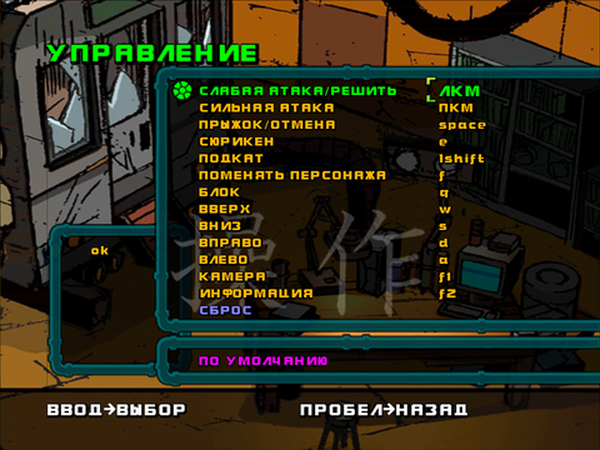

# Управление

[← К описанию мода](../README.md)

- [Клавиатура и мышь](#клавиатура-и-мышь)
- [Свои клавиши](#свои-клавиши)
- [Геймпады](#геймпады)
- [Двое за одной клавиатурой](#двое-за-одной-клавиатурой)
- [Меню и окно игры](#меню-и-окно-игры)

## Клавиатура и мышь

В моде две готовые раскладки. Переключаются они в главном меню: **НАСТРОЙКИ МОДА → КЛАВИШИ И МЫШЬ**.

| Действие | КАК В ИГРЕ | wasd + МЫШЬ |
|---|---|---|
| Ходить | стрелки | W A S D |
| Атака | F | левая кнопка мыши |
| Сильная атака | D | правая кнопка мыши |
| Прыжок | Пробел | Пробел |
| Сюрикен | R | E |
| Подкат | E | Левый Shift |
| Блок | S | Q |
| Сменить героя | Левый Shift | F |
| Камера | F1 | F1 |
| Информация | F2 | F2 |

Работает всегда, в любой раскладке:

| Клавиша | Что делает |
|---|---|
| Стрелки | ходить по меню |
| Enter | выбрать, Start |
| Esc | назад в меню, пауза в уровне |
| Колесо мыши | приблизить или отдалить камеру уровня |
| Средняя кнопка мыши | вернуть обычное расстояние камеры |
| Alt+Enter | окно ↔ окно без рамки на весь монитор |

Мышь действует, только пока окно игры активно и указатель над ним. С атакой на левой кнопке мышью удобно и в
меню: щелчок — «выбрать».

**Поднять напарника:** подойти вплотную к лежащему и держать блок полторы секунды.

## Свои клавиши

Любое действие можно повесить на любую клавишу или кнопку мыши в самой игре:

1. ОПЦИИ → УПРАВЛЕНИЕ → клавиатура.
2. Выбрать действие и нажать Enter.
3. Нажать нужную клавишу или кнопку мыши.

Кнопки мыши в списке подписаны ЛКМ, ПКМ, МЫШЬ 4 и МЫШЬ 5. После ручной настройки строка КЛАВИШИ И МЫШЬ в
НАСТРОЙКАХ МОДА показывает «СВОИ».

Мод хранит клавиши в `tmnt2net.ini`, поэтому они действуют и в сетевой игре и не сбрасываются при загрузке
сохранения.

То же можно сделать до запуска игры — в [лаунчере](LAUNCHER.md#графика-звук-и-управление), на вкладке
«Управление»: щёлкнуть по ячейке действия и нажать клавишу или кнопку мыши.

 

## Геймпады

Работают Xbox, PlayStation (DualShock 4, DualSense), Switch Pro и другие геймпады, которые знает SDL2.
Геймпад можно подключить и после запуска игры.

| Действие | Xbox | PlayStation |
|---|---|---|
| Ходить | левый стик, крестовина | левый стик, крестовина |
| Атака, «выбрать» в меню | A | ✕ |
| Сильная атака | X | □ |
| Прыжок, «отмена» в меню | B | ○ |
| Сюрикен | Y | △ |
| Подкат | LB | L1 |
| Блок | RB | R1 |
| Сменить героя | LT | L2 |
| Камера | нажатие правого стика | R3 |
| Информация | нажатие левого стика | L3 |
| Start, пауза | START | OPTIONS |
| Пауза | BACK | SHARE |

Кнопки геймпада переназначаются в игре: ОПЦИИ → УПРАВЛЕНИЕ.

На одном ПК могут играть до четырёх человек: каждый входит кнопкой Start на экране выбора героя. Сколько
геймпадов показывать игре, задаёт НАСТРОЙКИ МОДА → ГЕЙМПАДЫ (`[input] pads`, от 0 до 4). Значение 0 возвращает
поведение оригинала: только DirectInput, где у геймпадов Xbox кнопки перепутаны.

## Двое за одной клавиатурой

НАСТРОЙКИ МОДА → КЛАВИАТУРА → два игрока (`[input] keyboard_players = 2`). Половины клавиатуры становятся
двумя отдельными «геймпадами».

| Действие | Левая половина | Правая половина |
|---|---|---|
| Ходить | W A S D | стрелки |
| Атака | F | Num 1 |
| Сильная атака | G | Num 2 |
| Прыжок | Пробел | Num 0 |
| Сюрикен | R | Num 5 |
| Подкат | Q | Num 4 |
| Блок | E | Num 6 |
| Сменить героя | Левый Shift | Num 3 |
| R2 | C | Num . |
| Select | ` | Num − |
| Start | Tab | Num Enter |

Enter и Esc остаются у обычной клавиатуры игры — для меню.

## Меню и окно игры

- **Esc** — назад во всех меню игры, как и пробел.
- **Заставки при запуске** пропускаются любым нажатием: Enter, Esc, пробел, щелчок мыши или кнопка геймпада.
  Убрать их совсем: НАСТРОЙКИ МОДА → ЗАСТАВКИ ПРИ ЗАПУСКЕ → ПРОПУСКАТЬ.
- **Пауза** в уровне: Esc, Enter, START или BACK на геймпаде. В сетевой игре пауза общая.
- **Игра в фоне**: по умолчанию игра встаёт на паузу, когда её окно не активно. НАСТРОЙКИ МОДА → ИГРА В ФОНЕ →
  ПРОДОЛЖАЕТСЯ оставляет её работать.
