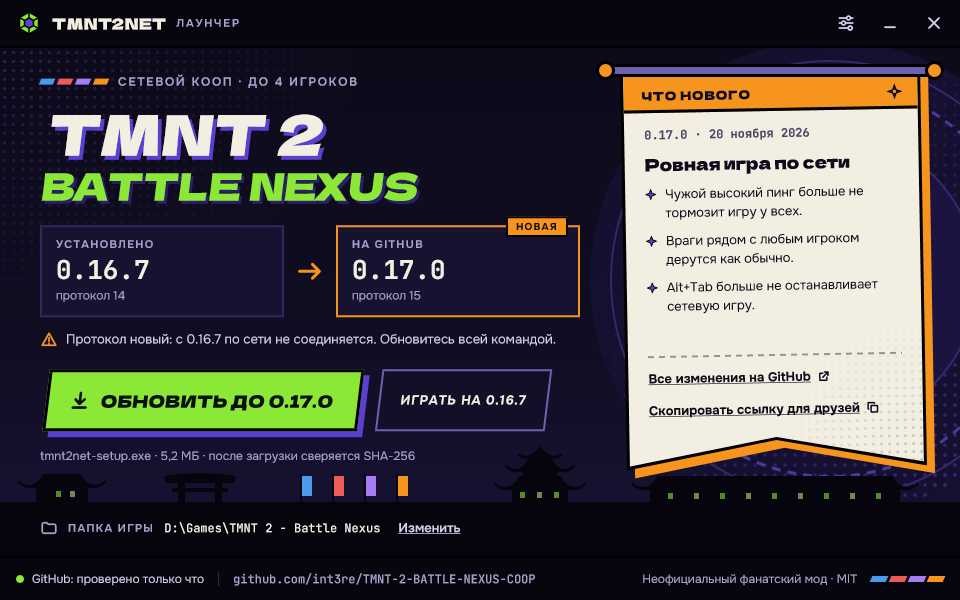
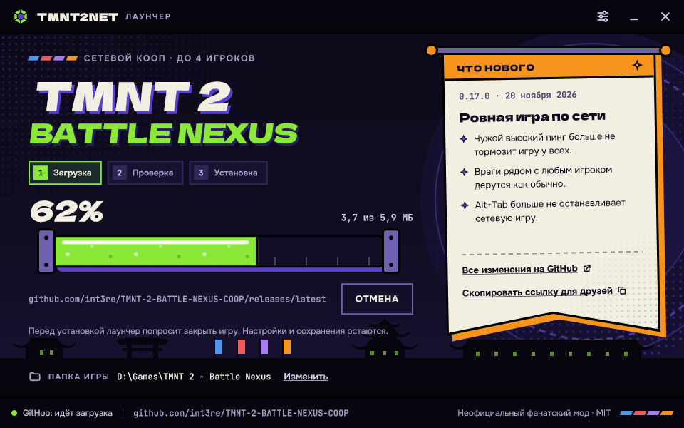
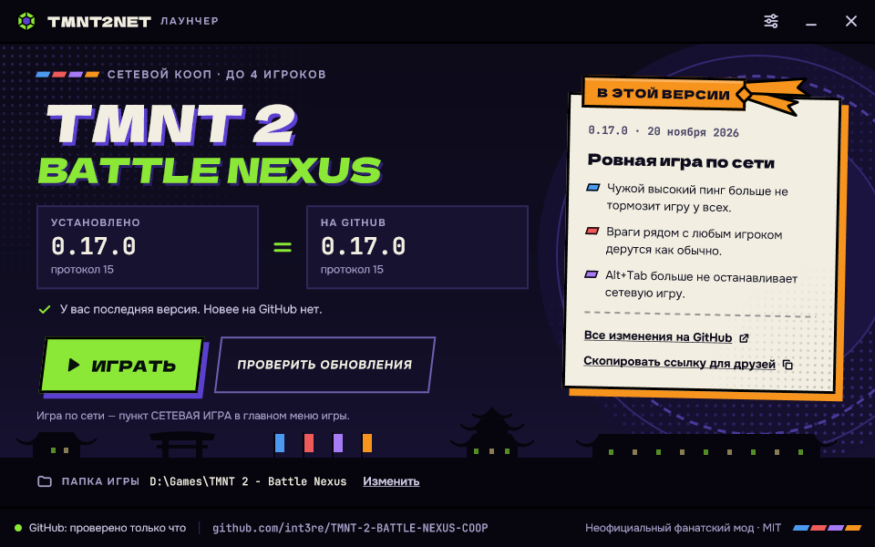
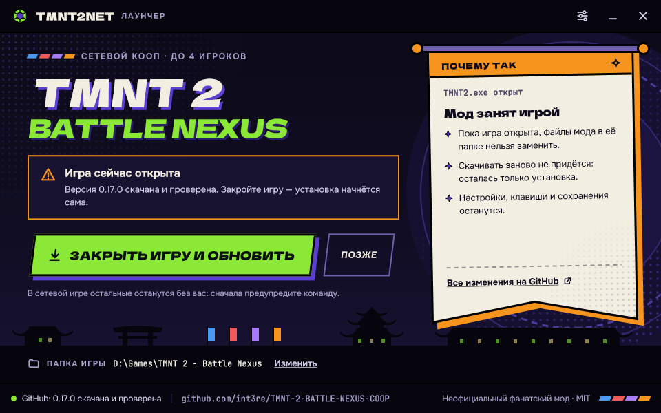
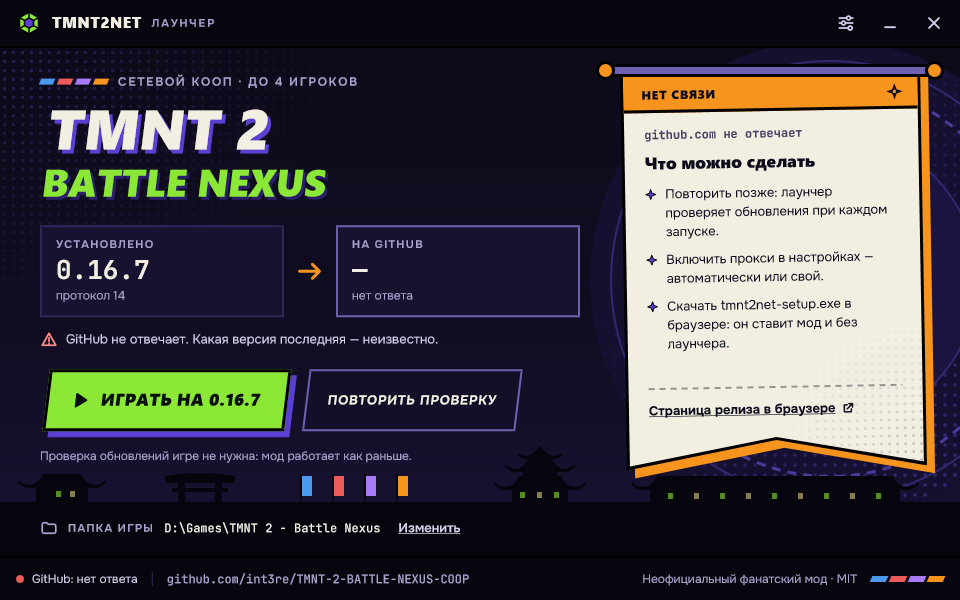
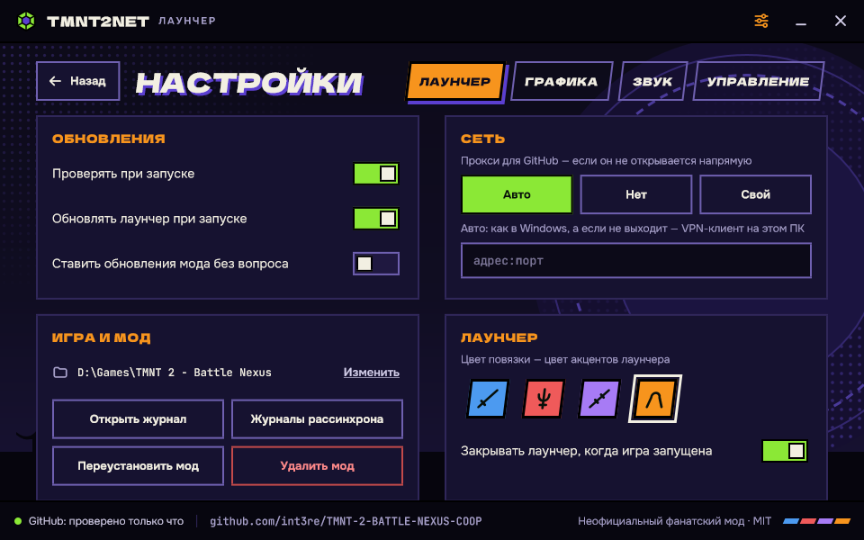
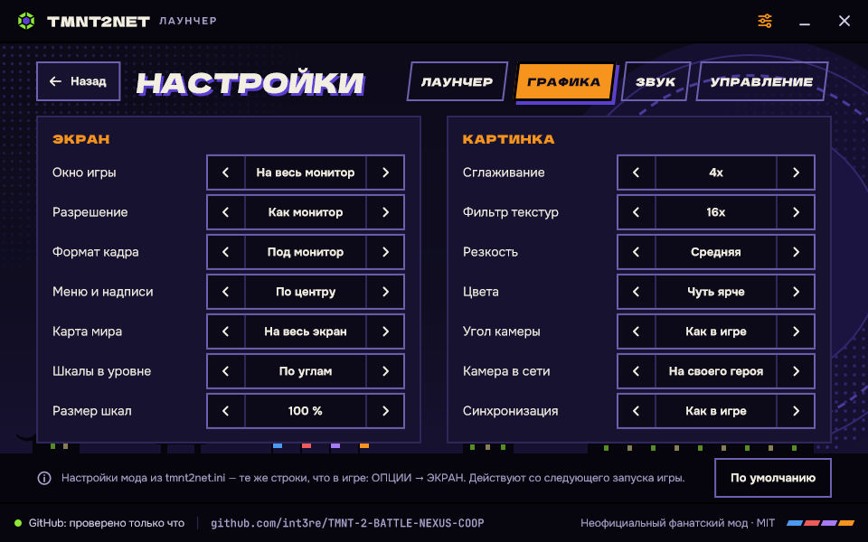
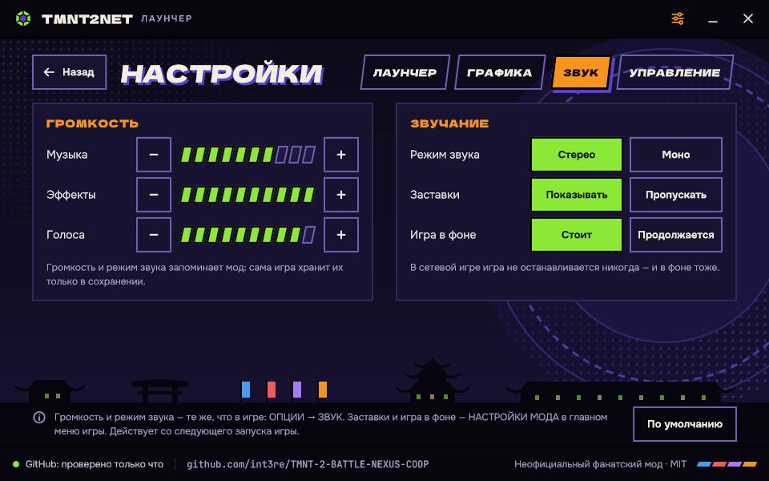
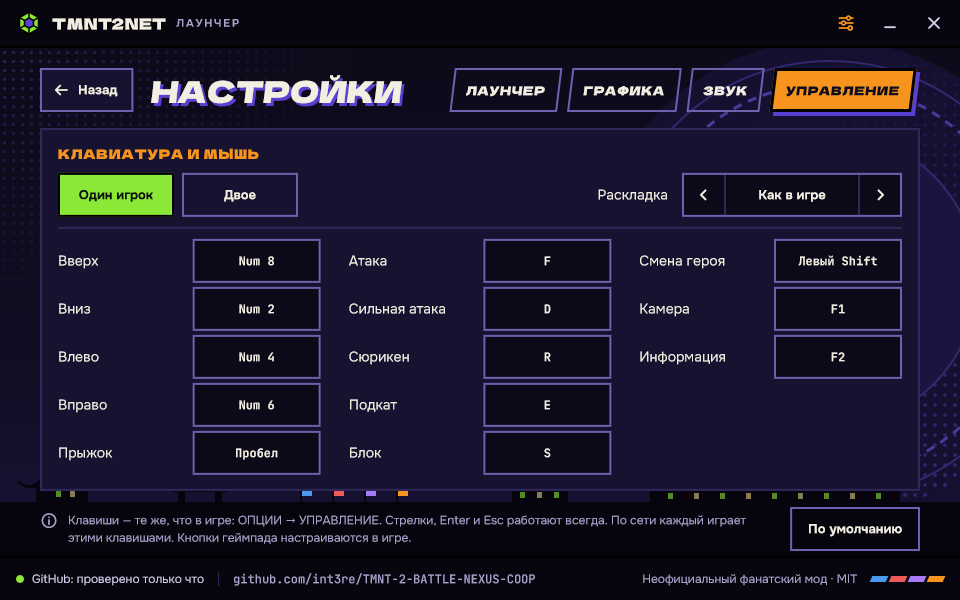

# Лаунчер

[← К описанию мода](../README.md) · [Вся документация](README.md)

`tmnt2net-launcher.exe` — единственный файл, который нужен игроку. **Мод лежит внутри него**: лаунчер
находит игру, ставит мод, следит за обновлениями и запускает игру. Скачать его можно со страницы
[Releases](../../../releases/latest). Ставить сам лаунчер не нужно: положите файл куда удобно и запускайте.

<p align="center">
  
</p>

## Содержание

- [Что он делает](#что-он-делает)
- [Экраны](#экраны)
- [Версии и протокол](#версии-и-протокол)
- [Настройки](#настройки)
- [Если GitHub не отвечает](#если-github-не-отвечает)
- [Где что лежит](#где-что-лежит)
- [Что лаунчер скачивает и запускает](#что-лаунчер-скачивает-и-запускает)
- [Из командной строки](#из-командной-строки)
- [Разработчикам](#разработчикам)

## Что он делает

1. **Находит игру.** Сначала — в своей папке, потом — по записи установщика игры в Windows, потом — в
   папках рядом с собой. Если не нашёл, просит указать папку, где лежит `TMNT2.exe`.
2. **Ставит мод.** Мод уже внутри лаунчера, поэтому первая установка идёт сразу и без интернета.
3. **Спрашивает у GitHub, не вышла ли версия новее.** Игру это не задерживает: кнопка **ИГРАТЬ** работает
   сразу, проверка идёт в фоне.
4. **Обновляет себя.** Если на GitHub вышел лаунчер новее, он скачивается, сверяется по контрольной сумме
   SHA-256 из релиза, встаёт на место прежнего и запускается сам. Мод в папке игры при этом не меняется.
5. **Обновляет мод одной кнопкой.** Новая версия мода приходит внутри нового лаунчера, поэтому после его
   перезапуска она ставится сразу, без загрузки. Настройки, клавиши и сохранения остаются.
6. **Настраивает игру.** Картинка, звук и клавиши — на вкладках его настроек, до запуска игры.
7. **Запускает игру.**

Файлы игры лаунчер не меняет: мод ставится рядом с `TMNT2.exe` и убирается одной кнопкой в настройках.
Отдельного установщика нет.

## Экраны

| Экран | Когда | Что предлагает |
|---|---|---|
| Проверка | при запуске | играть на установленной версии, пока GitHub отвечает |
| Лаунчер обновляется | на GitHub вышел лаунчер новее | ничего: загрузка, проверка, перезапуск идут сами; **ОТМЕНА** |
| Есть версия новее | в лаунчере или на GitHub мод новее вашего | **ОБНОВИТЬ** или играть на прежней |
| Загрузка | идёт обновление | три шага: загрузка, проверка, установка; **ОТМЕНА** |
| Последняя версия | обновлять нечего | **ИГРАТЬ**, проверить ещё раз |
| Мод не установлен | игра есть, мода нет | **УСТАНОВИТЬ МОД** |
| Игра не найдена | папка игры неизвестна | **ВЫБРАТЬ ПАПКУ ИГРЫ** |
| Нет связи | GitHub не ответил, а ставить нечего | играть на установленной версии, повторить проверку |
| Игра открыта | мод готов к установке, а игра запущена | закрыть игру и обновить, или позже |

<p align="center">
  
  
</p>

Правая рамка показывает, откуда версия: **НА GITHUB** — её нужно скачать, **В ЭТОМ ЛАУНЧЕРЕ** — она уже
здесь, и скачивать ничего не придётся.

<p align="center">
  
</p>

**Лаунчер обновляет себя сам.** При запуске, если на GitHub есть лаунчер новее, он скачивает его, сверяет
SHA-256, ставит на своё место и перезапускается — это несколько секунд. Мод в папке игры он при этом не
трогает: после перезапуска новая версия мода, если она вышла, уже лежит внутри лаунчера, и кнопка
**ОБНОВИТЬ** ставит её без загрузки. Если что-то не получилось — нет связи, файл повреждён, папку лаунчера
нельзя менять, — лаунчер пишет об этом одной строкой внизу и работает как раньше. Выключается в настройках:
«Обновлять лаунчер при запуске»; тогда о новом лаунчере скажет ссылка в строке состояния.

Справа на знамени — что нового в версии. Под ним две ссылки: все изменения на GitHub и **«Скопировать
ссылку для друзей»** — ссылка на последний релиз, которую можно отправить команде.

Пока игра открыта, файлы мода заменить нельзя. Лаунчер ждёт: закройте игру сами или нажмите **ЗАКРЫТЬ ИГРУ
И ОБНОВИТЬ** — он попросит игру закрыться так же, как крестик её окна. Скачивать заново не придётся.

<p align="center">
  
  
</p>

## Версии и протокол

На экране обновления стоят две версии: установленная и новая, под каждой — номер протокола сетевой игры.
Игроки с разными протоколами вместе играть не могут, поэтому лаунчер пишет прямо:

- **«Протокол новый: с 0.16.7 по сети не соединяется. Обновитесь всей командой»** — обновиться нужно всем;
- **«Протокол тот же»** — с друзьями на прежней версии играть можно.

Какие версии совместимы — в [таблице совместимости](CHANGELOG.md#совместимость-версий-в-сети).

## Настройки

Открываются значком с ползунками в заголовке окна. Вкладок четыре: **Лаунчер** — настройки самого лаунчера,
**Графика**, **Звук** и **Управление** — настройки игры.

### Лаунчер

<p align="center">
  
</p>

| Раздел | Что в нём |
|---|---|
| **Обновления** | проверять ли при запуске; обновлять ли лаунчер при запуске; ставить ли обновления мода без вопроса |
| **Сеть** | прокси для GitHub: «Авто», «Нет» или свой адрес |
| **Игра и мод** | папка игры; журнал мода; журналы рассинхронизации; переустановить мод; удалить мод |
| **Лаунчер** | цвет повязки — цвет акцентов; закрывать ли лаунчер после запуска игры |

- **Журналы рассинхронизации** открывает папку игры на самом свежем файле `tmnt2net-desync-*.log`: их и
  нужно прислать, если игра у игроков разошлась. См. [«Если что-то не так»](TROUBLESHOOTING.md#рассинхронизация).
- **Удалить мод** спрашивает ещё раз и убирает из папки игры ровно то, что было поставлено.

### Графика, звук и управление

Три вкладки с настройками игры — теми же строками, что в её меню. Менять их можно до запуска игры: лаунчер
пишет значения в `tmnt2net.ini` в папке игры, игра читает их при следующем запуске.

<p align="center">
  
</p>

| Вкладка | Что на ней | Где это в игре |
|---|---|---|
| **Графика** | окно игры, разрешение, формат кадра, меню и надписи, карта мира, шкалы в уровне и их размер; сглаживание, фильтр текстур, резкость, цвета, угол камеры, камера в сети, синхронизация | ОПЦИИ → ЭКРАН |
| **Звук** | громкость музыки, эффектов и голосов; режим звука — стерео или моно; заставки при запуске; игра в фоне | ОПЦИИ → ЗВУК, НАСТРОЙКИ МОДА |
| **Управление** | клавиша или кнопка мыши для каждого действия; раскладка; один игрок за клавиатурой или двое | ОПЦИИ → УПРАВЛЕНИЕ, НАСТРОЙКИ МОДА |

<p align="center">
  
  
</p>

- **Клавиша для действия.** Щёлкните по ячейке и нажмите клавишу. Кнопки мыши: правую и боковые — просто
  нажать, левую — щёлкнуть по той же ячейке ещё раз. Esc — отмена. Если клавиша занята другим действием, они
  меняются клавишами. Стрелки, Enter и Esc назначить нельзя: они работают всегда.
- **Раскладка**: «Как в игре», «WASD + мышь» или «Своя». Ваши клавиши остаются в запасе, пока включена
  готовая раскладка.
- **Двое** за одной клавиатурой: у каждой половины свои постоянные клавиши, вкладка показывает их.
- **По умолчанию** возвращает значения мода только на открытой вкладке.
- **Громкость** запоминает мод начиная с версии 0.17.2, **режим звука** — с 0.17.3. Со старым модом эти
  строки неактивны.
- Перед первым изменением лаунчер откладывает прежний файл: `tmnt2net.ini.before-launcher` в папке загрузок.
- Если игра лежит в папке, куда программам писать нельзя (например, в `Program Files`), Windows держит для
  игры свою копию её настроек. Лаунчер читает и пишет именно её.

## Если GitHub не отвечает

Поставить мод и играть можно и без связи: мод внутри лаунчера. Связь нужна только чтобы узнать о версии
новее и скачать её. Лаунчер пробует несколько путей по очереди, в зависимости от настройки «Сеть»:

| Настройка | Что пробует |
|---|---|
| **Авто** | как настроено в Windows; если не вышло — HTTP-прокси VPN-клиента на этом же ПК, если такой запущен (порты 10809, 7890, 7897, 2080, 2081, 8889) |
| **Нет** | только напрямую |
| **Свой** | только указанный адрес, в виде `адрес:порт` (HTTP-прокси) |

Бывает, что сама страница GitHub открывается, а файлы релизов — нет: они лежат на другом сервере. Лаунчер
это различает и пишет «GitHub отвечает, но файлы релиза не отдаёт» — тогда поможет прокси.

Запасной путь всегда один: скачать новый `tmnt2net-launcher.exe` в браузере со страницы релиза — новая
версия мода уже внутри него.

## Где что лежит

| Что | Где |
|---|---|
| настройки лаунчера | `%APPDATA%\tmnt2net\launcher.ini` |
| скачанные обновления | `%LOCALAPPDATA%\tmnt2net\cache` |
| настройки игры | `tmnt2net.ini` в папке игры |
| копия настроек игры до первого изменения из лаунчера | `%LOCALAPPDATA%\tmnt2net\cache\tmnt2net.ini.before-launcher` |

В реестр лаунчер ничего не пишет. Чтобы убрать его совсем, удалите сам файл и эти две папки.

## Что лаунчер скачивает и запускает

- Обращается он только к странице репозитория мода на GitHub и к файлам его релизов.
- Скачивает он одно: новый `tmnt2net-launcher.exe`, и сверяет его SHA-256 с указанным в релизе. Если сумма
  не совпала — файл удаляется.
- Когда лаунчер обновляет себя, проверенный файл встаёт на место прежнего и запускается: это тот же
  лаунчер новой версии. Прежний лежит рядом как `tmnt2net-launcher.exe.old`, пока не закроется, и удаляется.
- Когда обновляется мод, скачанный лаунчер не запускается: он открывается как данные, из него достаются
  файлы мода. На место прежнего он встаёт после установки и откроется при следующем запуске.
- Права администратора нужны только тогда, когда игра лежит в папке, куда обычной программе писать нельзя
  (например, в `Program Files`). Тогда Windows спросит разрешение для самого лаунчера.
- Лаунчер не подписан сертификатом: при первом запуске Windows может показать «Система Windows защитила ваш
  компьютер». Нажмите «Подробнее» → «Выполнить в любом случае».

## Из командной строки

Тот же файл ставит и убирает мод без окна:

```bash
tmnt2net-launcher.exe /install "C:\Games\TMNT 2 - Battle Nexus" /quiet
```

```bash
tmnt2net-launcher.exe /uninstall "C:\Games\TMNT 2 - Battle Nexus" /quiet
```

`/quiet` убирает окно с отчётом: он пишется в консоль, из которой запущен лаунчер. Код возврата `0` —
получилось, `2` — нет. Ключ `/package <файл>` ставит мод из другого файла лаунчера.

## Разработчикам

Лаунчер — обычная программа Windows без зависимостей: Direct2D и DirectWrite для картинки, WinHTTP для сети.
Исходники — в `src/launcher/`, шрифты и файлы мода встроены в exe как ресурсы. Как он собирается — в
[сборке](BUILDING.md).

**Мод внутри.** В ресурсах лаунчера лежат файлы мода, их список и описание версии (`dist/release.json`):

```
tmnt2net-package 1
version 0.17.3
protocol 16
launcher 1.3.0
file winmm.dll 301 loader
file tmnt2net.asi 302
file steam_api.dll 303
text steam_appid.txt 480 ifmissing
file tmnt2net.ini 304 keep
file tmnt2net-README.md 305
```

`loader` — уже стоящий Ultimate ASI Loader не заменяется; `keep` — существующий файл (настройки игрока)
остаётся; `ifmissing` — пишется, только если такого файла нет. Список один для всех версий: лаунчер ставит
мод из более нового лаунчера, не зная заранее, что в нём.

**Откуда он знает о новой версии.** К каждому релизу приложен файл `tmnt2net-latest.json`; лаунчер берёт
его по адресу `…/releases/latest/download/tmnt2net-latest.json`:

```json
{
  "schema": 2,
  "version": "0.17.3",
  "protocol": 16,
  "date": "2026-11-21",
  "title": "Лаунчер обновляет себя сам",
  "notes": ["…", "…"],
  "launcher": {"name": "tmnt2net-launcher.exe", "size": 5864960, "sha256": "…", "version": "1.3.0"},
  "setup": {"name": "tmnt2net-launcher.exe", "size": 5864960, "sha256": "…"},
  "protocols": {"0.17.3": 16, "0.17.2": 16, "0.17.1": 16, "0.17.0": 15}
}
```

Файл делает `tools/release_manifest.py` из `dist/release.json` (версия, протокол, дата, заголовок и до
четырёх коротких заметок для знамени) и готового `tmnt2net-launcher.exe`. Поле `setup` повторяет тот же
файл для лаунчера 1.0.0: он запускал скачанное как установщик, и новый лаунчер это умеет.

У релиза без этого файла лаунчер узнаёт только номер версии — по тому, куда ведёт `…/releases/latest`, —
и ставит мод из `tmnt2net-launcher.exe` этого релиза без сверки контрольной суммы, о чём пишет на экране.

**Проверка без окна.** Лаунчер умеет рисовать экран в файл и работать по сценарию со скрытым окном:

| Ключ | Что делает |
|---|---|
| `--shot <экран> <файл.png> [--scale N] [--accent 0..3]` | рисует экран с образцовыми данными: `update`, `downloading`, `ready`, `checking`, `install`, `nogame`, `offline`, `blocked`, `running`, `problem`, `settings`, `graphics`, `sound`, `controls`, `controls2` (двое за клавиатурой), `capture` (ячейка ждёт клавишу), `selfupdate` (лаунчер обновляет себя) |
| `--check --out <файл>` | спрашивает последнюю версию и пишет, что пришло и какой мод внутри |
| `--where --out <файл>` | пишет, где он находит игру и какой мод в ней стоит |
| `--drive "<сценарий>" --out <файл>` | окно скрыто; шаги через `;`: `wait:мс`, `click:имя`, `mouse:x,y`, `until:экран:мс`, `type:текст`, `keydown:клавиша:скан-код:расширенная`, `rdown`, `xdown:1`, `state`, `shot:файл`, `quit` |
| `--settings <ini>`, `--cache <папка>`, `--repo <адрес>`, `--pick <папка>` | свои настройки, своя папка загрузок, другой адрес вместо GitHub, ответ окна выбора папки |
| `--drive-next "<сценарий>"` | сценарий для лаунчера, который этот запустит на своём месте после обновления себя; без ключа лаунчер под сценарием другой не запускает |
| `--after-update <версия>` | так новый лаунчер узнаёт, что его запустил прежний: он пишет об этом и сам себя в этом запуске больше не обновляет |

Со сценарием лаунчер не запускает игру, не открывает ссылки и не ищет настоящую игру сам.

Имена для `click` на вкладках настроек игры: `tab.graphics`, `tab.sound`, `tab.controls`, `tab.launcher`;
`row.<строка>.prev`, `.next`, `.minus`, `.plus`, `.b7` (деление громкости), `.s1` (вторая из двух кнопок);
`key.<действие>` (ячейка клавиши), `layout.prev`, `layout.next`, `keys.one`, `keys.two`, `reset`. Шаг `state`
пишет в журнал значения всех строк и клавиш.
