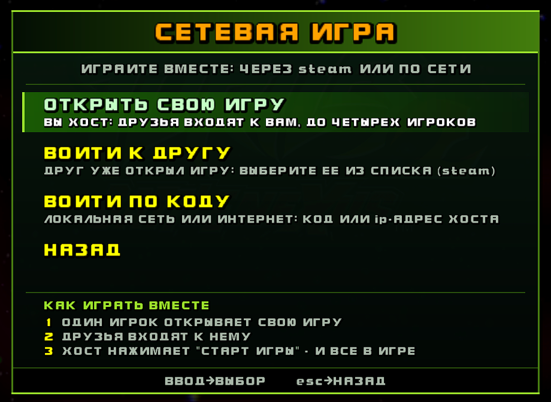
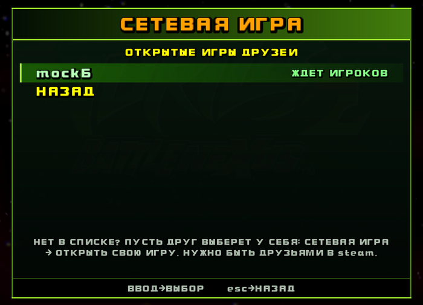
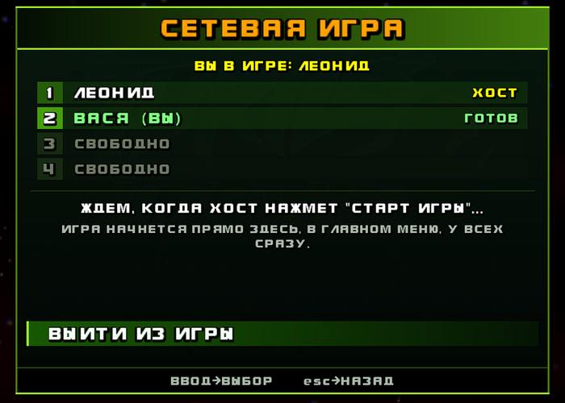
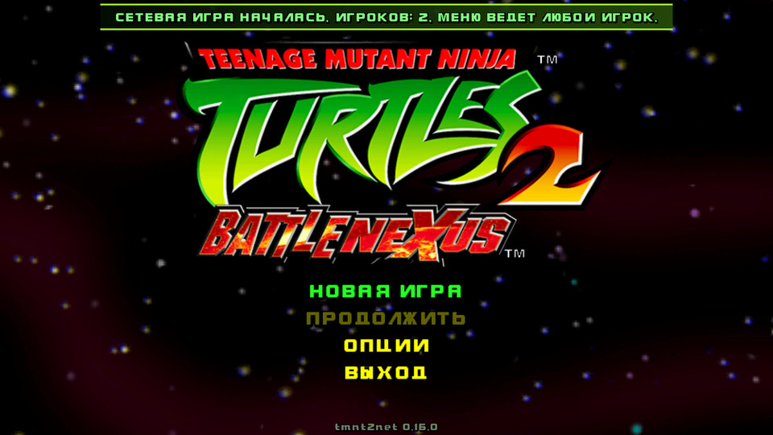
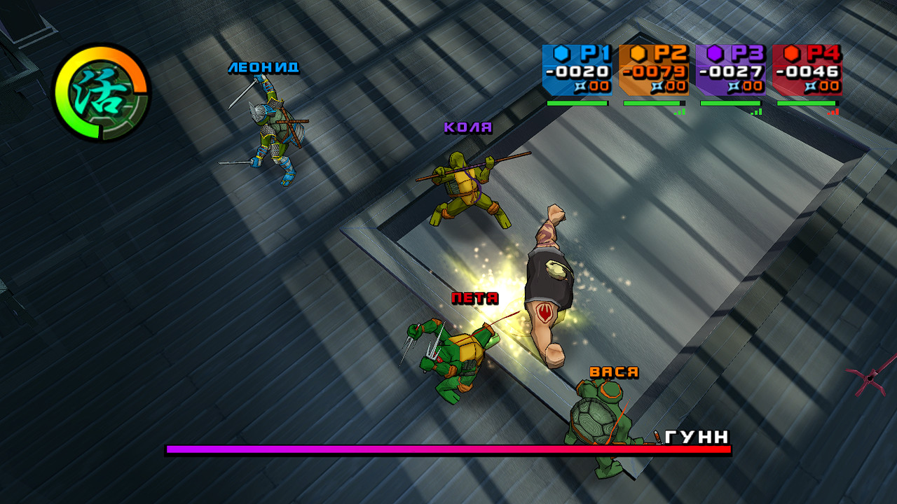

# Сетевая игра

[← К описанию мода](../README.md)

До четырёх игроков, у каждого свой ПК, своя копия игры и свой экран. Всё делается в меню самой игры:
главное меню → **СЕТЕВАЯ ИГРА**.

- [Перед началом](#перед-началом)
- [Как собраться](#как-собраться)
- [Через Steam](#через-steam)
- [По коду или IP](#по-коду-или-ip)
- [В игре](#в-игре)
- [Вход в идущую игру](#вход-в-идущую-игру)
- [Если пропала связь](#если-пропала-связь)
- [Пауза и выход](#пауза-и-выход)
- [Сохранения и прогресс](#сохранения-и-прогресс)
- [Скорость игры и задержка](#скорость-игры-и-задержка)
- [Что важно знать](#что-важно-знать)

## Перед началом

У всех игроков должны быть:

1. **одна и та же игра** — тот же `TMNT2.exe` и тот же перевод;
2. **совместимая версия мода** — она написана под главным меню. Какие версии играют вместе, см. в
   [таблице совместимости](CHANGELOG.md#совместимость-версий-в-сети).

Если `TMNT2.exe` или версия мода отличаются, хост откажет игроку и напишет причину.

## Как собраться

  
  

**Хост** (тот, кто создаёт игру):

1. СЕТЕВАЯ ИГРА → **ОТКРЫТЬ СВОЮ ИГРУ**.
2. На странице четыре места: видно, кто вошёл, готов ли он и какой у него пинг.
3. Когда все на месте — **СТАРТ ИГРЫ**. Можно начать и одному (**НАЧАТЬ ИГРУ ОДНОМУ**): друзья войдут по
   ходу игры.

**Остальные**:

1. СЕТЕВАЯ ИГРА → **ВОЙТИ К ДРУГУ** → игра хоста в списке. Или **ВОЙТИ ПО КОДУ**.
2. Ждать в главном меню: когда хост нажмёт СТАРТ ИГРЫ, общая игра начнётся сама.

Игра при этом не перезапускается: сессия начинается прямо в главном меню, где все стоят. Если в момент старта
кто-то не в главном меню, ему будет написано выйти в него.

 

  
   
  Что видят остальные: список открытых игр друзей и страница ожидания старта. Снимки сделаны на тестовом
  стенде без настоящего Steam, поэтому вместо ника друга в списке условное имя «mock6».

## Через Steam

- Steam должен быть запущен у всех, игроки — друзья в Steam.
- Во время сетевой игры Steam показывает статус «Spacewar». Это тестовое приложение Valve (AppID 480),
  через которое мод пользуется сетью Steam. Так и задумано.
- **ПОЗВАТЬ ДРУГА** на странице хоста открывает список друзей в сети: приглашение уходит прямо из игры.
  Друг принимает его в Steam, и его запущенная игра сама входит к хосту.
- То же работает из списка друзей Steam: «Пригласить в игру» у хоста или «Присоединиться к игре» у друга.
  Игра у приглашённого должна быть запущена.
- В списке **ВОЙТИ К ДРУГУ** видно, кто ждёт игроков, а кто уже играет, и почему в чью-то игру войти нельзя
  (например, другая версия мода).
- Пробрасывать порты не нужно.

По умолчанию игру хоста видят только друзья. Открыть её для всех: `[net] lobby_type = public` в
`tmnt2net.ini`.

## По коду или IP

Подходит для локальной сети и для игры без Steam.

1. Хост: ОТКРЫТЬ СВОЮ ИГРУ → **СКОПИРОВАТЬ КОД**. Код вида `TMNT-XXXX-XXX` попадает в буфер обмена.
2. Остальные: **ВОЙТИ ПО КОДУ** → набрать код или вставить его через Ctrl+V. Вместо кода можно ввести
   IP-адрес хоста.

  

Для игры через интернет хосту нужно открыть порт **`7790` UDP** на роутере и в брандмауэре. Другой порт
задаётся в `tmnt2net.ini`: `[net] port`.

## В игре

После старта все оказываются в одном главном меню. Его ведёт любой игрок: нажатия каждого — часть общей игры.

  

1. **НОВАЯ ИГРА** или **ПРОДОЛЖИТЬ** (общий прогресс сетевой игры).
2. На выборе героя каждый нажимает **Start** (Enter) и выбирает героя.

  

На выборе героя:

- стрелки **влево / вправо** — герой, **вверх / вниз** — костюм: ОБЫЧНЫЙ → САМУРАЙ → НЕКСУС → ДРУГОЙ ГЕРОЙ
  (Слэшур вместо Леонардо, Кейси вместо Рафаэля, Караи вместо Микеланджело, Сплинтер вместо Донателло);
- под рамкой — ник игрока, который ею управляет (рамки раздаются в порядке нажатия Start);
- черепаха и её «другой герой» занимают одно место: если кто-то взял Донателло, Сплинтера в эту команду уже
  не взять;
- в команде всегда четыре героя. Если игроков меньше четырёх, кто-то берёт нескольких и переключает их в бою
  кнопкой смены героя.

В уровне:

- **своя камера** следит за вашим героем. Напарники за краем экрана показаны ником со стрелкой;
- **можно расходиться**: в оригинале игра не отпускает никого от середины команды дальше общего экрана, в
  сетевой игре этого ограничения нет. Враги рядом с любым игроком дерутся как обычно, даже далеко от
  остальной команды;
- над каждым героем — **ник игрока** цветом его героя;
- **у каждого своё здоровье**. Круг слева показывает ваше, полоски под табличками справа — здоровье каждого;
- у кого здоровье кончилось, тот **засыпает на 10 секунд** и встаёт с третью здоровья. Напарник может поднять
  его раньше: подойти вплотную и держать блок полторы секунды. Игра кончается, только если лежат все сразу;
- под табличкой каждого игрока — **значок связи**: зелёный до 80 мс, жёлтый до 160, красный — больше;
- после района танцует вся команда, а на экране — **итоги района**: удары, блоки, сколько раз получил,
  сколько лежал и скольких поднял.

   
  Над героями — ники игроков; под табличками справа — здоровье и связь каждого.

## Вход в идущую игру

Опоздавший входит так же, как все: СЕТЕВАЯ ИГРА → ВОЙТИ К ДРУГУ → игра друга, или по приглашению Steam, или
по коду. Хосту ничего нажимать не нужно.

  

По сети идут только нажатия, поэтому «скопировать» идущую игру с другого ПК нечем: игра вошедшего сама
проигрывает всё, что было сыграно до него. На экране в это время обычная загрузка «ПОДКЛЮЧЕНИЕ К ИГРЕ» с
процентами и оставшимся временем. Догон идёт примерно в 37 раз быстрее игры: полчаса сыгранного — около
50 секунд. У остальных игра в это время не останавливается.

- Если вход пришёлся на уровень, новичок сразу появляется в нём с полным здоровьем: он забирает одного из
  неактивных героев у того игрока, у кого их больше всего.
- Если вход пришёлся на меню, карту или итоги — новичок появится в начале следующего уровня.

## Если пропала связь

- Игра ждёт пропавшего игрока: у всех на экране «Ожидание: P3 …», его значок связи мигает красным.
- Если связь не вернулась, игрок выбывает, а игра продолжается без него. Его герой остаётся стоять.
- **Короткий обрыв**: если игра у пропавшего не закрыта, он возвращается на своё место сам. Хост узнаёт его,
  досылает пропущенное, его игра быстро догоняет остальных. Перезаходить не нужно.
- **Игра закрылась или вылетела**: запустить её и войти заново, как при входе в идущую игру. Хост узнаёт
  игрока по Steam ID или по номеру его ПК (`[net] player_id` в `tmnt2net.ini`), даже под другим ником, и
  возвращает ему его героя.
- **Вышел хост**: у остальных игра продолжается без сети.

**Рассинхронизация.** Раз в 30 кадров ПК сверяют контрольные суммы игры. Если у кого-то игра пошла иначе, у
него она сама входит заново и догоняет остальных — до четырёх раз подряд; после двух минут ровной игры счёт
начинается сначала. Если перезаходы не помогли, игрок выходит из сессии с сообщением: в разошедшейся игре
он не остаётся. Журналы обеих сторон сохраняются в файлах `tmnt2net-desync-*.log`: пришлите их, см.
[«Если что-то не так»](TROUBLESHOOTING.md#рассинхронизация).

## Пауза и выход

- **Пауза**: Esc или Enter, на геймпаде START или BACK. Пауза общая: игра стоит у всех, меню паузы ведёт любой
  игрок.
- Из меню паузы можно вернуться на карту районов или выйти в главное меню сессии.
- **Выход из сетевой игры**: в главном меню сессии последний пункт — **ВЫЙТИ ИЗ СЕТЕВОЙ ИГРЫ**. Сессия
  заканчивается у всех, каждый остаётся в своём главном меню со своим сохранением. Общий прогресс
  сохраняется для следующей сетевой игры.

 

## Сохранения и прогресс

- В сетевой игре все играют с **прогрессом хоста**. Открытые районы и бонусы у всех одинаковые.
- Общий прогресс хранится отдельно от одиночного: в `tmnt2net-coop.rec` и в сетевом сохранении игры
  `tmntsave-net.dat`. При открытии своей игры хост берёт то из них, что новее. Поэтому прогресс не теряется,
  даже если игру закрыли посреди сессии.
- Ваше одиночное сохранение `tmntsave.dat` мод не трогает. После сетевой игры у каждого в главном меню снова
  его собственный прогресс.
- Когда в сессии есть прогресс, курсор в главном меню сразу стоит на ПРОДОЛЖИТЬ.

**Настройки игры — как у хоста.** СЛОЖНОСТЬ, АВТОСОХРАНЕНИЕ, ПОМОЩЬ и ПОПАДАНИЯ из ОПЦИЙ игры влияют на сам
ход игры, поэтому на время сессии у всех действуют значения хоста. После сессии возвращаются свои. Экран,
картинка, клавиши и камера у каждого свои всегда.

## Скорость игры и задержка

- Сетевая игра идёт **со скоростью самого медленного ПК**: каждый кадр ждёт нажатий от всех. Связь мод
  выравнивает сам (см. ниже), а слабый ПК — нет: если кадры всё время ждут кого-то одного, сверху появляется
  надпись, кого именно. Если не успевает ваш ПК — мод подскажет уменьшить сглаживание или разрешение.
- Нажатия применяются с небольшой задержкой в кадрах, чтобы успеть дойти до хоста. Каждый игрок подстраивает
  свою задержку под свою связь сам, раз в секунду, от 2 до 12 кадров: игрок с высоким пингом получает чуть
  более «вязкое» управление, зато игра не замедляется у остальных.
- Для ровной игры лучше проводное подключение и закрытые загрузки в фоне.

## Что важно знать

- Логика игры у всех считает **одну общую камеру** формата 16:9: от неё зависит поведение врагов, и она
  обязана быть одинаковой на всех ПК. Своя камера, широкий экран и угол обзора меняют только то, что
  нарисовано на вашем экране.
- Клавиатура каждого игрока идёт в общую игру как его геймпад, поэтому на одном ПК в сетевой игре играет
  один человек.
- Принятое приглашение Steam подхватывается, пока игра запущена, — даже посреди одиночной игры. Выключить:
  `[net] steam_invites = 0`.
