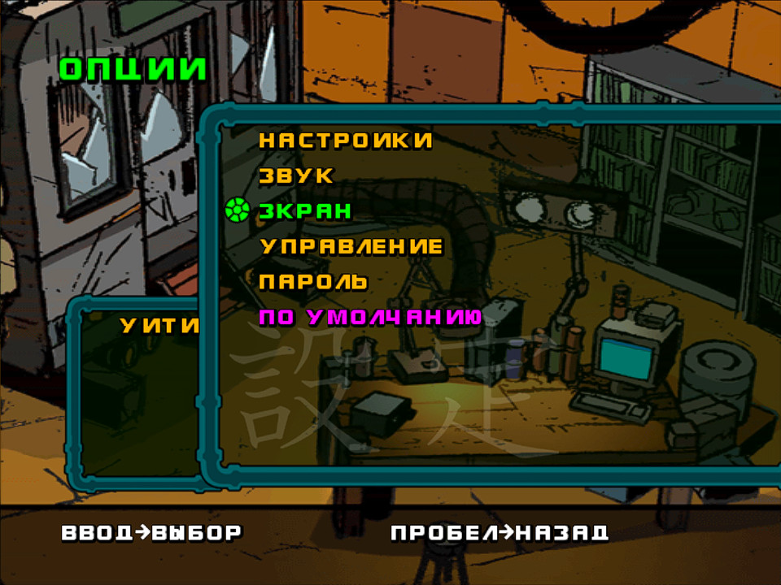
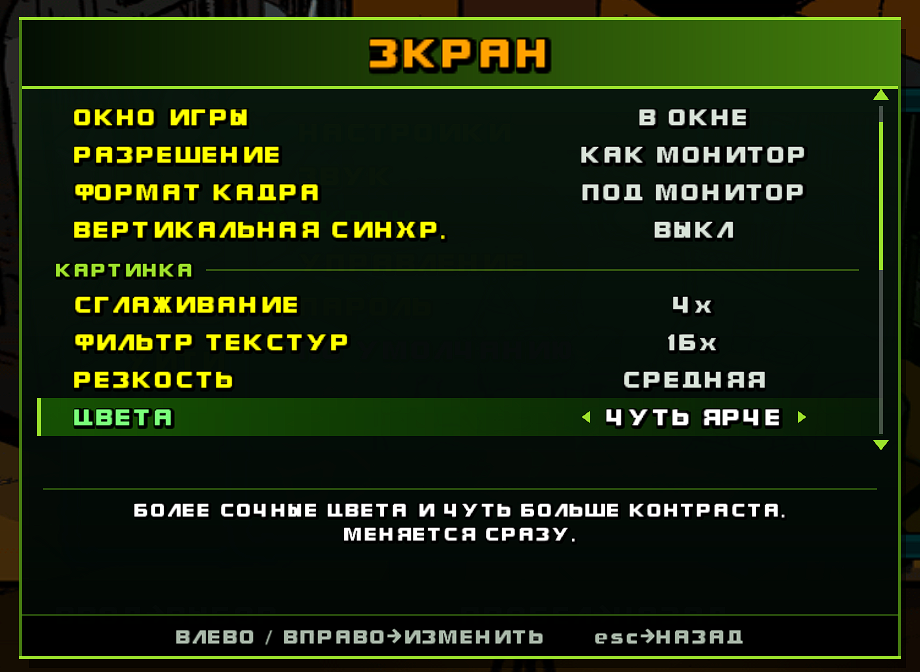
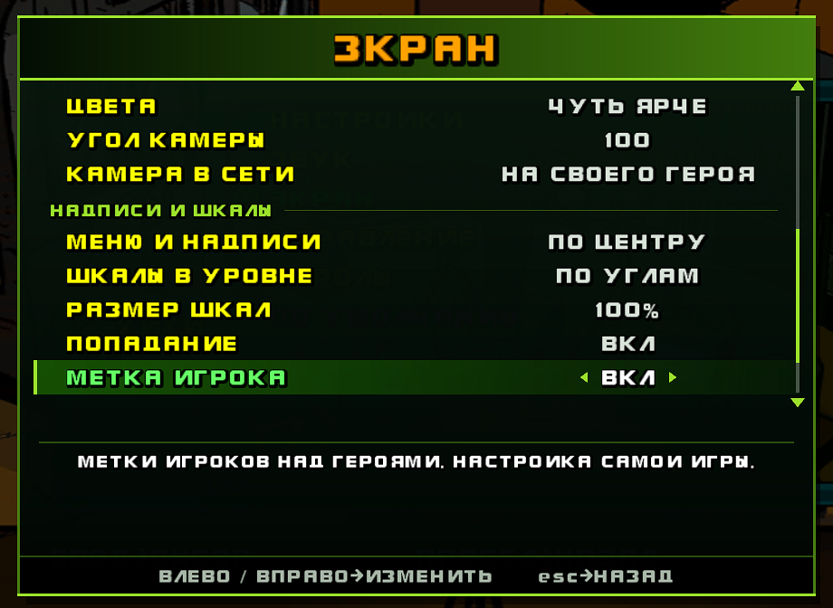

# Настройки

[← К описанию мода](../README.md)

Почти всё настраивается в самой игре, с подсказкой к каждой строке. Значения мод записывает в `tmnt2net.ini`
рядом с `TMNT2.exe`; этот же файл можно править вручную — изменения в нём применяются при следующем запуске
игры.

- [ОПЦИИ → ЭКРАН](#опции--экран)
- [НАСТРОЙКИ МОДА](#настройки-мода)
- [Справочник по tmnt2net.ini](#справочник-по-tmnt2netini)

## ОПЦИИ → ЭКРАН

  

Всё про экран и картинку собрано на одной странице в ОПЦИЯХ игры. Значение меняется стрелками влево и вправо
и сразу записывается. Большинство настроек действует тут же; те, которым нужен перезапуск игры, помечены
оранжевым.

**Окно и разрешение**

| Строка | Что делает | Ключ в ini |
|---|---|---|
| ОКНО ИГРЫ | окно без рамки на весь монитор или обычное окно | `mode` |
| РАЗРЕШЕНИЕ | все режимы вашего монитора и «КАК МОНИТОР»; меняется сразу, без перезапуска | `resolution` |
| ФОРМАТ КАДРА | под монитор (широкий экран), кадр 4:3 с полями или он же, растянутый на окно | `aspect` |
| ВЕРТИКАЛЬНАЯ СИНХР. | как в игре, выключена или включена | `vsync` |

**Картинка**

| Строка | Что делает | Ключ в ini |
|---|---|---|
| СГЛАЖИВАНИЕ | сглаживание краёв: выкл, 2x, 4x, 8x | `antialiasing` |
| ФИЛЬТР ТЕКСТУР | чёткость пола и стен под углом, до 16x | `anisotropy` |
| РЕЗКОСТЬ | резкость готового кадра: видны текстуры и мелкие детали | `sharpen` |
| ЦВЕТА | насыщенность и немного контраста | `colors` |
| УГОЛ КАМЕРЫ | обзор камеры, шире или уже | `fov` |
| КАМЕРА В СЕТИ | своя у каждого или одна на всех, как в оригинале | `own_camera` |

**Надписи и шкалы**

| Строка | Что делает | Ключ в ini |
|---|---|---|
| МЕНЮ И НАДПИСИ | в центре кадра в правильных пропорциях или растянуть на всю ширину | `hud` |
| ШКАЛЫ В УРОВНЕ | круг здоровья и таблички игроков по углам кадра или в середине | `gauges` |
| РАЗМЕР ШКАЛ | 100%, 85% или 70% | `gauges_size` |

Ниже на той же странице — собственные настройки игры: эффекты попаданий, метки игроков и окна помощи.

  
  
   
  Пункт ЭКРАН в ОПЦИЯХ игры и продолжение страницы: список прокручивается.

Во время сетевой сессии ЭКРАН открывает исходную страницу игры, без настроек мода: экран и картинку
настройте до начала сессии.

## НАСТРОЙКИ МОДА

  

Пункт главного меню. Здесь всё, что не про картинку.

| Строка | Что делает | Ключ в ini |
|---|---|---|
| КЛАВИШИ И МЫШЬ | раскладка: КАК В ИГРЕ, wasd + МЫШЬ или СВОИ | `[input] keys` |
| ГЕЙМПАДЫ | сколько геймпадов показать игре, 0–4 | `[input] pads` |
| КЛАВИАТУРА | один игрок или двое за одной клавиатурой | `[input] keyboard_players` |
| ИГРА В ФОНЕ | стоит на паузе или продолжается, пока окно не активно | `background` |
| ЗАСТАВКИ ПРИ ЗАПУСКЕ | показывать или пропускать | `intro` |

Подробнее о раскладках — в [описании управления](CONTROLS.md).

## Справочник по tmnt2net.ini

Файл лежит рядом с `TMNT2.exe`, в кодировке UTF-8. Ключ, которого в файле нет, берёт значение по умолчанию.

### [video]

| Ключ | По умолчанию | Значения |
|---|---|---|
| `intro` | `show` | `show` — заставки идут, любое нажатие их пропускает; `skip` — сразу главное меню |
| `mode` | `borderless` | `borderless` — без рамки на весь монитор; `windowed` — окно. Полноэкранного режима оригинала нет: в нём Alt+Tab останавливал игру, и сетевая игра у всех ждала |
| `resolution` | `auto` | `auto`; своё, например `1920x1080`; `game` — из `TMNT2.ini` |
| `aspect` | `auto` | `auto` — широкий экран: обзор шире, меню и ролики в центре 4:3; `4:3` — кадр 4:3 с чёрными полями; `stretch` — кадр 4:3, растянутый на окно. Камера игры при любом значении одна и та же |
| `hud` | `center` | `center` — меню и надписи в центре; `stretch` — на всю ширину |
| `gauges` | `corners` | `corners` — шкалы уровня по углам кадра; `center` — в середине 4:3 |
| `gauges_size` | `100` | размер шкал в процентах: `100`, `85`, `70` |
| `own_camera` | `1` | `1` — в сети камера следит за вашим героем; `0` — одна на всех |
| `camera_zoom` | `1.0` | приближение камеры колесом мыши, `0.5` ближе … `2.5` дальше; запоминается само |
| `fov` | `1.0` | обзор камеры, `0.5` … `2.0`; больше — шире |
| `antialiasing` | `4` | сглаживание MSAA: `0`, `2`, `4`, `8` |
| `anisotropy` | `16` | анизотропная фильтрация: `0` … `16` |
| `sharpen` | `50` | резкость кадра: `0` — выкл … `100` |
| `colors` | `25` | цвета: `0` — как в игре … `100` |
| `window_size` | `auto` | размер окна для `windowed`: `auto` — 3/4 высоты рабочего стола, или `1280x720` |
| `window_resize` | `1` | окно можно тянуть мышью, пропорции сохраняются |
| `vsync` | `-1` | `-1` — как в игре, `0` — выкл, `1` — вкл |
| `fps_limit` | `60` | кадров в секунду. Логика игры привязана к кадру: 60 — родная скорость; `0` — как в оригинале |
| `background` | `pause` | `pause` — игра ждёт, пока окно не активно; `run` — продолжает работать |
| `hide_cursor` | `1` | прятать указатель мыши над игрой |

Сглаживание работает, когда кадр заполняет окно: в режиме без рамки или в окне без масштабирования.

### [input]

| Ключ | По умолчанию | Значения |
|---|---|---|
| `pads` | `4` | сколько геймпадов показать игре через SDL, `0` … `4`; `0` — как в оригинале |
| `keyboard_players` | `1` | `2` — двое за одной клавиатурой |
| `keys` | — | 13 кодов клавиш; мод записывает строку сам, когда вы меняете клавиши в игре |

Порядок кодов в `keys`: атака, сильная атака, сюрикен, прыжок, подкат, блок, смена героя, камера, информация,
вверх, вниз, влево, вправо. Коды клавиш — как в DirectInput; кнопки мыши: `240` — левая, `241` — правая,
`243` и `244` — боковые.

### [net]

| Ключ | По умолчанию | Значения |
|---|---|---|
| `mode` | `off` | `off` — сетевая игра из меню игры; `host` — сразу открыть игру; `join` — сразу войти; `menu` — прежнее меню на чёрном экране |
| `join` | `steam` | куда входить при `mode = join`: `steam`, код `TMNT-XXXX-XXX`, `IP[:порт]` или SteamID64 хоста |
| `transport` | `auto` | `auto` — Steam, если он запущен, и LAN / IP всегда; `steam`; `enet` — только LAN / IP |
| `name` | имя в Steam или имя компьютера | ник для других игроков |
| `port` | `7790` | порт UDP для LAN / IP |
| `input_delay` | `auto` | задержка ввода в начале сессии, её задаёт хост; `auto` — по пингу, от 2 до 10 кадров. Дальше каждый игрок подстраивает свою задержку сам, до 12 кадров |
| `lobby_type` | `friends` | кто видит игру хоста в Steam: `friends` или `public` |
| `timeout_ms` | `8000` | игрок, от которого столько миллисекунд нет данных, выбывает |
| `steam_invites` | `1` | принимать приглашения Steam, пока игра идёт без сети |
| `wide` | `1` | `1` — в сети кадр под форму вашего монитора; `0` — у всех 16:9 с полями |
| `player_id` | создаётся сам | номер этого ПК: по нему хост узнаёт вернувшегося игрока |

### [fixes]

| Ключ | По умолчанию | Что исправляет |
|---|---|---|
| `gamepad_snapshot` | `1` | «Unkown Error» при запуске |
| `keyboard_focus` | `1` | вылет, если во время загрузки окно не активно |
| `all_modes` | `1` | все разрешения монитора в меню игры вместо трёх |
| `esc_back` | `1` | Esc — назад в меню игры |

### [log]

| Ключ | По умолчанию | Значения |
|---|---|---|
| `level` | `info` | подробность `tmnt2net.log`: `error`, `warn`, `info`, `debug` |
| `exceptions` | `1` | записывать в журнал ошибки в коде игры |

### [debug]

Для разработки и проверки. В обычной игре не нужны.

| Ключ | По умолчанию | Значения |
|---|---|---|
| `multi_instance` | `0` | разрешить вторую копию игры на одном ПК |
| `determinism` | `0` | журнал кадров `tmnt2net-sim.log`: одинаковый ввод должен давать одинаковые строки |
| `record`, `replay` | — | записать ввод каждого кадра в файл и повторить запись |

Остальные отладочные ключи описаны в [устройстве мода](ARCHITECTURE.md#проверка-и-отладка).
