# Что мод добавляет и что меняет — в картинках

[← К описанию мода](../README.md)

Все снимки сделаны в игре с модом версии 0.16.x. Имена игроков на них вымышлены.

- [Лаунчер](#лаунчер)
- [Было и стало](#было-и-стало)
- [Главное меню](#главное-меню)
- [Картинка](#картинка)
- [ОПЦИИ → ЭКРАН](#опции--экран)
- [НАСТРОЙКИ МОДА и управление](#настройки-мода-и-управление)
- [СЕТЕВАЯ ИГРА](#сетевая-игра)
- [Выбор героя](#выбор-героя)
- [Карта мира](#карта-мира)
- [В уровне](#в-уровне)
- [Вход в идущую игру](#вход-в-идущую-игру)
- [Пауза и выход из сессии](#пауза-и-выход-из-сессии)
- [Итоги района](#итоги-района)

## Лаунчер

В оригинале ничего похожего нет: мод ставится, обновляется и запускает игру одним файлом,
`tmnt2net-launcher.exe`. Мод лежит внутри него.

  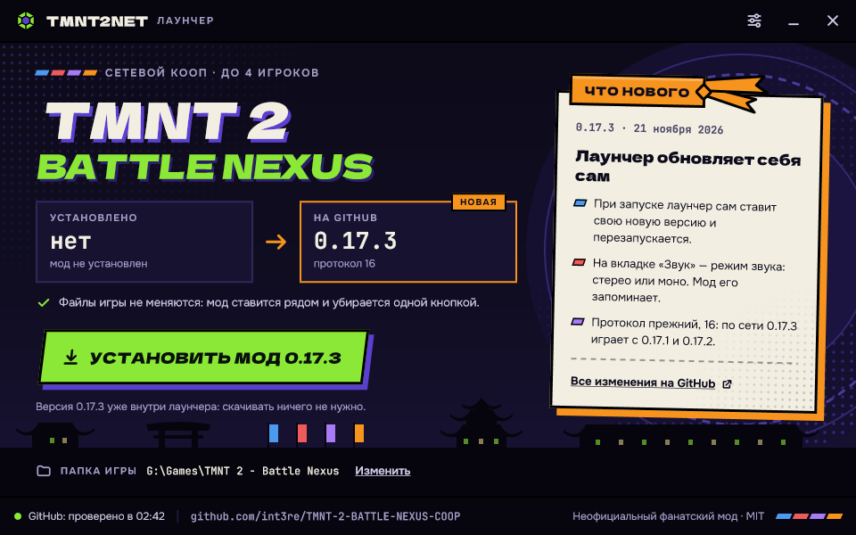
  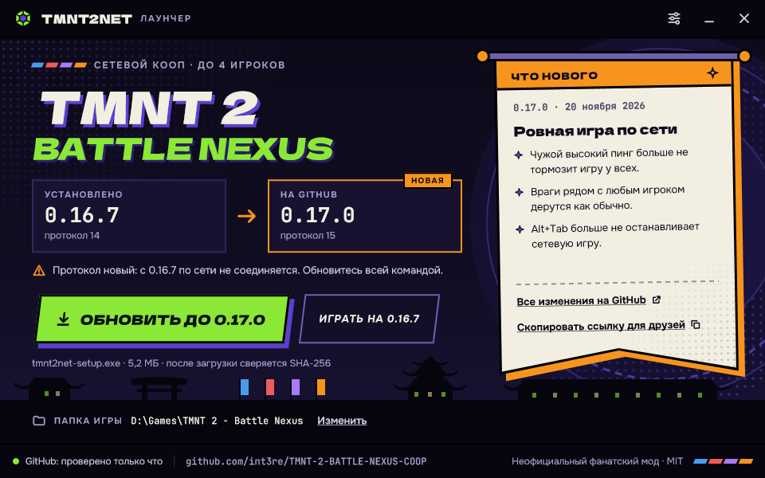

| | |
|---|---|
| **Первый запуск** | лаунчер находит игру и ставит мод одной кнопкой, без загрузки |
| **Новая версия** | видно, что изменилось и совместима ли она по сети с вашей; обновление — одной кнопкой, со сверкой SHA-256 |
| **Игра открыта** | лаунчер ждёт, пока её закроют, или сам просит её закрыться |
| **Настройки** | прокси для GitHub, журналы мода, удаление мода, цвет оформления |
| **Настройки игры** | вкладки «Графика», «Звук» и «Управление»: картинка, громкость и клавиши — до запуска игры |

Все экраны и подробности — на [странице лаунчера](LAUNCHER.md).

## Было и стало

| | В оригинале | С модом |
|---|---|---|
| **Запуск на Windows 10/11** | «Unkown Error», игра не стартует | запускается |
| **Alt+Tab во время загрузки** | вылет с ошибкой | игра продолжает работать |
| **Режим экрана** | только полный экран | окно без рамки на весь монитор, обычное окно; Alt+Enter |
| **Разрешение** | 640×480, 800×600, 1024×768 | любой режим монитора, меняется сразу |
| **Широкий экран** | кадр 4:3 растянут вширь | обзор шире, пропорции верные |
| **Скорость игры** | 53–57 кадров в секунду, игра идёт медленнее | ровно 60 |
| **Качество картинки** | без сглаживания и фильтрации | сглаживание до 8x, фильтр текстур 16x, резкость, цвета |
| **Геймпады** | только DirectInput, у геймпадов Xbox кнопки перепутаны | Xbox, PlayStation, Switch Pro; подключение на ходу |
| **Мышь** | не используется | кнопки мыши как клавиши, колесо приближает камеру |
| **Пауза** | только клавиша Esc | Esc, Enter, START и BACK на геймпаде |
| **Esc в меню** | не действует | назад |
| **Заставки** | идут до конца или до нажатия Start | пропускаются любым нажатием, можно отключить |
| **Кооператив** | до 4 игроков за одним ПК | то же по сети: Steam, локальная сеть, IP |
| **Камера** | одна на всех | в сети у каждого своя |
| **Расстояние между игроками** | никто не отойдёт от команды дальше общего экрана | в сети можно расходиться как угодно |
| **Здоровье** | одно на команду | у каждого своё; напарника можно поднять |
| **Костюмы и герои** | открываются по ходу игры, костюмы — «секретными» кнопками | открыты сразу, выбираются стрелками |
| **После района** | танцует только MVP | танцует вся команда, на экране итоги по игрокам |
| **Главное меню** | НОВАЯ ИГРА, ПРОДОЛЖИТЬ, ОПЦИИ, ВЫХОД | добавлены СЕТЕВАЯ ИГРА и НАСТРОЙКИ МОДА |
| **Настройки экрана** | несколько настроек в ОПЦИЯХ | целая страница: окно, разрешение, картинка, шкалы |

## Главное меню

  

**Добавлено:** пункты **СЕТЕВАЯ ИГРА** и **НАСТРОЙКИ МОДА**, строка с версией мода под меню.

**Изменено:** последний пункт в русской версии снова называется «ВЫХОД» — в переводе было «УИТИ». Esc работает
как «назад» во всех меню.

## Картинка

  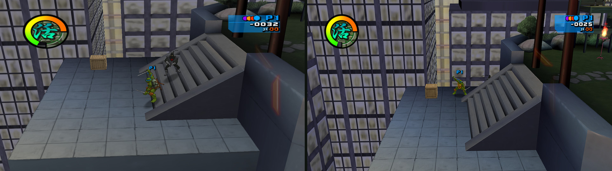 
  Один и тот же район на мониторе 16:9. Слева — как показывает оригинал: кадр 4:3 растянут, круг здоровья
  стал овалом. Справа — с модом: обзор шире, пропорции верные.

  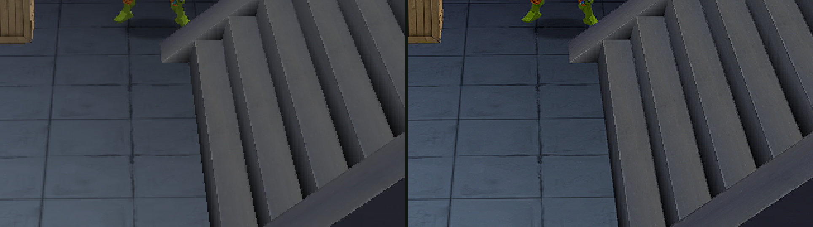 
  Увеличенный фрагмент кадра. Слева — без обработки, справа — со сглаживанием 4x, фильтром текстур 16x
  и резкостью: края ступеней ровные, плитка читается.

**Добавлено:** широкий экран без растяжения, сглаживание, анизотропная фильтрация, резкость и цвета готового
кадра, угол обзора, приближение камеры колесом мыши, окно без рамки и обычное окно.

**Изменено:** игра идёт ровно на 60 кадрах в секунду; круг здоровья и таблички игроков стоят в углах широкого
кадра, а меню и надписи — в его середине в правильных пропорциях.

## ОПЦИИ → ЭКРАН

Всё про экран и картинку — на одной странице в ОПЦИЯХ самой игры. Править ini-файл не нужно.

  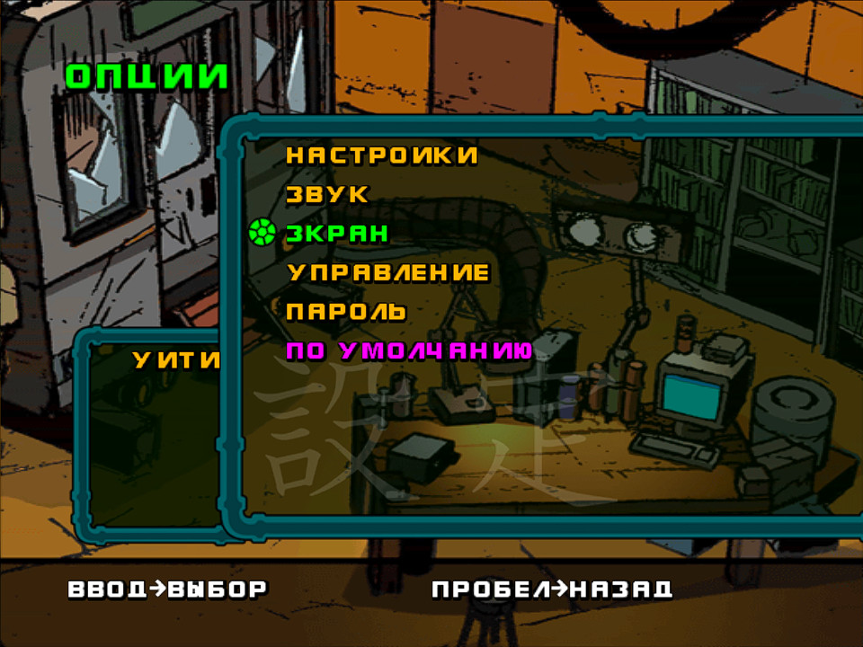
  

  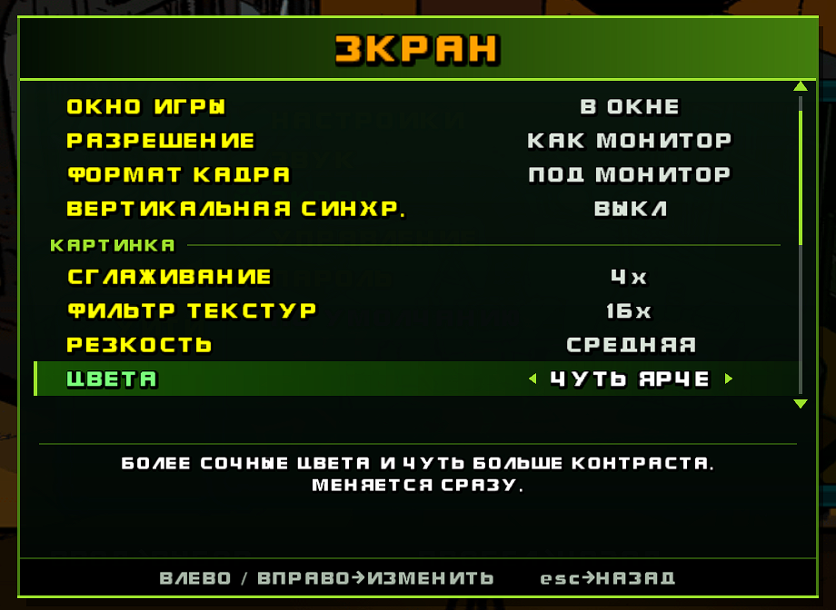
  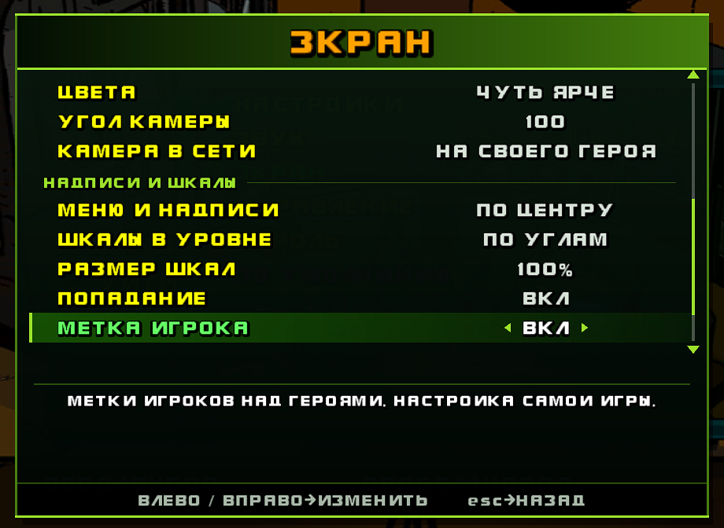

**Добавлено:** страница из трёх разделов — ОКНО И РАЗРЕШЕНИЕ, КАРТИНКА, НАДПИСИ И ШКАЛЫ. Под списком — подсказка
к выбранной строке и пометка, действует ли настройка сразу или после перезапуска.

**Изменено:** пункт ЭКРАН в ОПЦИЯХ игры открывает эту страницу. Собственные настройки игры с прежней страницы
(попадания, метки игроков, помощь) перенесены в её конец.

Подробно о каждой строке — в [настройках](SETTINGS.md).

## НАСТРОЙКИ МОДА и управление

  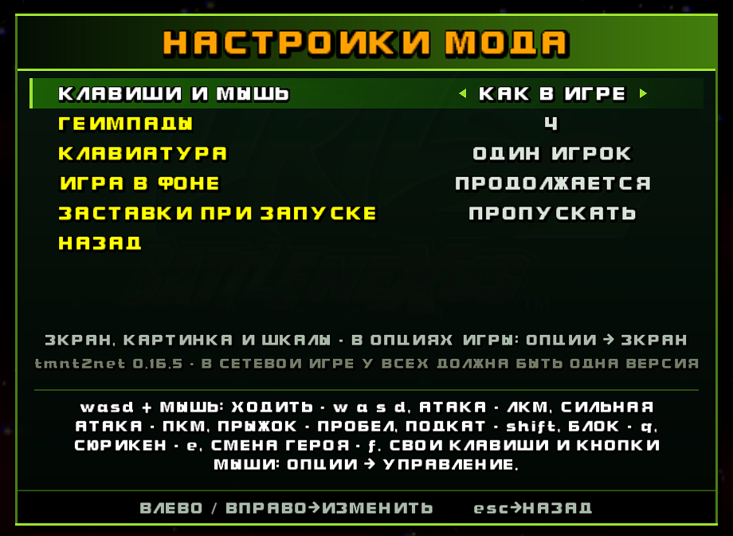
  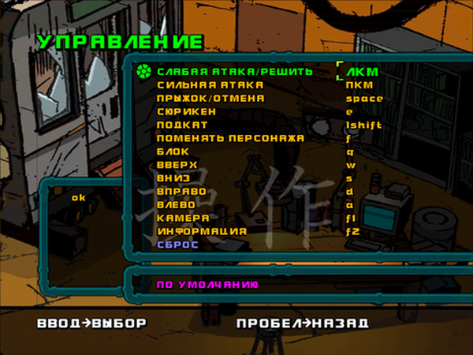

**Добавлено:** страница НАСТРОЙКИ МОДА в главном меню — раскладка клавиш, число геймпадов, клавиатура на двоих,
игра в фоне, заставки. Готовая раскладка «wasd + МЫШЬ».

**Изменено:** на странице клавиш игры (ОПЦИИ → УПРАВЛЕНИЕ) действию теперь можно назначить кнопку мыши: в
списке она подписана ЛКМ, ПКМ, МЫШЬ 4 или МЫШЬ 5.

Подробно — в [описании управления](CONTROLS.md).

## СЕТЕВАЯ ИГРА

Целиком новый раздел игры. Все страницы нарисованы шрифтом игры и в цветах её окон.

**Первая страница** — три пути и памятка «как играть вместе»:

  

**Страница хоста** — четыре места, готовность и пинг каждого игрока, код игры. Слева — игра вдвоём, с пунктом
ПОЗВАТЬ ДРУГА; справа — вчетвером по коду, без Steam:

  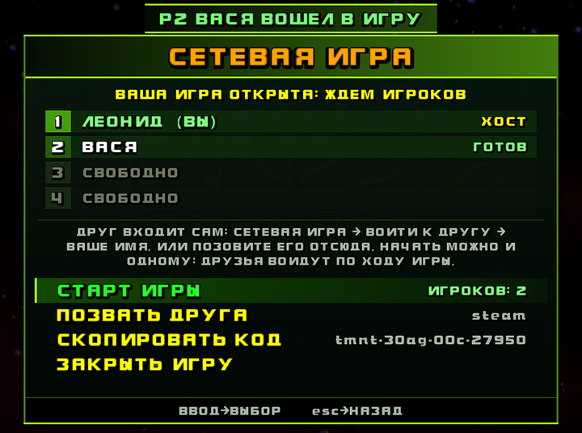
  

**У остальных игроков** — список открытых игр друзей и страница ожидания старта:

  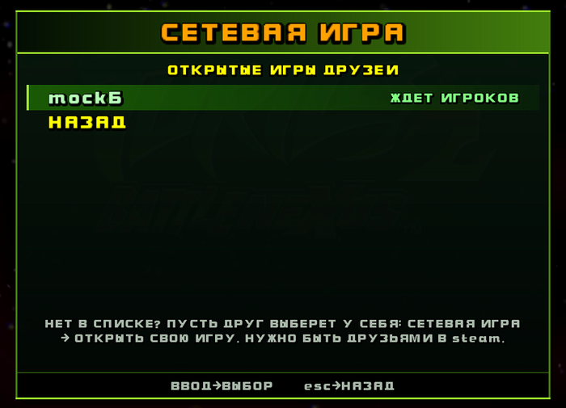
  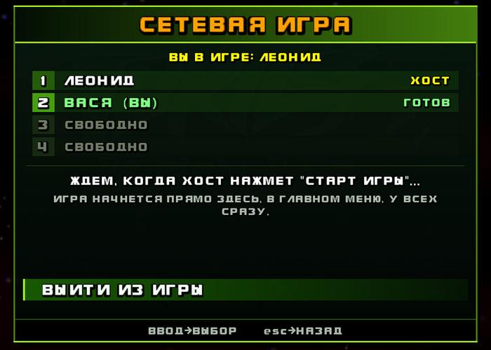

  Сетевые страницы сняты на тестовом стенде, без настоящего Steam: в списке вместо ника друга стоит
  условное имя «mock6».

**Вход по коду или IP** — код набирается в игре, Ctrl+V вставляет:

  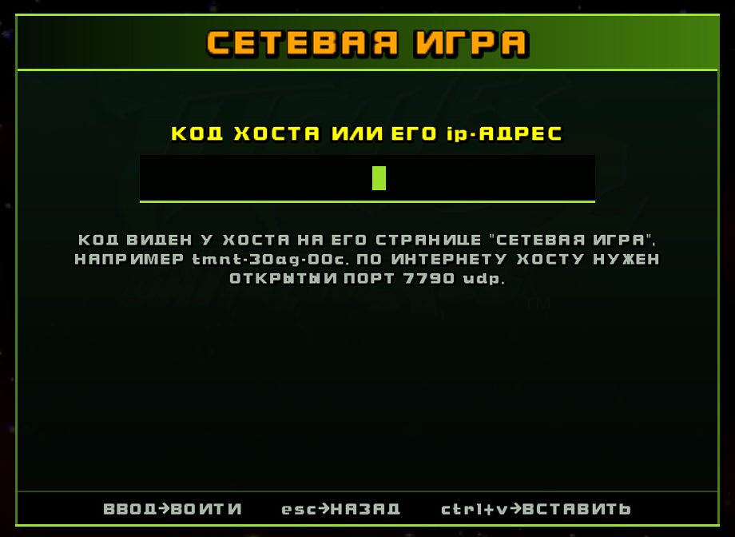

**Старт** — сессия начинается прямо в главном меню, игра не перезапускается. Сверху сообщение мода:

  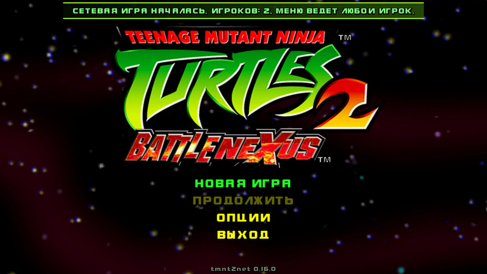

Подробно — в [руководстве по сетевой игре](NETPLAY.md).

## Выбор героя

  
  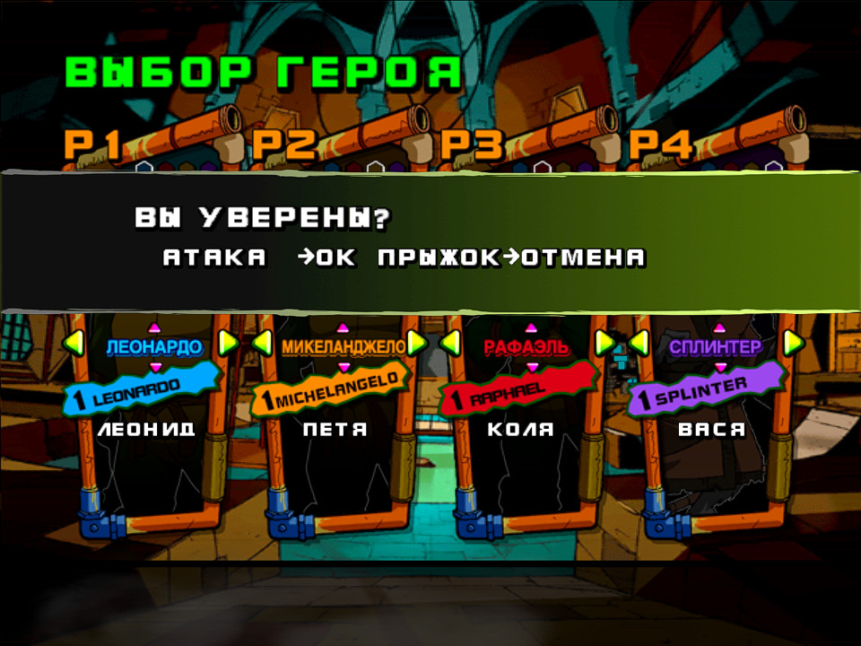

**Добавлено:** строка **КОСТЮМ** над именем героя — стрелки вверх и вниз листают ОБЫЧНЫЙ, САМУРАЙ, НЕКСУС и
ДРУГОЙ ГЕРОЙ. Под рамкой каждого игрока — его ник.

**Изменено:** все костюмы и герои доступны сразу. Курсор не останавливается на герое, которого уже взял другой
игрок. Плашка «ВЫ УВЕРЕНЫ?» на широком экране больше не растягивается на весь кадр.

## Карта мира

  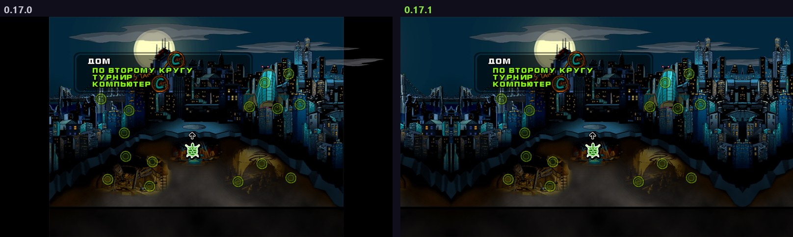 
  Слева — 0.17.0, справа — 0.17.1

**Изменено:** на широком экране карта занимает весь кадр. Её картинка нарисована под 4:3, поэтому по бокам она
продолжена собственным отражением; облака, луна и планеты рисуются как есть. Метки уровней, черепашка и меню
остались на местах. Вернуть чёрные поля: `map = center` в `tmnt2net.ini`.

**Добавлено:** **Esc** открывает меню карты — выбор персонажа, информация, опции, сохранить, загрузить, в главное
меню. Раньше оно открывалось только клавишей блока, и уйти с карты в главное меню было нечем.

## В уровне

  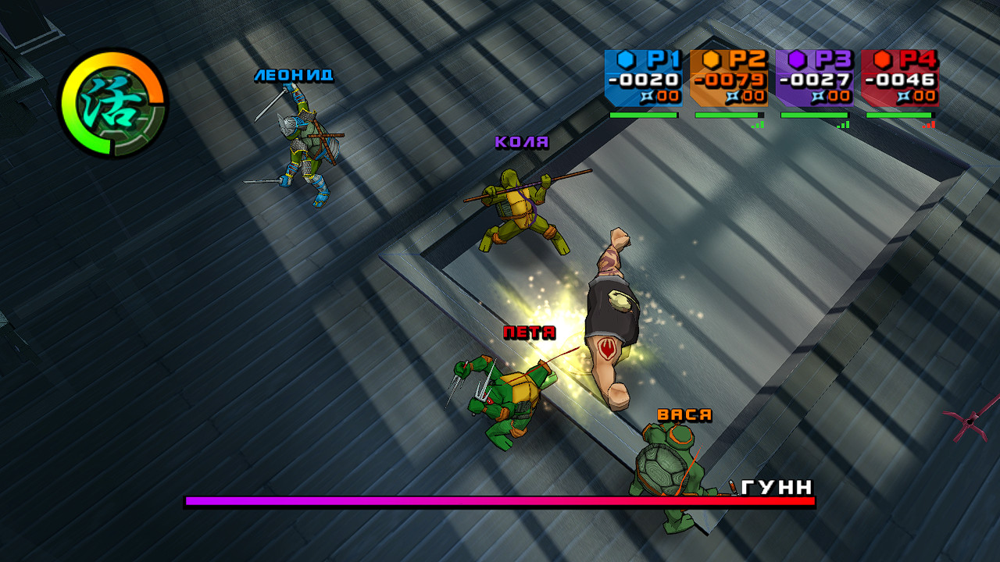

**Добавлено:**

- ник игрока над героем, цветом его героя;
- полоска здоровья под табличкой каждого игрока;
- значок связи под табличкой — как на телефоне;
- ник со стрелкой у края экрана, если напарник ушёл за кадр.

**Изменено:** круг здоровья слева показывает здоровье вашего героя, а не общее на команду.

  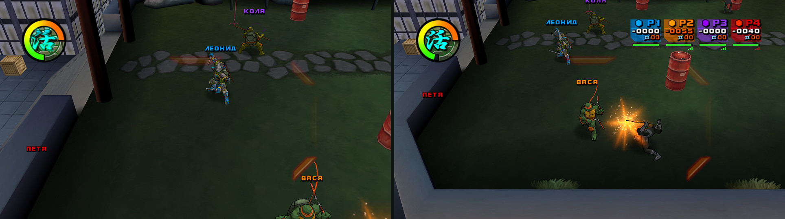 
  Один и тот же момент на двух ПК. Слева — общая камера, как в оригинале: она держит в кадре всех.
  Справа — своя камера: она следит за героем этого игрока.

## Вход в идущую игру

  

**Добавлено:** к сессии можно подключиться в любой момент. Пока игра догоняет остальных, на экране загрузка с
процентами; после неё игрок сразу в уровне, с героем команды.

## Пауза и выход из сессии

  
  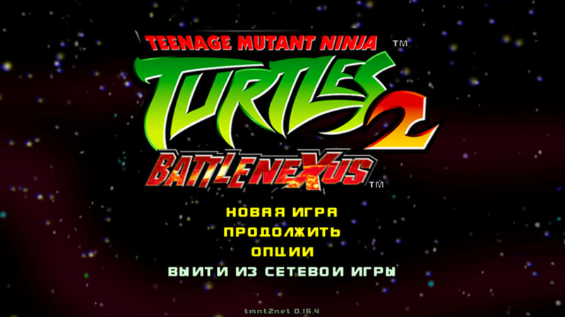

**Изменено:** меню паузы открывается в сетевой игре и с геймпада. В главном меню сессии последний пункт —
**ВЫЙТИ ИЗ СЕТЕВОЙ ИГРЫ**: он заканчивает сессию, а не закрывает игру.

## Итоги района

  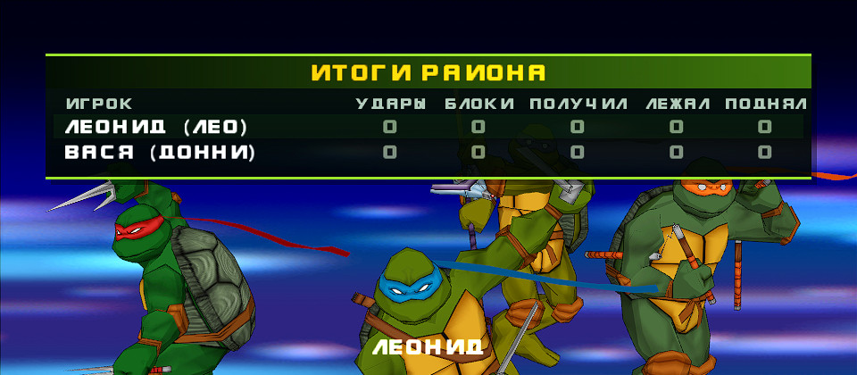

**Добавлено:** пока команда танцует после района, сверху таблица по игрокам — удары, блоки, сколько раз получил,
сколько лежал и скольких поднял.

**Изменено:** танцует вся команда, а не только MVP.
