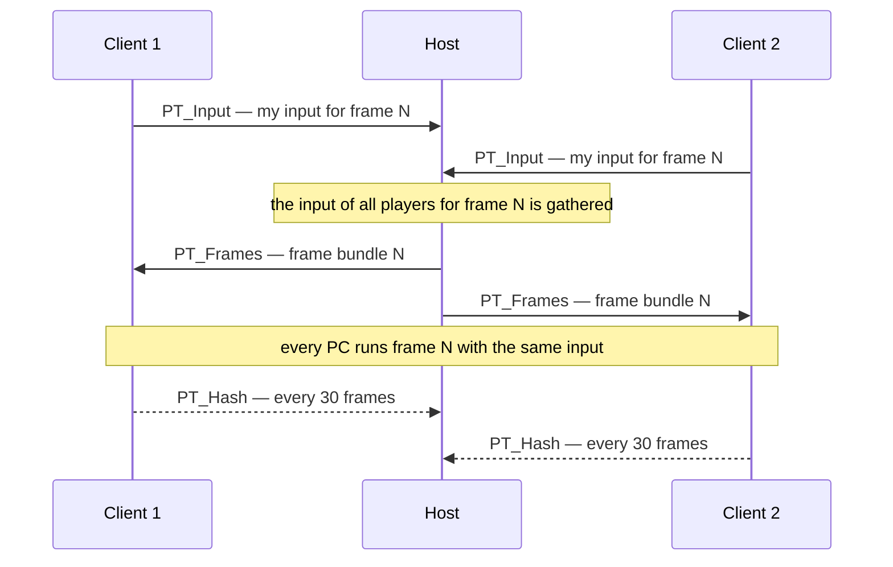

# Architecture

[← Back to the mod's page](../../README.en.md) · [All documentation](README.md) · [Русский](../ARCHITECTURE.md)

A page for those who want to understand the code or work on the mod.

- [How the mod gets into the game](#how-the-mod-gets-into-the-game)
- [Rules for working with the game's code](#rules-for-working-with-the-games-code)
- [Source map](#source-map)
- [The deterministic frame](#the-deterministic-frame)
- [Network play: lockstep](#network-play-lockstep)
- [Starting a session](#starting-a-session)
- [Joining a running game](#joining-a-running-game)
- [Drops and desync](#drops-and-desync)
- [What each PC has of its own](#what-each-pc-has-of-its-own)
- [Transports](#transports)
- [The interface in the game](#the-interface-in-the-game)
- [Protocol version](#protocol-version)
- [Testing and debugging](#testing-and-debugging)
- [References](#references)

## How the mod gets into the game

```
TMNT2.exe
  └─ imports winmm.dll ──► Ultimate ASI Loader (it lies in the game folder under this name)
       └─ loads tmnt2net.asi and calls InitializeASI()
            ├─ reads tmnt2net.ini, opens tmnt2net.log
            ├─ computes the SHA-256 of the TMNT2.exe file
            │    └─ not that file → the mod touches nothing, the game runs as without it
            └─ installs its hooks, module by module
```

`InitializeASI()` is called before the game's `WinMain` and outside the Windows loader lock, so every hook is
in place before the game runs its first line. The order in which the modules are installed is in
`src/mod/dllmain.cpp`.

## Rules for working with the game's code

- **The file on disk is never changed.** Every change is made in the process's memory.
- **One supported file.** The addresses in `src/mod/game.h` are right only for the `TMNT2.exe` with SHA-256
  `22f49908…42d8b6a`. The mod checks the hash at start-up.
- **Every hook checks the bytes.** Next to an address in `game.h` are the first bytes of the function. Before
  installing a hook the mod compares them with memory; if they differ, the hook is skipped, a warning goes to
  the log, and the rest works.
- **The game's own functions instead of the mod's.** Wherever possible the mod calls the game's code: its font
  and menu sounds, its change of video mode, its loading of the progress record, its volume setting.

The hooks are installed by [MinHook](https://github.com/TsudaKageyu/minhook); the wrappers around it, byte
writes and the replacement of entries in virtual function tables are in `src/mod/patch.cpp`.

## Source map

```
src/
  common/   shared code: log, SHA-256, network, transports, Steam, protocol
  mod/      the mod itself: tmnt2net.asi
  launcher/ the launcher tmnt2net-launcher.exe: the mod is inside it
dist/       the default tmnt2net.ini and the description for players
re/         reverse-engineering notes on TMNT2.exe
tools/      the frame-processing shader, the check that the build is 32-bit, the launcher's fonts and icon, the release description
third_party/minhook
```

### src/mod

| File | What it is responsible for |
|---|---|
| `dllmain.cpp` | entry point, hash check, the order in which the modules are installed |
| `game.h` | addresses and check bytes of the game's functions |
| `patch.cpp` | hooks, writes to memory, virtual function tables |
| `config.cpp` | reading `tmnt2net.ini` |
| `fixes.cpp` | fixes for the game's bugs ("Unkown Error" and others), writing its exceptions to the log |
| `video.cpp` | window modes, creating the Direct3D device, resolution, antialiasing, the frame limit, presenting the frame |
| `postfx.cpp` | sharpness and colours of the finished frame with one pixel shader |
| `widescreen.cpp` | widescreen: the cameras' view, the layout of menus and texts, gauges in the corners |
| `camera.cpp` | own camera on every PC, zoom with the wheel, field of view |
| `input.cpp` | keyboard, mouse buttons as keys, layouts, the volume and the player's keys in `tmnt2net.ini`, scripts for test runs |
| `pads.cpp` | gamepads through SDL2 as the game's virtual joysticks, the keyboard as a gamepad |
| `sim.cpp` | the deterministic frame: the frame's input, the frame log, loading inside a frame |
| `netplay.cpp` | sessions: lobby, start, frame bundles, checksums, joining a running game, a player's return |
| `midjoin.cpp` | a player who joined in the middle of a stage gets one of the team's heroes |
| `netpage.cpp` | the NETWORK GAME (СЕТЕВАЯ ИГРА) page |
| `menus.cpp` | the title menu's items, the SCREEN (ЭКРАН) and MOD SETTINGS (НАСТРОЙКИ МОДА) pages, pause |
| `pageui.cpp`, `gamefont.cpp` | the look of the mod's pages, and texts in the game's font |
| `overlay.cpp` | texts over the frame outside the game's scene: loading, waiting for a player |
| `coop.cpp` | names over the heroes, character select and costumes, icons on the map, the team's dance |
| `health.cpp` | each player's own health, falling asleep and getting up |
| `results.cpp` | the area results table |

### src/common

| File | What it is responsible for |
|---|---|
| `protocol.h` | the packet format and the protocol version |
| `transport.h` | the common transport interface |
| `transport_enet.cpp` | ENet: LAN and a direct connection by IP |
| `transport_steam.cpp` | Steam: `ISteamNetworkingMessages`, NAT traversal and relaying by Steam's own means |
| `lobby_steam.cpp` | Steam lobbies: how players find each other |
| `steam_boot.cpp`, `steam_real.cpp`, `steam_stub.cpp` | starting Steam, the real calls, and a stub for a build without the SDK |
| `steam_mock.cpp` | the lab: a mock of Steam for several copies of the game on one PC |
| `joincode.cpp` | join codes: an IP address and port in the form `TMNT-XXXX-XXX` |
| `net.cpp`, `log.cpp`, `sha256.cpp` | sockets, log, hash |

### src/launcher

[The launcher](LAUNCHER.md) stays outside the game. It carries the mod's files in its resources, puts them into
the game folder and removes them from there by itself; a new version of the mod arrives as a new launcher. One
program with no dependencies.

| File | What it is responsible for |
|---|---|
| `main.cpp` | the window, mouse and keyboard, what every press does, background work, the test modes without a window |
| `view.cpp` | the picture: every screen is drawn from the state in `launcher.h`; it also tells where what can be clicked |
| `gfx.cpp` | Direct2D and DirectWrite: fonts from the exe's resources, outlines from SVG strings, a screen to a PNG file |
| `core.cpp` | the game folder and the mod in it, settings, the release description `tmnt2net-latest.json`, downloading a new launcher |
| `gameset.cpp` | the game's settings on the tabs **ГРАФИКА** (Graphics), **ЗВУК** (Sound) and **УПРАВЛЕНИЕ** (Controls): the rows, their values, reading and writing `tmnt2net.ini` |
| `package.cpp` | the mod inside the launcher's file: reading its list and files, installing and removing by `tmnt2net-install.txt` |
| `net.cpp` | HTTP through WinHTTP: directly, through the Windows proxy or a given one |

## The deterministic frame

Lockstep works only if the game, given the same input, runs the same on any PC. The original cannot do that:
it skips frames, loading takes a different number of frames, and the logic asks about things that depend on
real time. `sim.cpp` fixes this.

- **The frame's input is fixed at one point**: in `CPCInputsDevice::Sync`. There the `FrameInput` structure is
  gathered: the keyboard, four gamepads and the answers to what the logic asks of real time — "the movie has
  ended", "a voice is still playing". During the frame the game reads only that structure.
- **Drawing is never skipped**: drawn effects take random numbers, and skipping a frame would change their
  sequence.
- **Loading finishes inside the frame** that waits for it: the number of frames a load takes no longer depends
  on the disk.
- **The game thread's arithmetic is the same.** Direct3D leaves the game's thread at single x87 precision with
  rounding to nearest, and all of the game's arithmetic runs that way. Foreign code in the process — an
  overlay, screen capture — can leave another precision, and then that PC computes other numbers: a few frames
  later it has a different game. At the start of every frame and before drawing the mod returns the x87
  control word and MXCSR to the game's own values, and writes the change to the log.
- **The frame log** `tmnt2net-sim.log`: the frame number, the random number generator's epoch, the number of
  its calls, a hash of its state and a hash of the input. Two copies of the game with the same input must write
  the same lines.

## Network play: lockstep

Every PC runs the whole game. Only input travels over the network.



- **A star around the host.** Clients send their input to the host, and the host sends everyone the finished
  frame bundle. Nobody runs frame N before receiving its bundle.
- **Input delay.** Every PC samples its input a few frames ahead, so that the bundle has time to arrive. If
  input is late, the host waits and the game stands still for everyone: with a delay of d frames and a
  round-trip time R the game makes no more than d / R frames per second. The host takes the starting delay from
  the first pings, from 2 to 10 frames. After that every client keeps its own: once a second the host reports
  in the player list how many frames to spare each player's input arrived with, and the client raises or
  lowers its delay (up to 12 frames). This does not affect how the game plays: the host needs exactly one input
  from every player for every frame, and a client that changes its delay neither skips nor repeats frames.
- **Two channels.** Control packets go over a reliable ordered channel, input and frame bundles over an
  unreliable one.
- **Redundancy instead of resends.** Every input packet and every frame-bundle packet carries the last 8
  frames, so the loss of individual packets does not hold the game up.
- **Speed.** The game runs at the speed of the slowest participant: a frame waits for everyone's input.

### Packets

All the structures are in `src/common/protocol.h`: packed, little-endian, no pointers.

| Packet | Direction | Purpose |
|---|---|---|
| `PT_Hello` | client → host | the hash of `TMNT2.exe`, the mod's version, the name, the PC's number |
| `PT_Welcome` | host → client | the player's number; a flag that the game is already running |
| `PT_Reject` | host → client | a refusal with the reason: version, no free places, a different exe |
| `PT_Roster` | host → all | who is in the game, readiness, pings, whom the game is waiting for |
| `PT_Record` | host → a player | the progress record everyone plays with, and the host's settings |
| `PT_Start` | host → all | the start: input delay, participants |
| `PT_Input` | client → host | own input, the last 8 frames |
| `PT_Frames` | host → clients | frame bundles, the last 8 |
| `PT_Hash` | client → host | a checksum of the state |
| `PT_Desync` | host → all | from which frame and for whom the checksums differ |
| `PT_History` | host → the joining player | every frame bundle since the first, 18 per packet |
| `PT_Alive`, `PT_Bye` | client → host | "I am here" in the lobby, and leaving on purpose |

## Starting a session

A session starts in the title menu of a game that is already running: no restart is needed. So that every PC
starts from the same state:

1. the host sends out the game's **progress record** (`CGameData::Record`, 0x968 bytes): it becomes the same
   for everyone for the length of the session;
2. the host sends out the **settings that affect how the game plays**: difficulty, autosave, hit effects, help
   windows;
3. at `PT_Start` every PC begins, in the same frame, to read its input from the frame bundles.

After the session everyone gets their own record and their own settings back. The shared progress is saved in
`tmnt2net-coop.rec`.

## Joining a running game

The game's state is never sent over the network: there is nothing to capture it with and nothing to apply it
with. A player who joins gets the **history**: every frame bundle since the session's first frame, and their
game replays them by itself.

- The history goes over the reliable channel, in pieces: for a half-hour session it is megabytes, and the
  transport does not accept that much at once.
- The game's code runs for every frame of the history: that is exactly what makes the game the same. But there
  is no reason to draw those frames: while the game catches up, Direct3D draw calls are skipped, the sound is
  off, and a loading frame is on the screen. That way catching up runs roughly 37 times faster than the game.
- Once the joining player's input has reached the current frame, the host takes them into the participants. In
  that same frame, on every PC, `midjoin.cpp` gives them one of the team's heroes.

## Drops and desync

- **Silence.** A player from whom no data has come for longer than `timeout_ms` is taken out of the
  participants: their participant bit in the frame bundles is cleared, and this happens in the same frame on
  every PC.
- **Back in place.** If the dropped player's game has not been closed and the link has come back, the host
  knows them by the same link, sends the frame bundles they missed, and they are among the participants again.
- **Joining again.** After a restart the player is known by their Steam ID or by `player_id` from
  `tmnt2net.ini` and gets their place back.
- **Checksums.** Every 30 frames the clients send the host the number of calls of the random number generator
  and a hash of its state. If the checksums differ, the host announces `PT_Desync`, and the client that went
  its own way joins the session again — up to four times; after two minutes of even play the count starts
  over. If that does not help, the client leaves the session. At every mismatch both sides save copies of
  their logs (`tmnt2net-desync-*.log`): comparing the frame logs shows the first frame that differs.
- **Every session from a clean slate.** A game takes part in one session after another without a restart, so
  when the lobby opens every buffer of the previous session — input, frame bundles, history, checksums — is
  cleared.

## What each PC has of its own

Everything that affects the logic must be the same. Everything else the mod does only while drawing, and each
PC has its own:

- **Distance between players.** In the original, `CGameProperty::AdjustWithinMoveBoundary` does not let a
  player out of a circle around the point the stage camera looks at. In a session there is no such boundary —
  the same on every PC, since it is part of the logic.
- **What the camera sees.** The logic asks the stage camera whether an enemy or a point is in view: the answer
  decides whether a shooter fires, whether an enemy "sees" its target, whether a generator removes an enemy,
  whether a stage effect runs. In a session being near any player also gives the answer "yes", so a player who
  has gone far from the team is not left with half-asleep enemies. The rule is the same on every PC.
- **Camera.** The game has one stage camera, and it is part of the logic: enemy activity and lines of sight
  depend on it. Every PC keeps computing it the same way, in the 16:9 shape. `camera.cpp` replaces the
  camera's frame only while the scene is drawn: it centres it on the PC's own player and applies the wheel
  zoom and the field of view.
- **Widescreen and frame shape.** The view is widened while drawing; menus and texts are laid out in the 4:3
  middle. The frame shapes 4:3 and STRETCH (РАСТЯНУТЬ) are only the shape and the presentation of the frame:
  the cameras are the same with them.
- **Frame processing.** Antialiasing, texture filter, sharpness, colours.
- **Keys.** Everyone has their own keyboard layout: what goes into the session is already the state of their
  gamepad.

## Transports

The packet format knows nothing about the transport: `transport.h` is the common interface, and there are
three implementations.

| Transport | When it is used |
|---|---|
| **Steam** | `ISteamNetworkingMessages`: Steam itself picks a direct or a relayed route, no ports need forwarding. Players find each other through Steam lobbies |
| **ENet** | LAN and a direct connection by IP, UDP port 7790. Always works, including without Steam |
| **mock** | for tests only: a mock of Steam on one PC — made-up SteamIDs, UDP on localhost, lobbies as files |

For Steam the mod uses AppID 480, Valve's test application Spacewar. `steam_api.dll` is delay-loaded, only
when it is needed.

## The interface in the game

The mod's pages are drawn inside the game's 2D scene with the game's own means:

- **`gamefont.cpp`** writes in the game's font through the game's functions, so the texts look native and use
  the letters of your translation of the game;
- **`pageui.cpp`** draws windows in the colours of the game's message windows: a dark background, lime lines,
  a heading, a highlight on the selected row, a line of hints;
- **`menus.cpp`** adds items to the game's title menu and builds the SCREEN (ЭКРАН) page into its OPTIONS
  (ОПЦИИ);
- **`overlay.cpp`** draws over the frame what must be visible when the game's scene is not being drawn: the
  connecting screen, the window that waits for a player.

The pages' coordinates are the game's 2D space: x from −320 to 320, y from −240 to 240, the 4:3 middle.

## Protocol version

`kVersion` in `protocol.h` changes not only when the packets change. It must be raised **every time the mod
changes how the game itself plays**: lockstep needs the same game on every PC, and players whose games behave
differently must not play together.

| Protocol | Mod version | What changed in how the game plays |
|---|---|---|
| 1 | 0.5.0 | the first network play |
| 2 | 0.7.1 | the whole team dances after an area |
| 3 | 0.7.2 | everyone jumps at in-stage transitions |
| 4 | 0.8.0 | each player has their own health |
| 5 | 0.9.0 | joining a running game |
| 6 | 0.10.0 | a teammate wakes a player who has fallen asleep |
| 7 | 0.12.0 | a player who joins in the middle of a stage gets a hero at once |
| 8 | 0.12.2 | a player is known by the number of their PC |
| 9 | 0.13.0 | the network menu inside the game |
| 10 | 0.14.0 | a session starts in the title menu without a restart |
| 11 | 0.16.0 | choice of costumes |
| 12 | 0.16.3 | every hero is unlocked |
| 13 | 0.16.4 | pause in a session |
| 14 | 0.16.6 | in a session the boundary around the camera does not keep the players together |
| 15 | 0.17.0 | everything near any player counts as seen by the stage camera |
| 16 | 0.17.1 | the world map's menu is also opened by a gamepad's SELECT (the keyboard's Esc) |

## Testing and debugging

Network play can be tested on one PC: several copies of the game in different folders, each with its own
`tmnt2net.ini`. The keys you need are in the `[debug]` section:

| Key | What it does |
|---|---|
| `multi_instance = 1` | allows several copies of the game at once |
| `script`, `frame_script` | key presses and shots of the frame by time or by frame number |
| `shots` | save the given frames into the `screenshots` folder |
| `autoquit` | quit after a given number of seconds |
| `offscreen`, `no_activate` | the window beyond the edge of the desktop, focus is not taken |
| `determinism`, `record`, `replay` | the frame log, recording the input to a file and replaying it |
| `area_test`, `clear_test` | start from a given area, count the stage as cleared |
| `replay_draws = 1` | draw the frames while catching up, as before 0.16.5 |
| `net_outage = at,for` | cut a client's link for a given time |

For the Steam mock: `[net] transport = mock` and the keys `mock_slot`, `mock_dir`, `mock_loss_pct`,
`mock_latency_ms`, `mock_send_rate`.

The main test is to compare the copies' `tmnt2net-sim.log` after a run: the session's lines must match frame
for frame. The first difference shows the frame from which the games went different ways.

What the lab does not cover: everything that depends on window focus. The copies in the lab are never the
active window, so keyboard acquisition, window activation and the real mouse are tested only in ordinary play.

## References

- [`re/notes.md`](../../re/notes.md) — reverse-engineering notes on `TMNT2.exe`: addresses, structures,
  evidence. In English.
- [`docs/TZ.md`](../TZ.md) (in Russian) — the original technical specification and the plan of stages. A
  historical reference: it describes the project as of version 0.12.
- [xntrz/tmnt2](https://github.com/xntrz/tmnt2) — an open reimplementation of the game's code. The class and
  function names in `game.h` and in the notes are taken from it and matched against the exe by code shape and
  strings.
