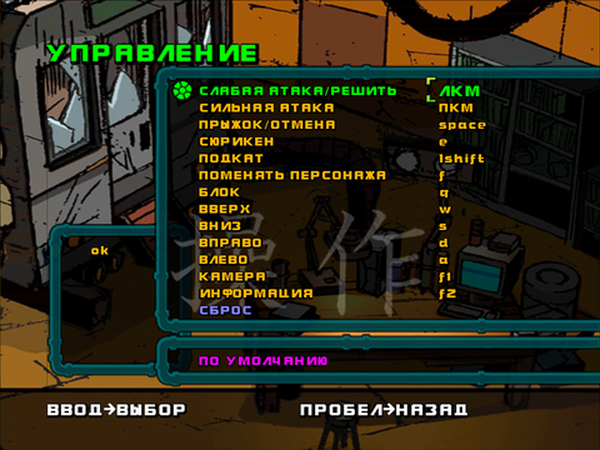

# Controls

[← Back to the mod's page](../../README.en.md) · [All documentation](README.md) · [Русский](../CONTROLS.md)

- [Keyboard and mouse](#keyboard-and-mouse)
- [Your own keys](#your-own-keys)
- [Gamepads](#gamepads)
- [Two players on one keyboard](#two-players-on-one-keyboard)
- [Menus and the game window](#menus-and-the-game-window)

## Keyboard and mouse

The mod has two ready layouts. They are switched in the title menu:
**MOD SETTINGS (НАСТРОЙКИ МОДА) → KEYS AND MOUSE (КЛАВИШИ И МЫШЬ)**.

| Action | AS THE GAME (КАК В ИГРЕ) | wasd + MOUSE (wasd + МЫШЬ) |
|---|---|---|
| Move | arrows | W A S D |
| Attack | F | left mouse button |
| Strong attack | D | right mouse button |
| Jump | Space | Space |
| Shuriken | R | E |
| Dash | E | Left Shift |
| Guard | S | Q |
| Change hero | Left Shift | F |
| Camera | F1 | F1 |
| Information | F2 | F2 |

These always work, in any layout:

| Key | What it does |
|---|---|
| Arrows | move through the menus |
| Enter | select, Start |
| Esc | back in a menu, pause in a stage |
| Mouse wheel | move the stage camera closer or farther |
| Middle mouse button | bring the camera back to its usual distance |
| Alt+Enter | window ↔ borderless window over the whole monitor |

The mouse works only while the game window is active and the pointer is over it. With attack on the left
button the mouse is handy in the menus too: a click is "select".

**Waking a teammate:** walk right up to the one who is down and hold guard for a second and a half.

## Your own keys

Any action can be put on any key or mouse button in the game itself:

1. OPTIONS (ОПЦИИ) → CONTROLS (УПРАВЛЕНИЕ) → keyboard (клавиатура).
2. Pick an action and press Enter.
3. Press the key or the mouse button you want.

Mouse buttons are named mouse 1, mouse 2, mouse 4 and mouse 5 in the list (ЛКМ, ПКМ, МЫШЬ 4 and МЫШЬ 5). After
keys have been set by hand, the KEYS AND MOUSE (КЛАВИШИ И МЫШЬ) row in MOD SETTINGS (НАСТРОЙКИ МОДА) shows
MY OWN (СВОИ).

The mod keeps the keys in `tmnt2net.ini`, so they work in a network game too and are not reset when a save is
loaded.

The same can be done before the game starts, in the [launcher](LAUNCHER.md#graphics-sound-and-controls), on
the **УПРАВЛЕНИЕ** (Controls) tab: click the action's cell and press a key or a mouse button.

 

## Gamepads

Xbox, PlayStation (DualShock 4, DualSense), Switch Pro and other gamepads known to SDL2 work. A gamepad can
also be plugged in after the game has started.

| Action | Xbox | PlayStation |
|---|---|---|
| Move | left stick, d-pad | left stick, d-pad |
| Attack, "select" in menus | A | ✕ |
| Strong attack | X | □ |
| Jump, "cancel" in menus | B | ○ |
| Shuriken | Y | △ |
| Dash | LB | L1 |
| Guard | RB | R1 |
| Change hero | LT | L2 |
| Camera | right stick click | R3 |
| Information | left stick click | L3 |
| Start, pause | START | OPTIONS |
| Pause | BACK | SHARE |

Gamepad buttons are reassigned in the game: OPTIONS (ОПЦИИ) → CONTROLS (УПРАВЛЕНИЕ).

Up to four people can play on one PC: each one joins with the Start button at character select. How many
gamepads the game is shown is set by MOD SETTINGS (НАСТРОЙКИ МОДА) → GAMEPADS (ГЕЙМПАДЫ): `[input] pads`, from
0 to 4. The value 0 brings back the original's behaviour: DirectInput only, where Xbox pads have their buttons
mixed up.

## Two players on one keyboard

MOD SETTINGS (НАСТРОЙКИ МОДА) → KEYBOARD (КЛАВИАТУРА) → TWO PLAYERS (ДВА ИГРОКА), that is
`[input] keyboard_players = 2`. The halves of the keyboard become two separate "gamepads".

| Action | Left half | Right half |
|---|---|---|
| Move | W A S D | arrows |
| Attack | F | Num 1 |
| Strong attack | G | Num 2 |
| Jump | Space | Num 0 |
| Shuriken | R | Num 5 |
| Dash | Q | Num 4 |
| Guard | E | Num 6 |
| Change hero | Left Shift | Num 3 |
| R2 | C | Num . |
| Select | ` | Num − |
| Start | Tab | Num Enter |

Enter and Esc stay with the game's ordinary keyboard, for the menus.

## Menus and the game window

- **Esc** goes back in every menu of the game, as Space does.
- **The intro movies at start-up** are skipped by any press: Enter, Esc, Space, a mouse click or a gamepad
  button. To remove them altogether: MOD SETTINGS (НАСТРОЙКИ МОДА) → INTRO AT START (ЗАСТАВКИ ПРИ ЗАПУСКЕ) →
  SKIP (ПРОПУСКАТЬ).
- **Pause** in a stage: Esc, Enter, or START or BACK on a gamepad. In a network game the pause is shared.
- **The game in the background**: by default the game pauses when its window is not active. MOD SETTINGS →
  IN THE BACKGROUND (ИГРА В ФОНЕ) → RUNS (ПРОДОЛЖАЕТСЯ) keeps it running.
