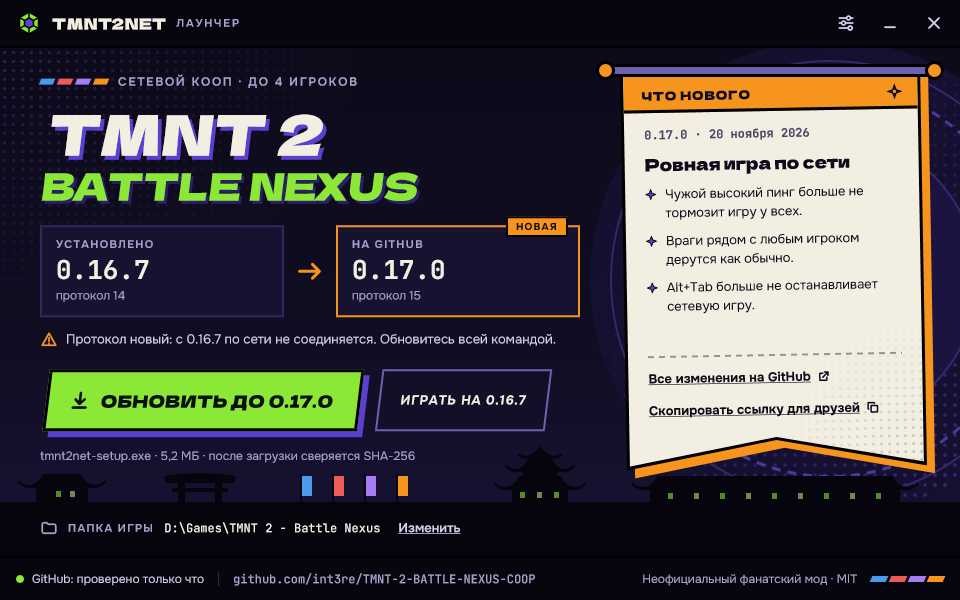
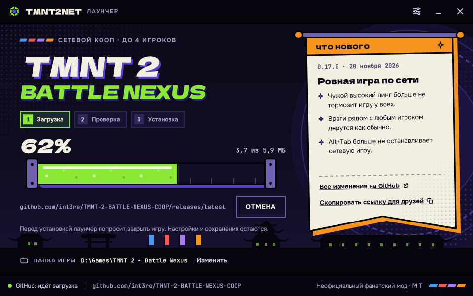
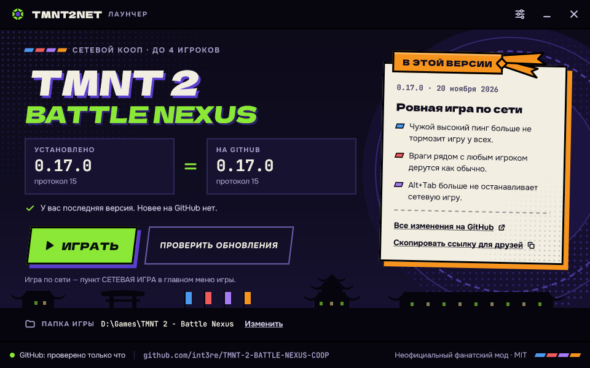
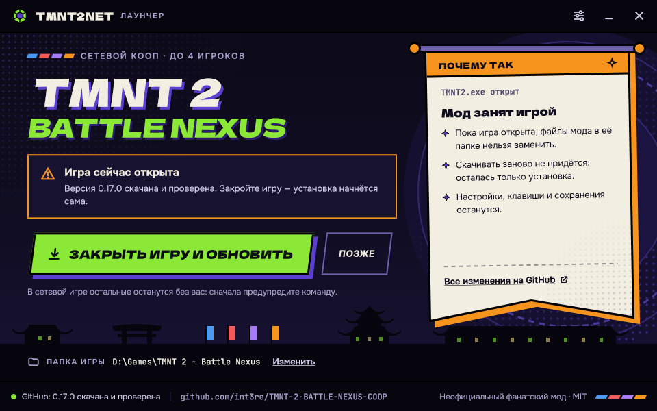
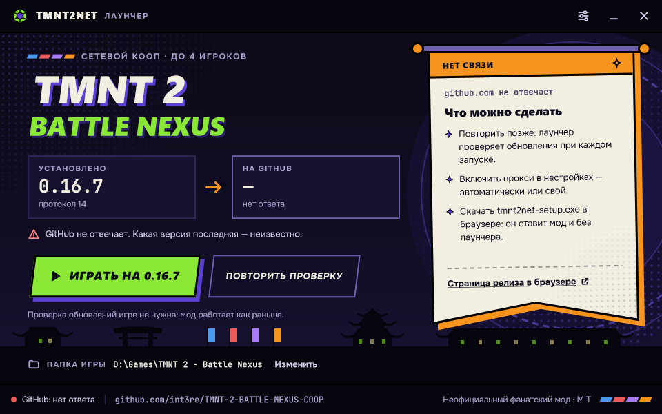
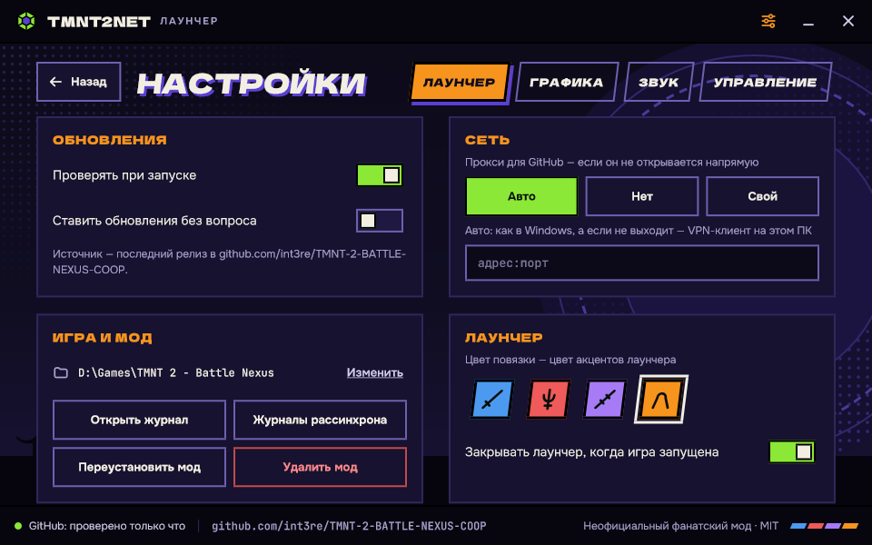
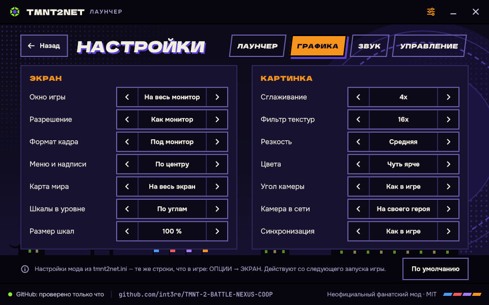
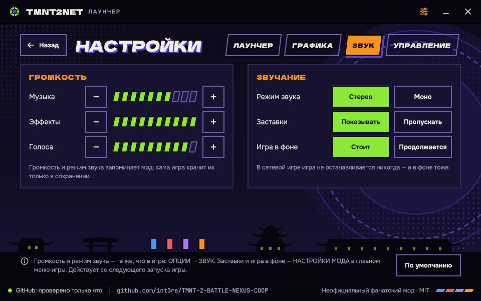
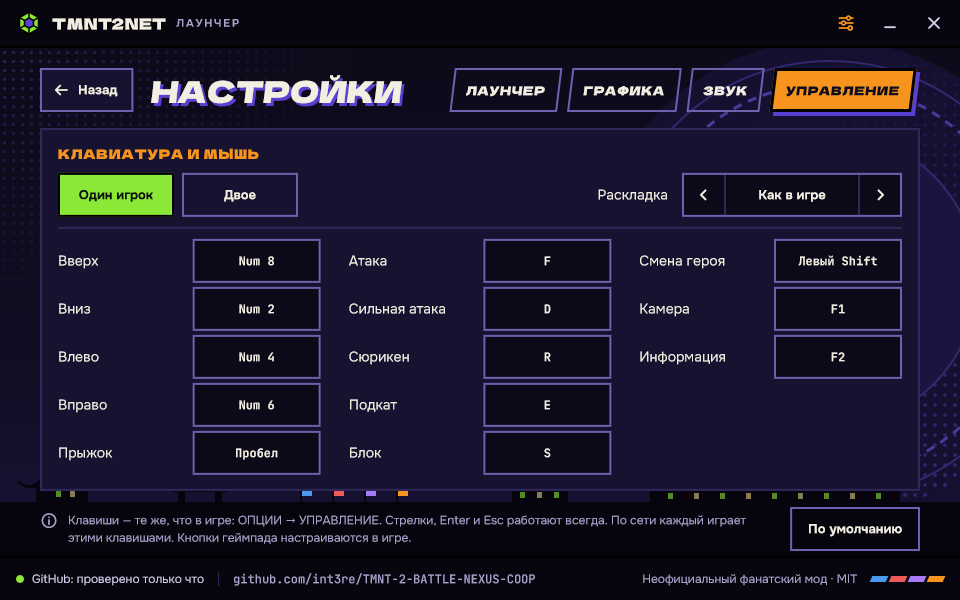

# Launcher

[← Back to the mod's page](../../README.en.md) · [All documentation](README.md) · [Русский](../LAUNCHER.md)

`tmnt2net-launcher.exe` is the only file a player needs. **The mod is inside it**: the launcher finds the
game, installs the mod, watches for updates and starts the game. Download it from the
[Releases](https://github.com/int3re/TMNT-2-BATTLE-NEXUS-COOP/releases/latest) page. The launcher itself needs
no installation: put the file wherever is convenient and run it.

<p align="center">
  
</p>

## Contents

- [What it does](#what-it-does)
- [Screens](#screens)
- [Versions and protocol](#versions-and-protocol)
- [Settings](#settings)
- [If GitHub does not answer](#if-github-does-not-answer)
- [Where things are](#where-things-are)
- [What the launcher downloads and runs](#what-the-launcher-downloads-and-runs)
- [From the command line](#from-the-command-line)
- [For developers](#for-developers)

## What it does

1. **Finds the game.** First in its own folder, then by the game installer's entry in Windows, then in the
   folders next to it. If it does not find the game, it asks for the folder where `TMNT2.exe` is.
2. **Installs the mod.** The mod is already inside the launcher, so the first installation goes at once and
   without the internet.
3. **Asks GitHub whether a newer version is out.** This does not hold the game up: the **ИГРАТЬ** (Play)
   button works at once, and the check runs in the background.
4. **Updates itself.** If a newer launcher is out on GitHub, it is downloaded, checked against the SHA-256
   checksum from the release, put in the place of the old one and started by itself. The mod in the game
   folder is not changed by this.
5. **Updates the mod with one button.** A new version of the mod arrives inside the new launcher, so after
   its restart it is installed at once, with no download. Settings, keys and saves stay.
6. **Sets the game up.** The picture, the sound and the keys are on the tabs of its settings, before the game
   starts.
7. **Starts the game.**

The launcher does not change the game's files: the mod is installed next to `TMNT2.exe` and removed with one
button in the settings. There is no separate installer.

## Screens

| Screen | When | What it offers |
|---|---|---|
| Checking | at start | playing the installed version while GitHub is answering |
| The launcher is updating | a newer launcher is out on GitHub | nothing: the download, the check and the restart go by themselves; **ОТМЕНА** (Cancel) |
| A newer version is out | the mod in the launcher or on GitHub is newer than yours | **ОБНОВИТЬ** (Update), or playing the old one |
| Downloading | an update is in progress | three steps: download, check, install; **ОТМЕНА** |
| Latest version | there is nothing to update | **ИГРАТЬ** (Play), checking once more |
| The mod is not installed | the game is there, the mod is not | **УСТАНОВИТЬ МОД** (Install the mod) |
| The game is not found | the game folder is not known | **ВЫБРАТЬ ПАПКУ ИГРЫ** (Choose the game folder) |
| No connection | GitHub did not answer and there is nothing to install | playing the installed version, repeating the check |
| The game is open | the mod is ready to be installed but the game is running | closing the game and updating, or later |

<p align="center">
  
  
</p>

The right-hand frame shows where the version comes from: **НА GITHUB** (On GitHub) means it has to be
downloaded, **В ЭТОМ ЛАУНЧЕРЕ** (In this launcher) means it is already here and nothing has to be downloaded.

<p align="center">
  
</p>

**The launcher updates itself.** At its start, if there is a newer launcher on GitHub, it downloads it, checks
its SHA-256, puts it in its own place and restarts; this takes a few seconds. It does not touch the mod in the
game folder: after the restart the new version of the mod, if one is out, is already inside the launcher, and
the **ОБНОВИТЬ** button installs it with no download. If something fails (no connection, a damaged file, a
launcher folder that cannot be changed), the launcher says so in one line at the bottom and works as before.
It is switched off in the settings: **Обновлять лаунчер при запуске** (Update the launcher at start); then a
link in the status line tells you about a new launcher.

On the right, a sheet with a bandana shows what is new in the version. At the bottom of the sheet there are
two links: all the changes on GitHub, and **Скопировать ссылку для друзей** (Copy the link for friends), a link
to the latest release that you can send to the team.

While the game is open, the mod's files cannot be replaced. The launcher waits: close the game yourself or
press **ЗАКРЫТЬ ИГРУ И ОБНОВИТЬ** (Close the game and update), and it asks the game to close the way its
window's close button does. Nothing has to be downloaded again.

<p align="center">
  
  
</p>

## Versions and protocol

The update screen shows two versions, the installed one and the new one, each with its network play protocol
number underneath. Players with different protocols cannot play together, so the launcher says it plainly:

- **«Протокол новый: с 0.16.7 по сети не соединяется. Обновитесь всей командой»** (The protocol is new: it
  does not join 0.16.7 over the network. Update the whole team): everyone has to update;
- **«Протокол тот же»** (The protocol is the same): you can play with friends who are on the old version.

Which versions are compatible is in the
[compatibility table](CHANGELOG.md#version-compatibility-in-network-play).

## Settings

They are opened with the sliders icon in the window's title bar. There are four tabs: **ЛАУНЧЕР** (Launcher)
holds the settings of the launcher itself; **ГРАФИКА** (Graphics), **ЗВУК** (Sound) and **УПРАВЛЕНИЕ**
(Controls) hold the settings of the game.

### Launcher

<p align="center">
  
</p>

| Section | What is in it |
|---|---|
| **ОБНОВЛЕНИЯ** (Updates) | whether to check at start; whether to update the launcher at start; whether to install mod updates without asking |
| **СЕТЬ** (Network) | a proxy for GitHub: **Авто** (Auto), **Нет** (None) or an address of your own |
| **ИГРА И МОД** (Game and mod) | the game folder; the mod's log; the desync logs; reinstalling the mod; removing the mod |
| **ЛАУНЧЕР** (Launcher) | the bandana's colour, which is the accent colour; whether to close the launcher after the game has started |

- **Журналы рассинхрона** (Desync logs) opens the game folder at the newest `tmnt2net-desync-*.log` file:
  these are the files to send if the players' games have gone different ways. See
  [Troubleshooting](TROUBLESHOOTING.md#desync).
- **Удалить мод** (Remove the mod) asks once more and removes from the game folder exactly what was installed.

### Graphics, sound and controls

Three tabs with the game's settings, the same rows as in its menus. They can be changed before the game
starts: the launcher writes the values to `tmnt2net.ini` in the game folder, and the game reads them at its
next start.

<p align="center">
  
</p>

| Tab | What is on it | Where it is in the game |
|---|---|---|
| **ГРАФИКА** (Graphics) | screen mode, resolution, frame shape, menus and texts, world map, stage gauges and their size; antialiasing, texture filter, sharpness, colours, field of view, network camera, vsync | OPTIONS (ОПЦИИ) → SCREEN (ЭКРАН) |
| **ЗВУК** (Sound) | the volume of music, effects and voices; the sound mode, stereo or mono; intro movies at start-up; the game in the background | OPTIONS → SOUND (ЗВУК), MOD SETTINGS (НАСТРОЙКИ МОДА) |
| **УПРАВЛЕНИЕ** (Controls) | a key or a mouse button for every action; the layout; one player at the keyboard or two | OPTIONS → CONTROLS (УПРАВЛЕНИЕ), MOD SETTINGS |

<p align="center">
  
  
</p>

- **A key for an action.** Click the cell and press a key. Mouse buttons: the right one and the side ones are
  simply pressed; for the left one, click the same cell once more. Esc cancels. If the key is taken by another
  action, the two actions swap keys. The arrows, Enter and Esc cannot be assigned: they always work.
- **Раскладка** (Layout): **Как в игре** (As in the game), **WASD + мышь** (WASD + mouse) or **Своя** (My
  own). Your own keys are kept in reserve while a ready layout is on.
- **Двое** (Two players) on one keyboard: each half has fixed keys of its own, and the tab shows them.
- **По умолчанию** (Defaults) brings back the mod's values on the open tab only.
- **The volume** is remembered by the mod from version 0.17.2 on, **the sound mode** from 0.17.3. With an
  older mod these rows are inactive.
- Before the first change the launcher puts the old file aside: `tmnt2net.ini.before-launcher` in its
  downloads folder.
- If the game is in a folder where programs may not write (for example `Program Files`), Windows keeps a copy
  of the game's settings of its own for the game. The launcher reads and writes exactly that copy.

## If GitHub does not answer

You can install the mod and play without a connection: the mod is inside the launcher. A connection is needed
only to learn about a newer version and download it. The launcher tries several ways in turn, depending on the
**СЕТЬ** (Network) setting:

| Setting | What it tries |
|---|---|
| **Авто** (Auto) | what is set up in Windows; if that fails, the HTTP proxy of a VPN client on this same PC, if one is running (ports 10809, 7890, 7897, 2080, 2081, 8889) |
| **Нет** (None) | directly only |
| **Свой** (My own) | only the given address, in the form `address:port` (an HTTP proxy) |

Sometimes the GitHub page itself opens but the release files do not: they are on another server. The launcher
tells the two apart and says «GitHub отвечает, но файлы релиза не отдаёт» (GitHub answers but does not give
the release's files); then a proxy helps.

The fallback is always the same: download the new `tmnt2net-launcher.exe` in a browser from the release page;
the new version of the mod is already inside it.

## Where things are

| What | Where |
|---|---|
| the launcher's settings | `%APPDATA%\tmnt2net\launcher.ini` |
| downloaded updates | `%LOCALAPPDATA%\tmnt2net\cache` |
| the game's settings | `tmnt2net.ini` in the game folder |
| a copy of the game's settings from before the first change made in the launcher | `%LOCALAPPDATA%\tmnt2net\cache\tmnt2net.ini.before-launcher` |

The launcher writes nothing to the registry. To remove it completely, delete the file itself and these two
folders.

## What the launcher downloads and runs

- It contacts only the page of the mod's repository on GitHub and the files of its releases.
- It downloads one thing, the new `tmnt2net-launcher.exe`, and checks its SHA-256 against the one given in the
  release. If the checksum does not match, the file is deleted.
- When the launcher updates itself, the checked file takes the place of the old one and is started: it is the
  same launcher in a new version. The old one lies next to it as `tmnt2net-launcher.exe.old` until it closes,
  and is then deleted.
- When the mod is updated, the downloaded launcher is not run: it is opened as data, and the mod's files are
  taken out of it. It takes the place of the old one after the installation and opens at the next start.
- Administrator rights are needed only when the game is in a folder where an ordinary program may not write
  (for example `Program Files`). Then Windows asks permission for the launcher itself.
- The launcher is not signed with a certificate: at the first start Windows may show "Windows protected your
  PC". Click "More info" → "Run anyway".

## From the command line

The same file installs and removes the mod without a window:

```bash
tmnt2net-launcher.exe /install "C:\Games\TMNT 2 - Battle Nexus" /quiet
```

```bash
tmnt2net-launcher.exe /uninstall "C:\Games\TMNT 2 - Battle Nexus" /quiet
```

`/quiet` removes the window with the report: the report is written to the console the launcher was started
from. Exit code `0` means it worked, `2` means it did not. The switch `/package <file>` installs the mod from
another launcher file.

## For developers

The launcher is an ordinary Windows program with no dependencies: Direct2D and DirectWrite for the picture,
WinHTTP for the network. The sources are in `src/launcher/`; the fonts and the mod's files are built into the
exe as resources. How it is built is in [Building](BUILDING.md).

**The mod inside.** The launcher's resources hold the mod's files, their list and the description of the
version (`dist/release.json`):

```
tmnt2net-package 1
version 0.17.3
protocol 16
launcher 1.3.1
file winmm.dll 301 loader
file tmnt2net.asi 302
file steam_api.dll 303
text steam_appid.txt 480 ifmissing
file tmnt2net.ini 304 keep
file tmnt2net-README.md 305
```

`loader`: an Ultimate ASI Loader that is already installed is not replaced; `keep`: an existing file (the
player's settings) stays; `ifmissing`: written only if there is no such file. The list is the same for all
versions: the launcher installs the mod from a newer launcher without knowing in advance what is in it.

**How it learns about a new version.** Every release has the file `tmnt2net-latest.json` attached; the
launcher takes it from `…/releases/latest/download/tmnt2net-latest.json`:

```json
{
  "schema": 2,
  "version": "0.17.3",
  "protocol": 16,
  "date": "2026-11-21",
  "title": "Лаунчер обновляет себя сам",
  "notes": ["…", "…"],
  "launcher": {"name": "tmnt2net-launcher.exe", "size": 5864960, "sha256": "…", "version": "1.3.1"},
  "setup": {"name": "tmnt2net-launcher.exe", "size": 5864960, "sha256": "…"},
  "protocols": {"0.17.3": 16, "0.17.2": 16, "0.17.1": 16, "0.17.0": 15}
}
```

The file is made by `tools/release_manifest.py` from `dist/release.json` (version, protocol, date, title and
up to four short notes for the news sheet) and the finished `tmnt2net-launcher.exe`. The `setup` field repeats
the same file for launcher 1.0.0: it ran what it had downloaded as an installer, and the new launcher can work
as one.

For a release without this file the launcher learns only the version number, from where `…/releases/latest`
leads, and installs the mod from that release's `tmnt2net-launcher.exe` without checking the checksum, which
it says on the screen.

**Testing without a window.** The launcher can draw a screen to a file and run a script with its window
hidden:

| Switch | What it does |
|---|---|
| `--shot <screen> <file.png> [--scale N] [--accent 0..3]` | draws a screen with sample data: `update`, `downloading`, `ready`, `checking`, `install`, `nogame`, `offline`, `blocked`, `running`, `problem`, `settings`, `graphics`, `sound`, `controls`, `controls2` (two players on one keyboard), `capture` (a cell waits for a key), `selfupdate` (the launcher updates itself) |
| `--check --out <file>` | asks for the latest version and writes what came back and which mod is inside |
| `--where --out <file>` | writes where it finds the game and which mod is installed in it |
| `--drive "<script>" --out <file>` | the window is hidden; steps separated by `;`: `wait:ms`, `click:name`, `mouse:x,y`, `until:screen:ms`, `type:text`, `keydown:key:scan-code:extended`, `rdown`, `xdown:1`, `state`, `shot:file`, `quit` |
| `--settings <ini>`, `--cache <folder>`, `--repo <address>`, `--pick <folder>` | its own settings, its own downloads folder, another address instead of GitHub, the answer of the folder-choosing window |
| `--drive-next "<script>"` | a script for the launcher that this one starts in its own place after updating itself; without the switch a launcher under a script does not start another |
| `--after-update <version>` | this is how the new launcher learns that the old one started it: it says so and does not update itself again in this run |

Under a script the launcher does not start the game, does not open links and does not look for the real game
by itself.

Names for `click` on the game settings tabs: `tab.graphics`, `tab.sound`, `tab.controls`, `tab.launcher`;
`row.<row>.prev`, `.next`, `.minus`, `.plus`, `.b7` (a notch of the volume scale), `.s1` (the second of two
buttons); `key.<action>` (a key's cell), `layout.prev`, `layout.next`, `keys.one`, `keys.two`, `reset`. The
`state` step writes the values of all rows and keys to the log.
