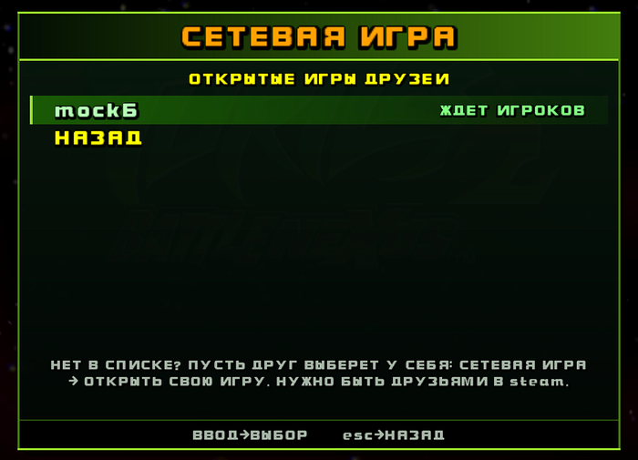
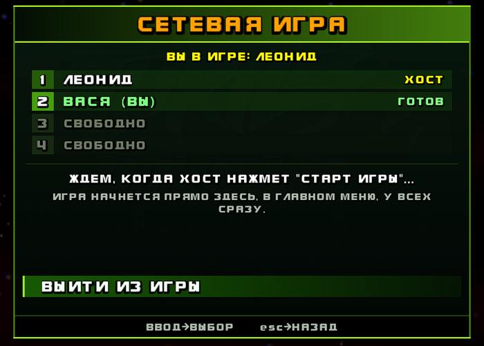
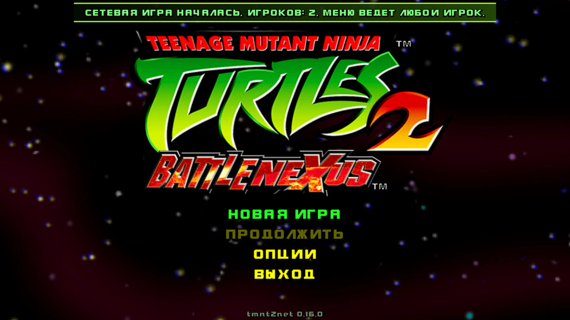
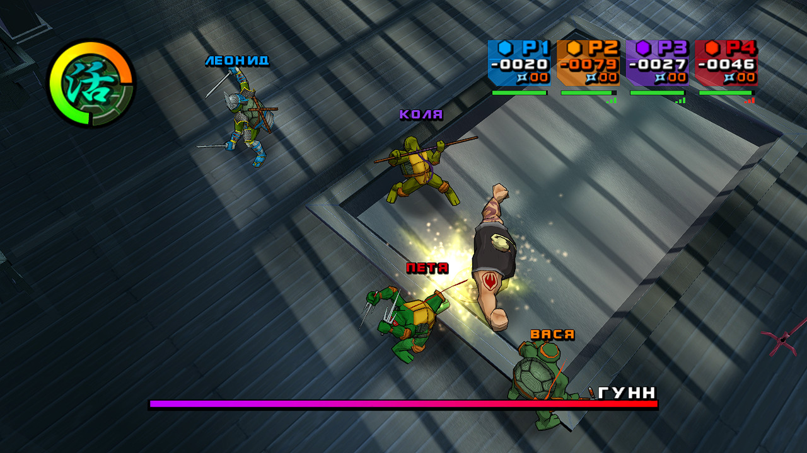
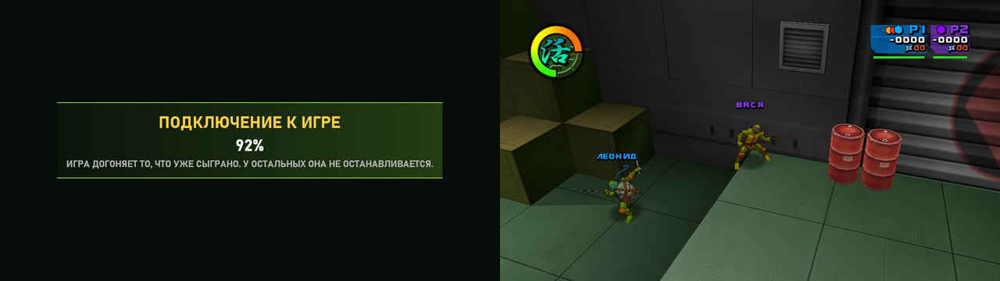

# Network play

[← Back to the mod's page](../../README.en.md) · [All documentation](README.md) · [Русский](../NETPLAY.md)

Up to four players, each with their own PC, their own copy of the game and their own screen. Everything is
done in the game's own menus: title menu → **NETWORK GAME** (СЕТЕВАЯ ИГРА).

- [Before you start](#before-you-start)
- [Getting together](#getting-together)
- [Over Steam](#over-steam)
- [By code or IP](#by-code-or-ip)
- [In the game](#in-the-game)
- [Joining a running game](#joining-a-running-game)
- [If the connection drops](#if-the-connection-drops)
- [Pause and leaving](#pause-and-leaving)
- [Saves and progress](#saves-and-progress)
- [Game speed and delay](#game-speed-and-delay)
- [What you should know](#what-you-should-know)

## Before you start

All players must have:

1. **the same game** — the same `TMNT2.exe` and the same translation;
2. **a compatible version of the mod** — it is shown under the title menu. Which versions play together: see
   the [compatibility table](CHANGELOG.md#version-compatibility-in-network-play).

If `TMNT2.exe` or the mod's version differs, the host refuses the player and says why.

## Getting together

  
  

**The host** (the one who creates the game):

1. NETWORK GAME → **HOST A GAME** (ОТКРЫТЬ СВОЮ ИГРУ).
2. The page has four places: you see who has joined, whether they are ready and what their ping is.
3. When everyone is there, press **START THE GAME** (СТАРТ ИГРЫ). You can also start alone, with
   **START ALONE** (НАЧАТЬ ИГРУ ОДНОМУ): friends join as the game goes.

**Everyone else**:

1. NETWORK GAME → **JOIN A FRIEND** (ВОЙТИ К ДРУГУ) → the host's game in the list. Or **JOIN BY CODE**
   (ВОЙТИ ПО КОДУ).
2. Wait in the title menu: when the host presses START THE GAME, the shared game begins by itself.

The game is not restarted for this: the session begins right in the title menu, where everyone is. If somebody
is not in the title menu at the moment of the start, they are told to go back to it.

 

  
   
  What the others see: the list of friends' open games and the page where they wait for the start. The
  screenshots were taken on a test rig without the real Steam, so the list shows the placeholder name "mock6"
  instead of a friend's name.

## Over Steam

- Steam must be running for everyone, and the players must be Steam friends.
- During a network game Steam shows the status "Spacewar". It is Valve's test application (AppID 480),
  through which the mod uses Steam networking. This is intended.
- **INVITE A FRIEND** (ПОЗВАТЬ ДРУГА) on the host page opens the list of friends who are online: the invitation
  is sent right from the game. The friend accepts it in Steam, and their running game joins the host by itself.
- The same works from the Steam friends list: "Invite to Game" on the host's side or "Join Game" on the
  friend's side. The invited player's game must be running.
- The **JOIN A FRIEND** list shows who is waiting for players and who is already playing, and why somebody's
  game cannot be joined (for example, another version of the mod).
- No port forwarding is needed.

By default only friends see the host's game. To open it to everyone: `[net] lobby_type = public` in
`tmnt2net.ini`.

## By code or IP

Suits a LAN and play without Steam.

1. The host: HOST A GAME → **COPY THE CODE** (СКОПИРОВАТЬ КОД). A code of the form `TMNT-XXXX-XXX` goes to the
   clipboard.
2. Everyone else: **JOIN BY CODE** → type the code or paste it with Ctrl+V. The host's IP address can be
   entered instead of the code.

  

To play over the internet the host has to open port **`7790` UDP** on the router and in the firewall. Another
port is set in `tmnt2net.ini`: `[net] port`.

## In the game

After the start everyone is in one and the same title menu. Any player can lead it: everyone's presses are
part of the shared game.

  

1. **NEW GAME** (НОВАЯ ИГРА) or **CONTINUE** (ПРОДОЛЖИТЬ; the shared progress of network play).
2. At character select everyone presses **Start** (Enter) and picks a hero.

  

At character select:

- the **left / right** arrows pick the hero, **up / down** the costume: ORDINARY (ОБЫЧНЫЙ) → SAMURAI
  (САМУРАЙ) → NEXUS (НЕКСУС) → THE PARTNER (ДРУГОЙ ГЕРОЙ): Slashuur instead of Leonardo, Casey instead of
  Raphael, Karai instead of Michelangelo, Splinter instead of Donatello;
- under the frame is the name of the player who controls it (frames are handed out in the order Start is
  pressed);
- a turtle and its "partner" share one place: if somebody has taken Donatello, Splinter can no longer be
  taken into this team;
- the team always has four heroes. If there are fewer than four players, somebody takes several and switches
  between them in a fight with the change hero button.

In a stage:

- **your own camera** follows your hero. Teammates beyond the edge of the screen are shown by their name and
  an arrow;
- **you can go apart**: in the original the game lets nobody further from the middle of the team than the
  shared screen; in a network game there is no such limit. Enemies near any player fight as usual, even far
  from the rest of the team;
- over every hero is the **player's name** in the colour of their hero;
- **everyone has their own health**. The ring on the left shows yours, the bars under the boxes on the right
  show everyone's;
- a player whose health has run out **falls asleep for 10 seconds** and gets up with a third of their health.
  A teammate can wake them sooner: come right up to them and hold guard for a second and a half. The game is
  over only if everyone is down at once;
- under every player's box is a **link indicator**: green up to 80 ms, yellow up to 160, red above that;
- after an area the whole team dances, and the screen shows the **area results**: hits, blocks, hits taken,
  times down and teammates woken.

   
  Over the heroes: the players' names; under the boxes on the right: everyone's health and link.

## Joining a running game

A latecomer joins the same way as everyone: NETWORK GAME → JOIN A FRIEND → the friend's game, or by a Steam
invitation, or by code. The host does not have to press anything.

  

Only button presses travel over the network, so there is nothing to "copy" a running game from another PC
with: the newcomer's game replays by itself everything that was played before them. Meanwhile the screen shows
a plain loading screen, CONNECTING TO THE GAME (ПОДКЛЮЧЕНИЕ К ИГРЕ), with a percentage and the time left.
Catching up runs roughly 37 times faster than the game: half an hour of play takes about 50 seconds. The
others' game does not stop meanwhile.

- If the join falls on a stage, the newcomer appears in it at once with full health: they take one of the
  inactive heroes from the player who has the most of them.
- If the join falls on a menu, the map or the results, the newcomer appears at the start of the next stage.

## If the connection drops

- The game waits for the player who is gone: everyone's screen shows "Waiting: P3 …" (Ожидание: P3 …), and
  that player's link indicator blinks red.
- If the connection does not come back, the player drops out and the game goes on without them. Their hero
  stays standing.
- **A short break**: if the dropped player's game is not closed, they come back to their place on their own.
  The host recognises them and sends what they missed, and their game quickly catches up with the others.
  There is no need to join again.
- **The game was closed or crashed**: start it and join again, as when joining a running game. The host
  recognises the player by their Steam ID or by the number of their PC (`[net] player_id` in `tmnt2net.ini`),
  even under another name, and gives them their hero back.
- **The host left**: the others' game goes on without the network.

**Desync.** Every 30 frames the PCs compare checksums of the game. If somebody's game has gone another way, it
rejoins by itself and catches up with the others — up to four times in a row; after two minutes of even play
the count starts over. If rejoining did not help, the player leaves the session with a message: they do not
stay in a game that has gone its own way. The logs of both sides are saved in `tmnt2net-desync-*.log` files:
send them, see [Troubleshooting](TROUBLESHOOTING.md#desync).

## Pause and leaving

- **Pause**: Esc or Enter, START or BACK on a gamepad. The pause is shared: the game stands still for
  everyone, and any player can lead the pause menu.
- From the pause menu you can return to the area map or go out to the session's title menu.
- **Leaving the network game**: the last item of the session's title menu is **LEAVE THE NETWORK GAME**
  (ВЫЙТИ ИЗ СЕТЕВОЙ ИГРЫ). The session ends for everyone, and each player stays in their own title menu with
  their own save. The shared progress is kept for the next network game.

 

## Saves and progress

- In a network game everyone plays with the **host's progress**. The unlocked areas and bonuses are the same
  for everyone.
- The shared progress is kept apart from the single-player one: in `tmnt2net-coop.rec` and in the game's
  network save `tmntsave-net.dat`. When the host opens their game, the newer of the two is taken. So the
  progress is not lost even if the game was closed in the middle of a session.
- The mod does not touch your single-player save `tmntsave.dat`. After a network game everyone has their own
  progress in the title menu again.
- When the session has progress, the cursor in the title menu stands on CONTINUE at once.

**The game's settings are the host's.** DIFFICULTY (СЛОЖНОСТЬ), AUTOSAVE (АВТОСОХРАНЕНИЕ), HELP (ПОМОЩЬ) and
HIT EFFECTS (ПОПАДАНИЯ) from the game's OPTIONS (ОПЦИИ) affect how the game itself plays, so for the time of a
session everyone has the host's values. After the session each player's own come back. The screen, the
picture, the keys and the camera are always each player's own.

## Game speed and delay

- A network game runs **at the speed of the slowest PC**: every frame waits for presses from everyone. The mod
  evens out the link by itself (see below), but not a weak PC: if frames keep waiting for one and the same
  player, a line at the top says for whom. If it is your PC that cannot keep up, the mod suggests lowering
  the antialiasing or the resolution.
- Presses are applied with a small delay in frames, so that they have time to reach the host. Every player
  adjusts their own delay to their own link by themselves, once a second, from 2 to 12 frames: a player with
  a high ping gets slightly more "sluggish" controls, but the game does not slow down for the others.
- For even play a wired connection is better, with background downloads closed.

## What you should know

- On every PC the game's logic computes **one shared camera** of the 16:9 shape: the enemies' behaviour
  depends on it, and it has to be the same on all PCs. Your own camera, widescreen and the field of view
  change only what is drawn on your screen.
- Every player's keyboard goes into the shared game as their gamepad, so in a network game one person plays
  on one PC.
- An accepted Steam invitation is picked up while the game is running — even in the middle of a
  single-player game. To switch this off: `[net] steam_invites = 0`.
