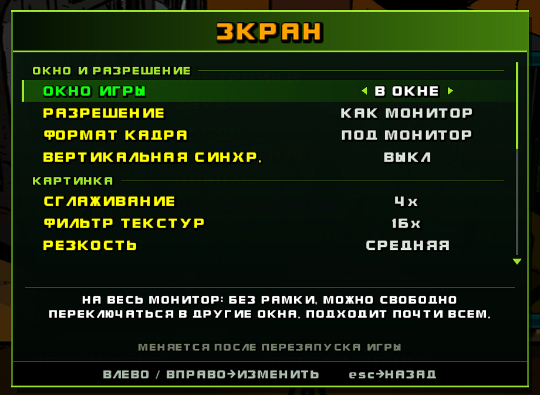
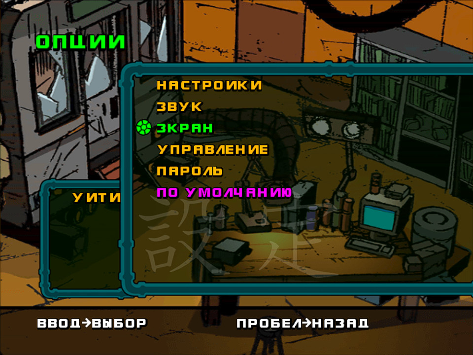
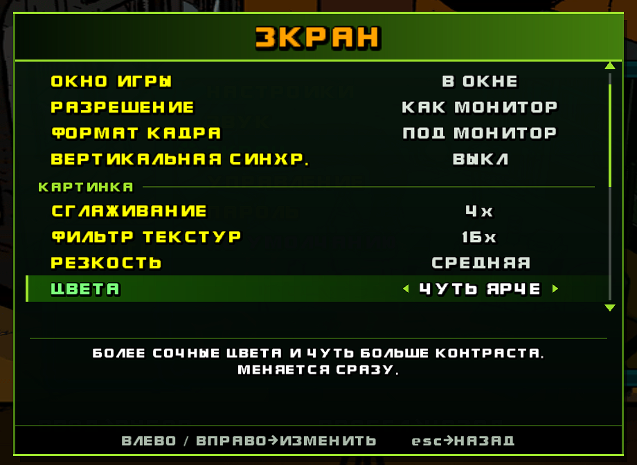
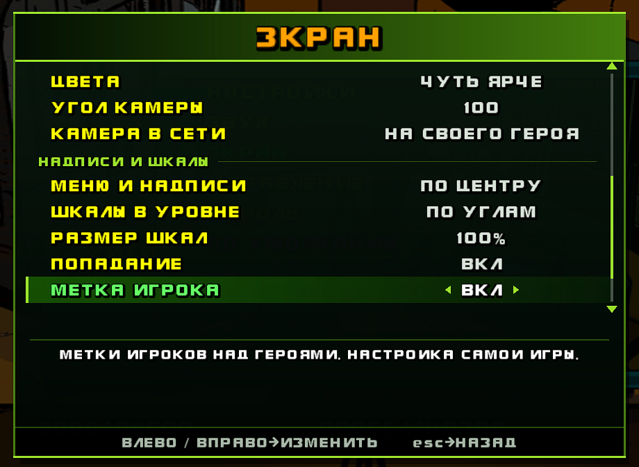

# Settings

[← Back to the mod's page](../../README.en.md) · [All documentation](README.md) · [Русский](../SETTINGS.md)

Almost everything is set up in the game itself, with a hint for each row. The mod writes the values to
`tmnt2net.ini` next to `TMNT2.exe`; the same file can be edited by hand — changes in it apply at the next
start of the game.

The same settings are in the [launcher](LAUNCHER.md#graphics-sound-and-controls): the tabs **ГРАФИКА**
(Graphics), **ЗВУК** (Sound) and **УПРАВЛЕНИЕ** (Controls) change this file before the game starts.

- [OPTIONS → SCREEN](#options--screen)
- [MOD SETTINGS](#mod-settings)
- [tmnt2net.ini reference](#tmnt2netini-reference)

## OPTIONS → SCREEN

  

Everything about the screen and the picture is gathered on one page of the game's OPTIONS (ОПЦИИ → ЭКРАН). A
value is changed with the left and right arrows and is written at once. Most settings take effect right away;
those that need a restart of the game are marked orange.

**Window and resolution**

| Row | What it does | Key in the ini |
|---|---|---|
| SCREEN MODE (ОКНО ИГРЫ) | a borderless window over the whole monitor or an ordinary window | `mode` |
| RESOLUTION (РАЗРЕШЕНИЕ) | every mode of your monitor and AS THE MONITOR (КАК МОНИТОР); changes at once, without a restart | `resolution` |
| FRAME SHAPE (ФОРМАТ КАДРА) | as the monitor (widescreen), a 4:3 frame with bars, or the same frame stretched over the window | `aspect` |
| VSYNC (ВЕРТИКАЛЬНАЯ СИНХР.) | as in the game, off or on | `vsync` |

**Picture**

| Row | What it does | Key in the ini |
|---|---|---|
| ANTIALIASING (СГЛАЖИВАНИЕ) | antialiasing of edges: off, 2x, 4x, 8x | `antialiasing` |
| TEXTURE FILTER (ФИЛЬТР ТЕКСТУР) | how crisp floors and walls are at an angle, up to 16x | `anisotropy` |
| SHARPNESS (РЕЗКОСТЬ) | sharpness of the finished frame: textures and small details show | `sharpen` |
| COLOURS (ЦВЕТА) | saturation and a little contrast | `colors` |
| FIELD OF VIEW (УГОЛ КАМЕРЫ) | the camera's view, wider or narrower | `fov` |
| NETWORK CAMERA (КАМЕРА В СЕТИ) | each player's own, or one for everybody as in the original | `own_camera` |

**Texts and gauges**

| Row | What it does | Key in the ini |
|---|---|---|
| MENUS AND TEXTS (МЕНЮ И НАДПИСИ) | in the middle of the frame in the right proportions, or stretched over the whole width | `hud` |
| STAGE GAUGES (ШКАЛЫ В УРОВНЕ) | the health ring and the players' boxes in the corners of the frame or in the middle | `gauges` |
| GAUGES SIZE (РАЗМЕР ШКАЛ) | 100%, 85% or 70% | `gauges_size` |

Further down the same page are the game's own settings: hit effects, player markers and help windows.

  
  
   
  The SCREEN item in the game's OPTIONS and the rest of the page: the list scrolls.

During a network session SCREEN opens the game's original page, without the mod's settings: set up the screen
and the picture before the session begins.

## MOD SETTINGS

  

An item of the title menu (НАСТРОЙКИ МОДА). Everything that is not about the picture is here.

| Row | What it does | Key in the ini |
|---|---|---|
| KEYS AND MOUSE (КЛАВИШИ И МЫШЬ) | the layout: AS THE GAME (КАК В ИГРЕ), wasd + MOUSE (wasd + МЫШЬ) or MY OWN (СВОИ) | `[input] keys` |
| GAMEPADS (ГЕЙМПАДЫ) | how many gamepads to show the game, 0–4 | `[input] pads` |
| KEYBOARD (КЛАВИАТУРА) | one player, or two players on one keyboard | `[input] keyboard_players` |
| IN THE BACKGROUND (ИГРА В ФОНЕ) | the game pauses or goes on while the window is not active | `background` |
| INTRO AT START (ЗАСТАВКИ ПРИ ЗАПУСКЕ) | show or skip | `intro` |

More about the layouts: the [controls page](CONTROLS.md).

## tmnt2net.ini reference

The file is next to `TMNT2.exe`, in the UTF-8 encoding. A key that is not in the file takes its default value.

### [video]

| Key | Default | Values |
|---|---|---|
| `intro` | `show` | `show` — the intro movies play, any press skips them; `skip` — the title menu at once |
| `mode` | `borderless` | `borderless` — no border, over the whole monitor; `windowed` — a window. The original's fullscreen mode is not there: in it Alt+Tab stopped the game, and the network game waited on every PC |
| `resolution` | `auto` | `auto`; your own, for example `1920x1080`; `game` — from `TMNT2.ini` |
| `aspect` | `auto` | `auto` — widescreen: a wider view, menus and movies in the 4:3 middle; `4:3` — a 4:3 frame with black bars; `stretch` — a 4:3 frame stretched over the window. The game's camera is the same with any value |
| `hud` | `center` | `center` — menus and texts in the middle; `stretch` — over the whole width |
| `gauges` | `corners` | `corners` — the stage gauges in the corners of the frame; `center` — in the 4:3 middle |
| `gauges_size` | `100` | size of the gauges in percent: `100`, `85`, `70` |
| `map` | `wide` | `wide` — the world map out to the edges of a wide screen; `center` — in the 4:3 middle with black bars |
| `own_camera` | `1` | `1` — in network play the camera follows your hero; `0` — one for everybody |
| `camera_zoom` | `1.0` | camera zoom with the mouse wheel, `0.5` closer … `2.5` farther; remembered by itself |
| `fov` | `1.0` | the camera's view, `0.5` … `2.0`; more is wider |
| `antialiasing` | `4` | MSAA antialiasing: `0`, `2`, `4`, `8` |
| `anisotropy` | `16` | anisotropic filtering: `0` … `16` |
| `sharpen` | `50` | sharpness of the frame: `0` — off … `100` |
| `colors` | `25` | colours: `0` — as in the game … `100` |
| `window_size` | `auto` | window size for `windowed`: `auto` — 3/4 of the desktop's height, or `1280x720` |
| `window_resize` | `1` | the window can be resized by dragging with the mouse; the proportions are kept |
| `vsync` | `-1` | `-1` — as in the game, `0` — off, `1` — on |
| `fps_limit` | `60` | frames per second. The game's logic is tied to the frame: 60 is the native speed; `0` — as in the original |
| `background` | `pause` | `pause` — the game waits while the window is not active; `run` — it keeps running |
| `hide_cursor` | `1` | hide the mouse pointer over the game |

Antialiasing works when the frame fills the window: in the borderless mode or in a window without scaling.

### [audio]

| Key | Default | Values |
|---|---|---|
| `mode` | — | sound mode: `stereo` or `mono` |
| `music` | — | music volume, `0` (silent) … `10` |
| `effects` | — | effects volume, `0` … `10` |
| `voices` | — | voices volume, `0` … `10` |

The game itself keeps the sound mode and the volume only in the save. The mod writes these lines by itself
when you change them in OPTIONS → SOUND (ОПЦИИ → ЗВУК) or in the launcher, sets them at every start and puts
them back after a save is loaded. While the lines are not there, the sound is as in the game.

### [input]

| Key | Default | Values |
|---|---|---|
| `pads` | `4` | how many gamepads to show the game through SDL, `0` … `4`; `0` — as in the original |
| `keyboard_players` | `1` | `2` — two players on one keyboard |
| `keys` | — | 13 key codes; the mod writes the line by itself when you change the keys in the game |
| `keys_own` | — | your keys while a ready layout is chosen in the launcher: the layout **Своя** (My own) goes back to them. The game does not read this line |

The order of the codes in `keys`: attack, strong attack, shuriken, jump, dash, guard, change hero, camera,
information, up, down, left, right. Key codes are those of DirectInput; mouse buttons: `240` — left, `241` —
right, `243` and `244` — the side buttons.

### [net]

| Key | Default | Values |
|---|---|---|
| `mode` | `off` | `off` — network play from the game's menu; `host` — open a game at once; `join` — join at once; `menu` — the former menu on a black screen |
| `join` | `steam` | where to join with `mode = join`: `steam`, a code `TMNT-XXXX-XXX`, `IP[:port]` or the host's SteamID64 |
| `transport` | `auto` | `auto` — Steam if it is running, and LAN / IP always; `steam`; `enet` — LAN / IP only |
| `name` | the Steam name or the computer's name | the name other players see |
| `port` | `7790` | UDP port for LAN / IP |
| `input_delay` | `auto` | input delay at the start of a session, set by the host; `auto` — by the ping, from 2 to 10 frames. After that every player adjusts their own delay by themselves, up to 12 frames |
| `lobby_type` | `friends` | who sees the host's game in Steam: `friends` or `public` |
| `timeout_ms` | `8000` | a player from whom no data has come for this many milliseconds drops out |
| `steam_invites` | `1` | accept Steam invitations while the game runs without the network |
| `wide` | `1` | `1` — in network play the frame takes the shape of your monitor; `0` — 16:9 with bars for everybody |
| `player_id` | created by itself | the number of this PC: the host recognises a returning player by it |

### [fixes]

| Key | Default | What it fixes |
|---|---|---|
| `gamepad_snapshot` | `1` | "Unkown Error" at start-up |
| `keyboard_focus` | `1` | a crash if the window is not active during loading |
| `all_modes` | `1` | every resolution of the monitor in the game's menu instead of three |
| `esc_back` | `1` | Esc goes back in the game's menus |

### [log]

| Key | Default | Values |
|---|---|---|
| `level` | `info` | how detailed `tmnt2net.log` is: `error`, `warn`, `info`, `debug` |
| `exceptions` | `1` | write errors in the game's code to the log |

### [debug]

For development and testing. Not needed in ordinary play.

| Key | Default | Values |
|---|---|---|
| `multi_instance` | `0` | allow a second copy of the game on one PC |
| `determinism` | `0` | the frame log `tmnt2net-sim.log`: the same input must give the same lines |
| `record`, `replay` | — | record every frame's input to a file and replay the recording |

The other debug keys are described on the [architecture page](ARCHITECTURE.md#testing-and-debugging).
