# What the mod adds and changes, in pictures

[← Back to the mod's page](../../README.en.md) · [All documentation](README.md) · [Русский](../TOUR.md)

All screenshots were taken in the game with version 0.16.x of the mod. The player names in them are made up.

- [Launcher](#launcher)
- [Before and after](#before-and-after)
- [Title menu](#title-menu)
- [Picture](#picture)
- [OPTIONS → SCREEN](#options--screen)
- [MOD SETTINGS and controls](#mod-settings-and-controls)
- [NETWORK GAME](#network-game)
- [Character select](#character-select)
- [World map](#world-map)
- [In a stage](#in-a-stage)
- [Joining a running game](#joining-a-running-game)
- [Pause and leaving the session](#pause-and-leaving-the-session)
- [Area results](#area-results)

## Launcher

The original has nothing like it: one file, `tmnt2net-launcher.exe`, installs the mod, updates it and starts
the game. The mod is inside it.

  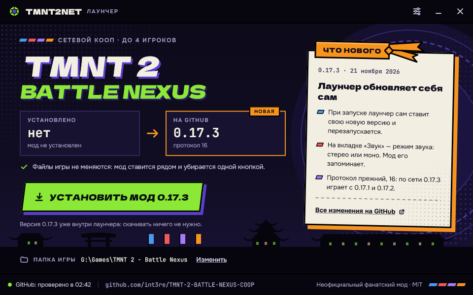
  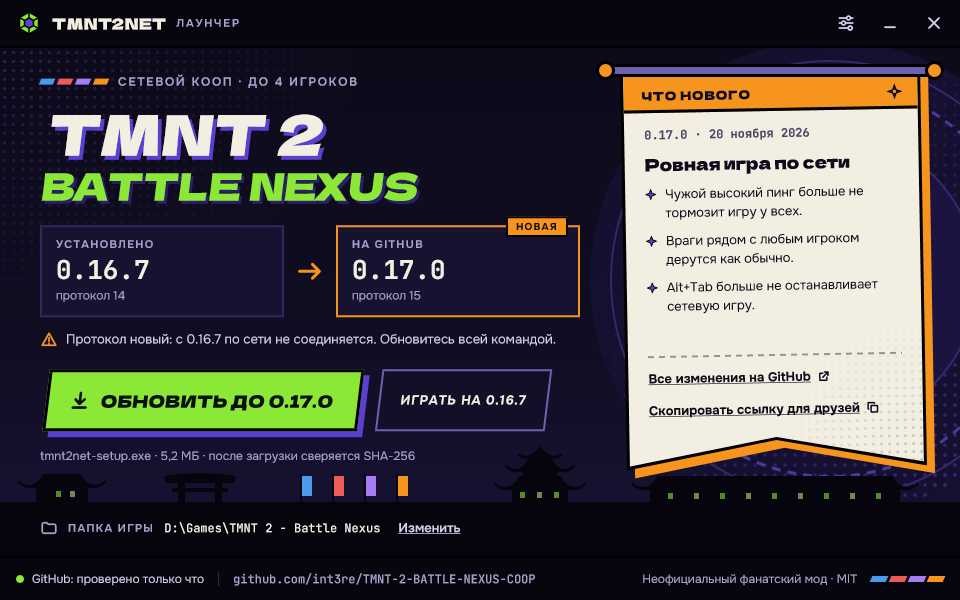

| | |
|---|---|
| **First start** | the launcher finds the game and installs the mod with one button, nothing to download |
| **A new version** | it shows what has changed and whether the new version is compatible with yours in network play; the update takes one button and is checked against its SHA-256 |
| **The game is open** | the launcher waits until it is closed, or asks it to close |
| **Settings** | a proxy for GitHub, the mod's logs, removing the mod, the accent colour |
| **Game settings** | the tabs **ГРАФИКА** (Graphics), **ЗВУК** (Sound) and **УПРАВЛЕНИЕ** (Controls): the picture, the volume and the keys, before the game starts |

Every screen and the details are on [the launcher page](LAUNCHER.md).

## Before and after

| | Original | With the mod |
|---|---|---|
| **Starting on Windows 10/11** | "Unkown Error", the game does not start | starts |
| **Alt+Tab during loading** | a crash with an error | the game keeps running |
| **Screen mode** | fullscreen only | borderless window over the whole monitor, ordinary window; Alt+Enter |
| **Resolution** | 640×480, 800×600, 1024×768 | any monitor mode, changed at once |
| **Widescreen** | a 4:3 frame stretched sideways | a wider view, the right proportions |
| **Game speed** | 53–57 frames per second, the game runs slower | exactly 60 |
| **Picture quality** | no antialiasing or filtering | antialiasing up to 8x, 16x texture filter, sharpness, colours |
| **Gamepads** | DirectInput only, Xbox gamepads have their buttons mixed up | Xbox, PlayStation, Switch Pro; hot-plugging |
| **Mouse** | not used | mouse buttons work as keys, the wheel zooms the camera |
| **Pause** | the Esc key only | Esc, Enter, START and BACK on a gamepad |
| **Esc in menus** | does nothing | back |
| **Intro movies** | play to the end or until Start is pressed | skipped by any press, can be switched off |
| **Co-op** | up to 4 players on one PC | the same over the network: Steam, LAN, IP |
| **Camera** | one for everybody | one of your own in a network game |
| **Distance between players** | nobody gets further from the team than the shared screen | go as far apart as you like in a network game |
| **Health** | one for the team | one for each player; a teammate can be woken |
| **Costumes and heroes** | unlocked as you play, costumes with "secret" buttons | unlocked from the start, picked with the arrows |
| **After an area** | only the MVP dances | the whole team dances, with per-player results on the screen |
| **Title menu** | NEW GAME (НОВАЯ ИГРА), CONTINUE (ПРОДОЛЖИТЬ), OPTIONS (ОПЦИИ), QUIT (ВЫХОД) | NETWORK GAME (СЕТЕВАЯ ИГРА) and MOD SETTINGS (НАСТРОЙКИ МОДА) added |
| **Screen settings** | a few settings in OPTIONS | a whole page: window, resolution, picture, gauges |

## Title menu

  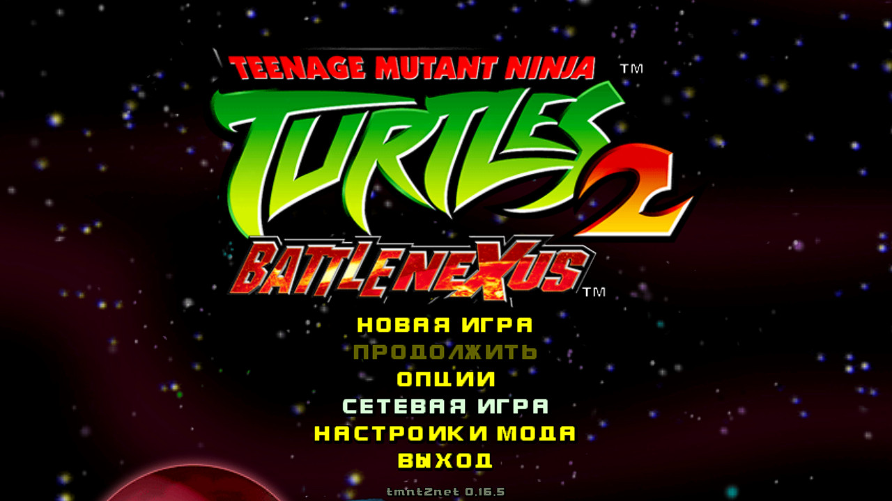

**Added:** the items **NETWORK GAME** (СЕТЕВАЯ ИГРА) and **MOD SETTINGS** (НАСТРОЙКИ МОДА), and a line with the
mod's version under the menu.

**Changed:** in the Russian version the last item is called «ВЫХОД» (QUIT) again: the translation had «УИТИ».
Esc works as "back" in every menu.

## Picture

  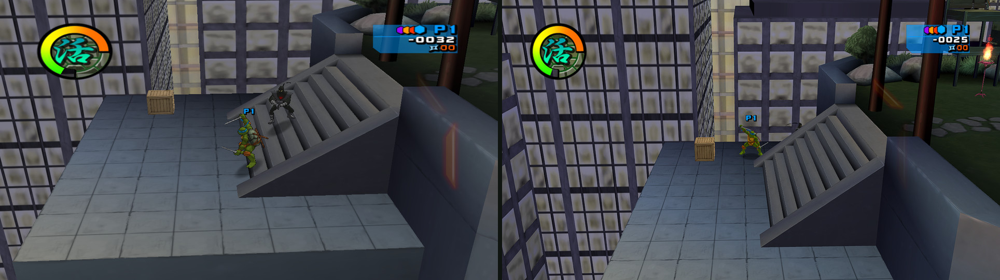 
  The same area on a 16:9 monitor. Left, as the original shows it: the 4:3 frame is stretched and the
  health ring has become an oval. Right, with the mod: a wider view, the right proportions.

  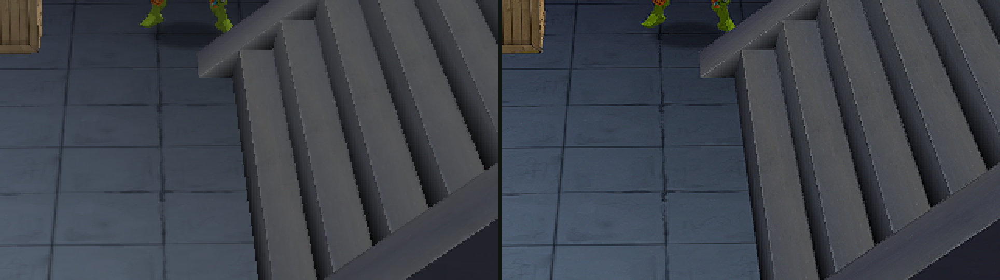 
  An enlarged part of the frame. Left: no processing. Right: with 4x antialiasing, the 16x texture filter
  and sharpness: the edges of the steps are even and the tiles can be made out.

**Added:** widescreen without stretching, antialiasing, anisotropic filtering, sharpness and colours of the
finished frame, field of view, camera zoom with the mouse wheel, a borderless window and an ordinary window.

**Changed:** the game runs at exactly 60 frames per second; the health ring and the players' boxes are in the
corners of the wide frame, and menus and texts are in its middle, in the right proportions.

## OPTIONS → SCREEN

Everything about the screen and the picture is on one page in the game's own OPTIONS (ОПЦИИ). There is no need
to edit the ini file.

  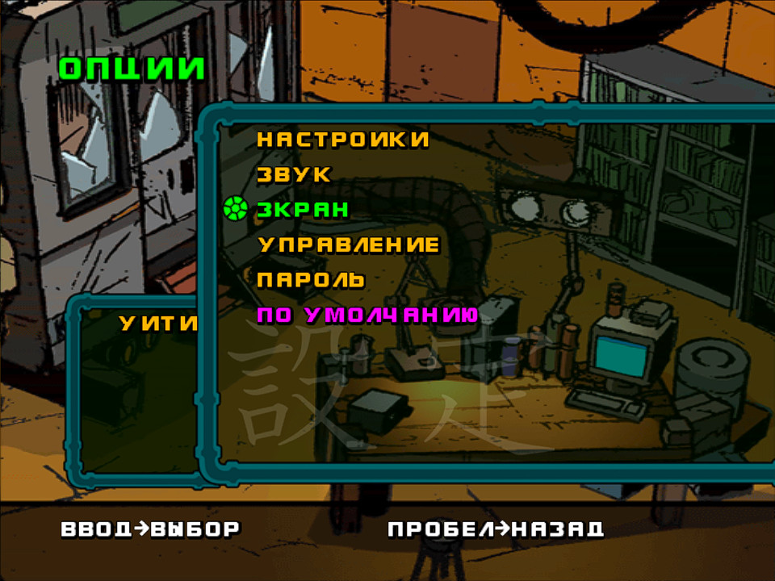
  

  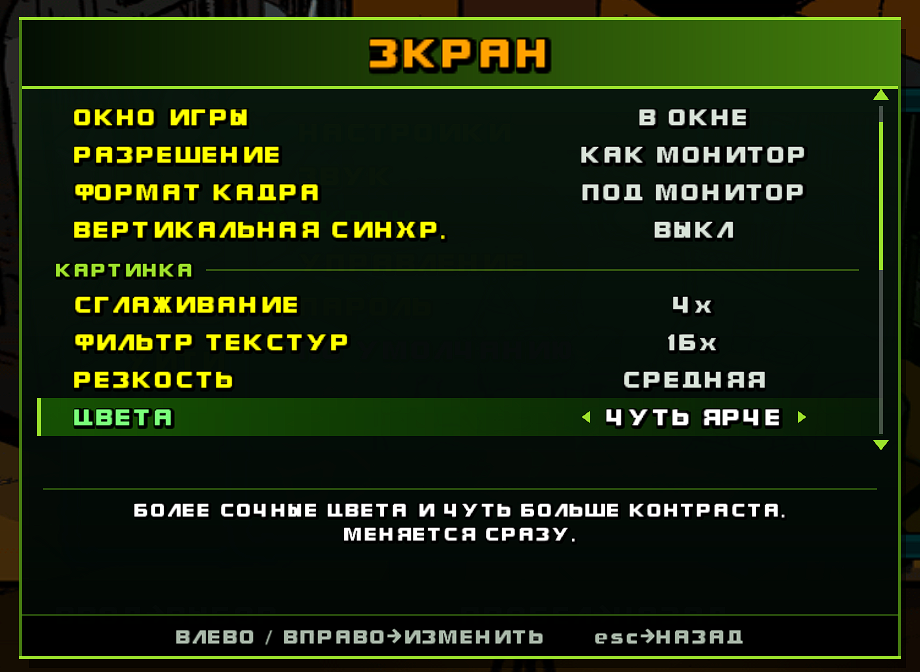
  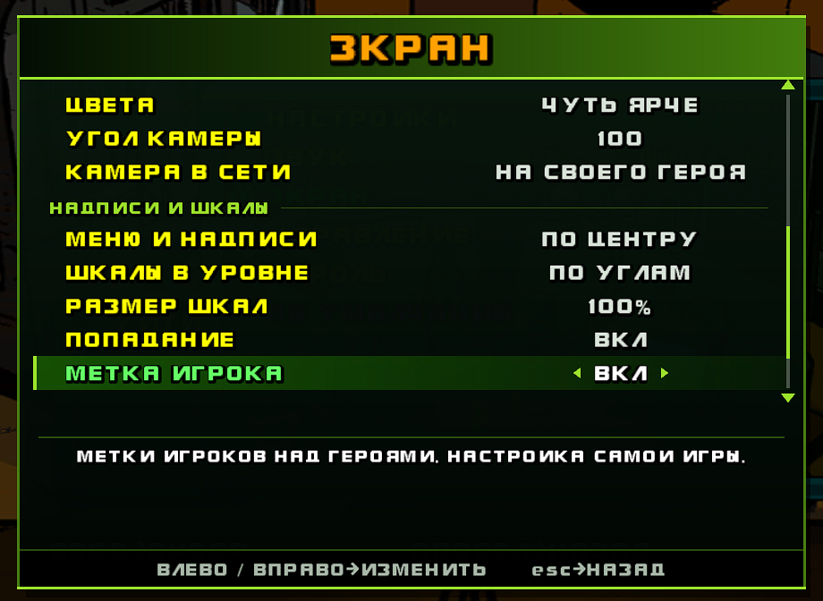

**Added:** a page of three sections: WINDOW AND RESOLUTION (ОКНО И РАЗРЕШЕНИЕ), PICTURE (КАРТИНКА), TEXTS AND
GAUGES (НАДПИСИ И ШКАЛЫ). Under the list there is a hint for the chosen row and a mark that says whether the
setting takes effect at once or after a restart.

**Changed:** the SCREEN (ЭКРАН) item in the game's OPTIONS opens this page. The game's own settings from the
former page (hit effects, player markers, help) have been moved to its end.

Every row is described in detail in [Settings](SETTINGS.md).

## MOD SETTINGS and controls

  
  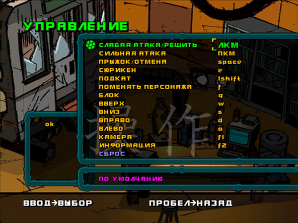

**Added:** the MOD SETTINGS (НАСТРОЙКИ МОДА) page in the title menu: the key layout, the number of gamepads,
a keyboard for two, running in the background, intro movies. A ready layout, wasd + MOUSE (wasd + МЫШЬ).

**Changed:** on the game's key page, OPTIONS → CONTROLS (ОПЦИИ → УПРАВЛЕНИЕ), an action can now be given a mouse
button: in the list it is labelled mouse 1, mouse 2, mouse 4 or mouse 5 (ЛКМ, ПКМ, МЫШЬ 4, МЫШЬ 5).

Details are in [Controls](CONTROLS.md).

## NETWORK GAME

A wholly new part of the game. Every page is drawn in the game's font and in the colours of its windows.

**The first page**: three ways and a "how to play together" note:

  

**The host page**: four places, every player's readiness and ping, the game's code. Left: a game for two, with
the INVITE A FRIEND (ПОЗВАТЬ ДРУГА) item. Right: a game for four by code, without Steam:

  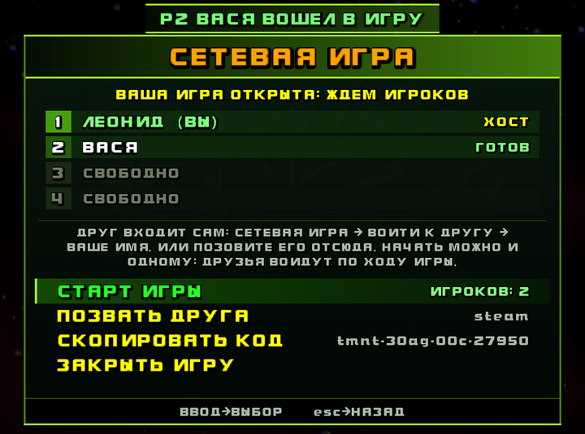
  

**For the other players**: the list of friends' open games and the page where they wait for the start:

  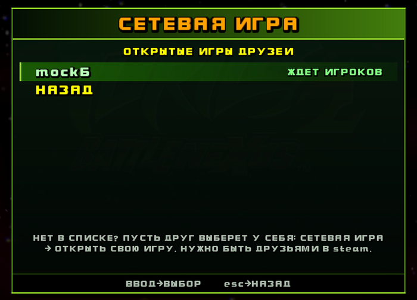
  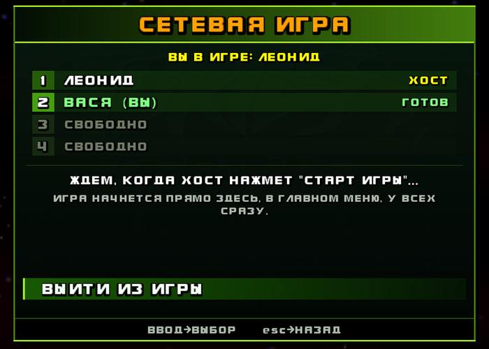

  The network pages were captured on a test rig, without the real Steam: in the list a placeholder name,
  "mock6", stands in place of the friend's name.

**Joining by code or IP**: the code is typed in the game, Ctrl+V pastes it:

  

**The start**: the session begins right in the title menu, the game does not restart. At the top is the mod's
message:

  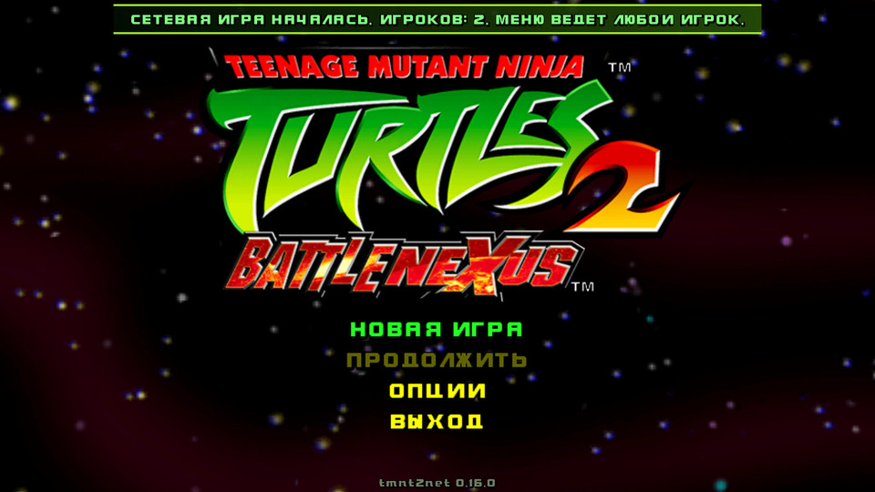

Details are in the [network play guide](NETPLAY.md).

## Character select

  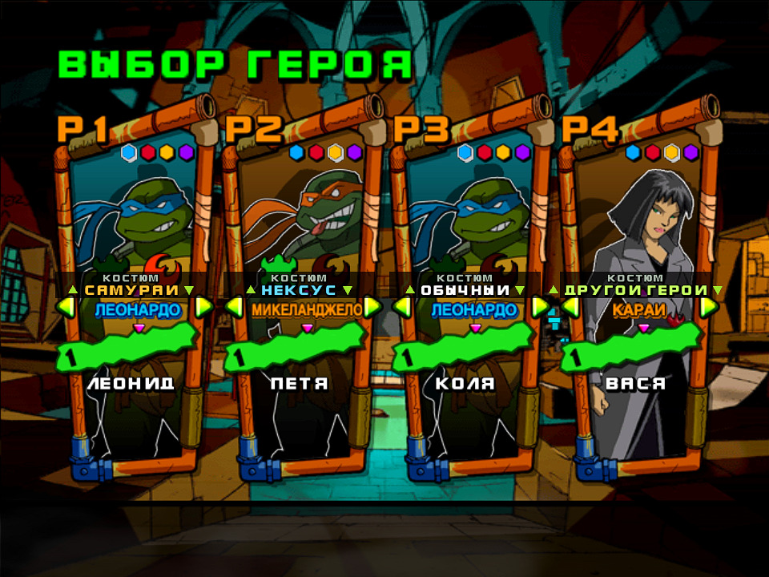
  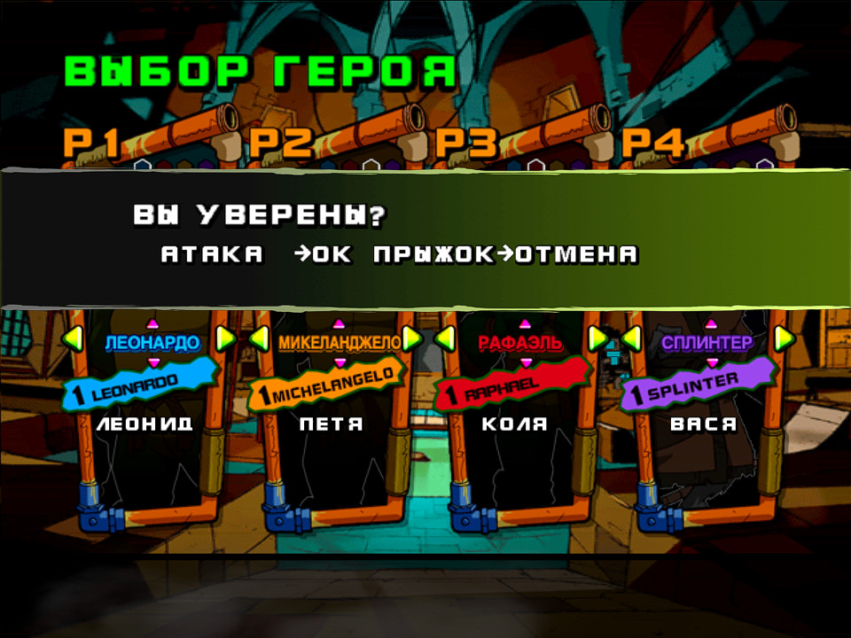

**Added:** the **COSTUME** (КОСТЮМ) row above the hero's name: the up and down arrows go through ORDINARY
(ОБЫЧНЫЙ), SAMURAI (САМУРАЙ), NEXUS (НЕКСУС) and THE PARTNER (ДРУГОЙ ГЕРОЙ). Under every player's frame is their
name.

**Changed:** every costume and hero is available from the start. The cursor does not stop on a hero that
another player has already taken. On a wide screen the ARE YOU SURE? (ВЫ УВЕРЕНЫ?) box is no longer stretched
over the whole frame.

## World map

  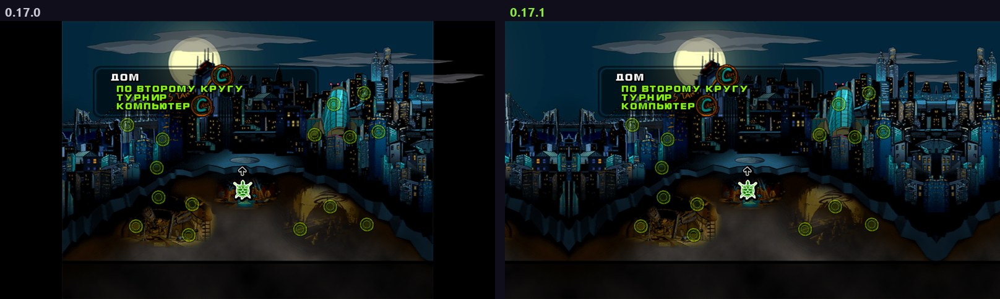 
  Left: 0.17.0. Right: 0.17.1

**Changed:** on a wide screen the map fills the whole frame. Its picture was drawn for 4:3, so at the sides it
is continued by its own mirror image; the clouds, the moon and the planets are drawn as they are. The stage
marks, the little turtle and the menu stay where they were. To bring the black bars back: `map = center` in
`tmnt2net.ini`.

**Added:** **Esc** opens the map's menu: character select, information, options, save, load, to the title
menu. Before, only the guard key opened it, and there was no way to leave the map for the title menu.

## In a stage

  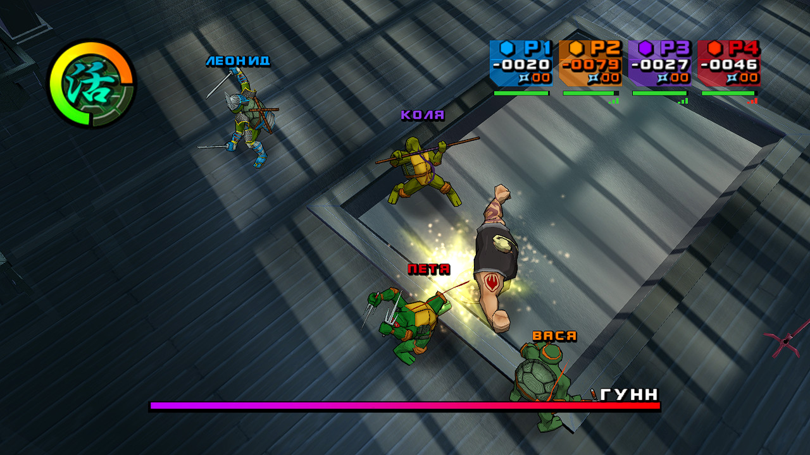

**Added:**

- the player's name over the hero, in the colour of their hero;
- a health bar under every player's box;
- a link indicator under the box, like the one on a phone;
- a name with an arrow at the edge of the screen when a teammate has gone out of the frame.

**Changed:** the health ring on the left shows your hero's health, not the team's shared health.

  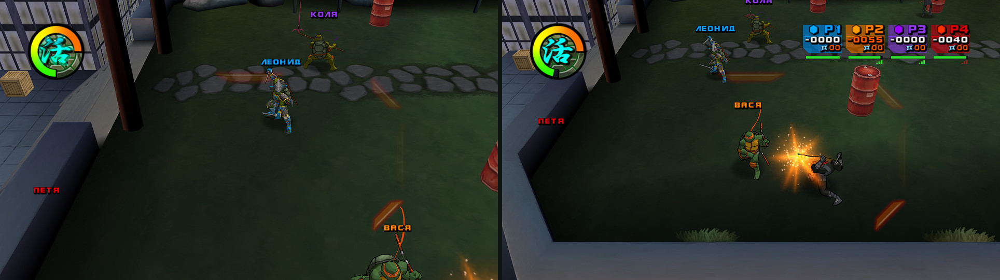 
  The same moment on two PCs. Left, the shared camera, as in the original: it keeps everybody in the
  frame. Right, the player's own camera: it follows this player's hero.

## Joining a running game

  

**Added:** a session can be joined at any moment. While the game catches up with the others, the screen shows
loading with a percentage; after it the player is in the stage at once, with one of the team's heroes.

## Pause and leaving the session

  
  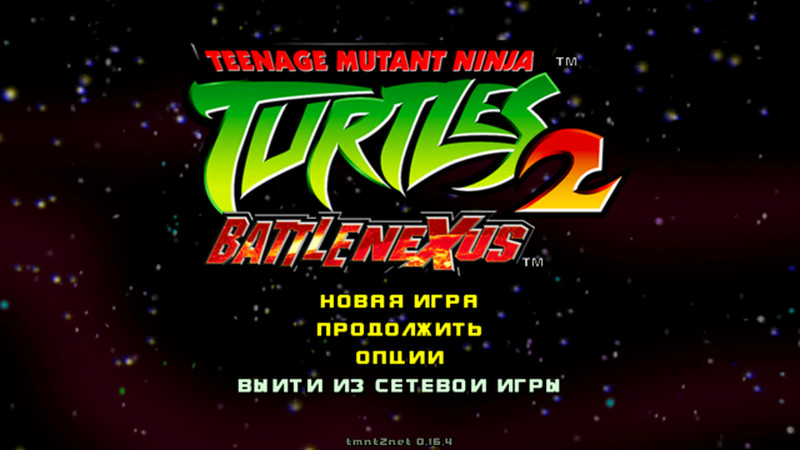

**Changed:** the pause menu opens in a network game, and from a gamepad too. In the session's title menu the
last item is **LEAVE THE NETWORK GAME** (ВЫЙТИ ИЗ СЕТЕВОЙ ИГРЫ): it ends the session instead of closing the
game.

## Area results

  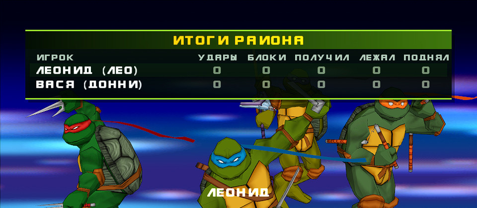

**Added:** while the team dances after an area, a per-player table is shown at the top: hits dealt, blows
blocked, hits taken, times down and teammates woken.

**Changed:** the whole team dances, not only the MVP.
